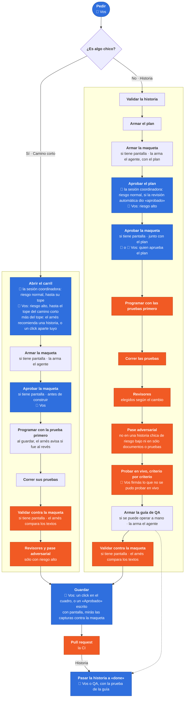

# Arnés TYCON

[English](README.md) · Castellano

**El arnés en seis minutos** (con subtítulos).

https://github.com/user-attachments/assets/0c339969-7bd4-40ce-b656-c95d141ae26d

Hoy un agente de IA escribe en minutos el código que antes llevaba horas, y resuelve las tareas sin que nadie le indique cada paso. Esa autonomía es una gran ventaja, pero tiene un costo.

Ya no hay que darle guías para cada lenguaje y framework: buenas prácticas de codificación en React o en .NET, cómo se manejan los errores o cómo se validan los datos que llegan al sistema. Tampoco hay que recordarle patrones de diseño, como separar responsabilidades, inyectar dependencias o mantener bajo el acoplamiento.

Pero el agente conoce las buenas prácticas y no siempre las aplica. Y hay algo que no puede saber por su cuenta: el proceso, las reglas y las decisiones de cada organización, porque los define ella. Por ejemplo, especificar antes de programar, escribir y correr las pruebas, mostrarle una maqueta a una persona antes de construir, o no cerrar un trabajo sin cumplir su definición de terminado. Aunque estén escritos en sus instrucciones, a veces los olvida o se saltea pasos, y no se puede depender de que el desarrollador se los recuerde siempre.

Así, cada equipo termina trabajando con sus agentes a su manera, y el cliente recibe una calidad distinta según el equipo que le tocó: hay que rehacer algo, o una entrega se atrasa.

Y el problema crece a medida que se les delega más: tareas más largas y varios agentes a la vez. Para el desarrollador, seguir todo lo que hacen se vuelve cada vez más difícil. Y cuanto menos se puede revisar lo que hacen, más necesario es un proceso que se cumpla aunque nadie esté mirando.

Para eso creamos TYCON Harness, un SDLC agéntico. Cubre el ciclo de vida completo del software, desde el requerimiento hasta la operación en producción. Y rodea a cada agente de IA con un arnés: le marca el camino, decide qué puede hacer y qué no, y lo frena cuando se equivoca.

El arnés lleva a cada agente por un proceso definido, paso por paso, y ningún paso se saltea en silencio. Todo arranca con un requerimiento: una funcionalidad nueva, un cambio o un error para corregir. El agente escribe una historia junto con quien lo pidió: qué se pide y qué tiene que cumplir. Lo hace con un método de especificación de requerimientos guiado por IA. La historia se valida y con ella se arma un plan. Si hay pantalla, el agente arma una maqueta, que se aprueba junto con el plan. El plan se aprueba antes de programar. Después el agente escribe las pruebas, antes que el código, y el arnés verifica ese orden. Antes de sumarse al resto, ese código y sus pruebas los revisan otros agentes, distintos del que los escribió y cada uno con sus propias reglas. Y antes de cerrar, se prueba funcionando y se compara con la maqueta aprobada. Las pruebas también se prueban: el arnés rompe el código a propósito y verifica que alguna falle.

Las aprobaciones no pesan todas igual. Lo que se puede deshacer puede aprobarlo un agente coordinador, si la organización lo habilita. Lo delicado lo aprueba siempre una persona: lo que el arnés reconoce como producción, datos o seguridad, y cualquier cambio que afloje un control.

Para un cambio chico, el proceso prevé un camino corto, con menos pasos. Para controlar el gasto, cada organización elige el modelo de IA de cada tarea y puede fijar el más caro que pueden usar los revisores. El sitio muestra cuánto consumió cada ejecución.

Una vez terminado, el trabajo sigue por el pipeline de integración y despliegue continuo. El arnés trae pipelines listos para algunas plataformas; para las demás, se suma al que ya tiene la organización. Ahí se construye, se vuelven a correr las pruebas y se despliega en un entorno de prueba. En los pipelines que trae el arnés, a producción se pasa sólo con la aprobación de una persona.

Y nada de esto depende de que el modelo no se olvide o de que el desarrollador se lo recuerde: los controles viven afuera del modelo. Por ejemplo, si un agente intenta cerrar una historia sin la evidencia de sus pruebas, el arnés lo frena en la máquina. Antes de que el trabajo se sume al código, el pipeline de integración continua verifica que la historia traiga la evidencia de sus pruebas y la constancia de quién la revisó. Si hace falta saltear un control, queda registrado y el responsable lo ve. Aflojar un control lo aprueba siempre una persona. Y cada noche, los controles del arnés se ponen a prueba con ejemplos armados para eso: lo que cada uno tiene que frenar y lo que tiene que dejar pasar.

Así, cada trabajo que pasa por el proceso queda con su historia, sus pruebas, qué revisores corrieron y quién aprobó lo delicado. Y lo que entra por el camino corto, o directamente por fuera del arnés, no se pierde: el sitio cuenta cuántos cambios entraron sin historia. Cuando un cliente pregunta cómo se trabaja con IA en su producto, todo queda registrado y se puede mostrar. Las historias, la evidencia de las pruebas y la constancia de los revisores quedan guardadas en los repositorios del propio proyecto.

Cada organización lo ajusta a su medida: sus reglas, sus revisores y quién aprueba qué.

Y el ciclo no termina ahí. Cada noche, TYCON Harness busca vulnerabilidades en los componentes de terceros que usa cada producto y avisa de cada una para que se decida; si se decide arreglarla, se crea una tarea para el equipo. También puede vigilar los errores de producción y dejar un diagnóstico listo. En ambos casos, decide el administrador. Además, aprende del trabajo de todos los días. Mira qué controles frenaron de más o dejaron pasar algo. Cuando un control frena trabajo que estaba bien, se corrige, se convierte en un aviso o se retira, con la aprobación del administrador. Así el control sigue siendo útil. Y mira cómo trabajan los desarrolladores con los agentes. Con eso propone mejoras a sus reglas y a su forma de trabajar. Ninguna se aplica sin que el administrador la apruebe.

Un administrador configura y sigue el SDLC desde un sitio web. El sitio lo instala cada organización en su propia infraestructura. Todo lo que se mide queda ahí, y es ella la que decide quién lo ve. Cada cambio de configuración queda registrado, con quién lo pidió. La organización decide si, antes de aplicarse, lo tiene que aprobar otra persona. Desde el sitio, el administrador define cómo trabaja el equipo, sigue y mide lo que pasa, y decide.

**Miralo con datos de ejemplo y sin cuenta:** [abrí la demo del sitio](https://is.gd/tyconharnessdemo)

**Define.** Primero, lo que gobierna el trabajo: quién aprueba cada cosa y los revisores propios de la organización, con las reglas de la casa. Después, las personas y sus permisos, los repositorios y productos, qué modelo usa cada tipo de trabajo, y la tecnología de cada equipo con sus herramientas de prueba. También las integraciones: por dónde llegan los avisos, como Telegram, Slack, Teams o correo, y con qué herramienta se registran las horas. Y qué versión del arnés tiene cada máquina del equipo y cómo se actualiza.

**Sigue.** En cada producto, las historias en curso, paradas y bloqueadas, qué versión está en prueba y cuál en producción, las vulnerabilidades abiertas, y qué hace un producto que los otros no. Y cómo trabaja el agente: cada paso del proceso, con sus revisores y sus controles, y qué parte es del arnés y qué parte de la organización.

**Mide.** El trabajo de los agentes: en cada historia o cambio, cuánto duró, cuánto consumió, dónde se fue el tiempo, qué revisores corrieron y qué encontraron o frenaron los controles. La calidad: cuánto trabajo vuelve y por qué, cuántas vueltas de revisión lleva un cambio, la cobertura de lo que se tocó, si las pruebas detectan errores puestos a propósito y cuánto tardan en correr. Las estimaciones: cuánto se estimó cada parte de un producto y, si se registran las horas, cuánto llevó de verdad. Y el riesgo: los cambios que entraron sin historia y los productos que no tienen un pipeline a producción.

**Decide.** Cada mañana recibe el resultado de la revisión nocturna: vulnerabilidades en los componentes de terceros, errores de producción, controles que fallaron y trabajos que quedaron trabados antes de sumarse al código. Lo que decide arreglar se convierte en una tarea para el equipo. Aprueba o descarta las mejoras que el arnés propone a partir de cómo trabaja el equipo. Y controla al propio arnés: si cada control sigue frenando lo que tiene que frenar, si los revisores siguen encontrando lo que deben, y qué reglas nunca encontraron nada y se pueden retirar.

Con varios agentes trabajando a la vez, coordinarlos se vuelve un trabajo en sí mismo: saber lo que hace cada agente, lo que espera y lo que hay que decidir. Para eso, el sitio reúne las oficinas de todo el equipo. La máquina de cada desarrollador tiene la suya: una sala virtual donde sus agentes trabajan, cada uno en su escritorio. Cada desarrollador ve a todos sus agentes de un vistazo. Y un líder ve el trabajo de cada desarrollador: lo que avanza, lo que está trabado y lo que espera una decisión, sin tener que preguntarle a nadie. Al costado, un tablero muestra lo pendiente, lo que está en curso y lo terminado, y se arma solo: nadie tiene que cargarlo. Si alguien se desconecta, su oficina sigue mostrando lo último que hizo.

Funciona con los agentes de programación más usados, como Claude Code, Codex y Cursor. Cada equipo sigue con el agente que ya usa, y lo que pasa a ser igual para todos es el proceso. Soporta modelos de Anthropic, de OpenAI o de pesos abiertos a través de Ollama. Y no está atado a ningún lenguaje: cada organización lo configura para su propia tecnología.

Y es de código abierto: sin costo de licencia, y el código se puede revisar entero. Se puede empezar en una sola máquina, sin sitio, y sumar después el equipo, el sitio y la revisión nocturna.

Los agentes aportan la velocidad. TYCON Harness aporta el método, la calidad y el control. Juntos, hacen ingeniería de software con IA.

**¿Querés arrancar ya?** [El arnés en un minuto](getting-started/one-minute.es.md): el primer día en tres pasos y
las palabras que usa.

## Cómo funciona

**La medida justa.** Al arrancar un producto se especifica entero, una vez —documento de producto, arquitectura,
épicos e historias—; después, historia por historia.

- **El tamaño decide: historia o camino corto.** La pregunta: ¿es algo chico? Un arreglo o una función nueva: lo pedís en
  una frase, y al terminar sabés si quedó bien sin revisar una lista.
  - **Es chico** si lo pedís en una frase, para saber que quedó bien alcanza con mirar el resultado y correr las pruebas,
    y es un solo tema, en una sesión, sin esperar a nadie de afuera. Ejemplos: «el combo de provincia muestra el nombre completo en vez de la sigla» o «un botón que exporta esta tabla a Excel». Va por **camino corto**.
  - **No es chico** si para saber que quedó completo hace falta una lista de criterios, si lleva más de una sesión o si
    espera a alguien de afuera. Ejemplo: «el combo trae las opciones de la base y recuerda la última elección». Va por
    **historia**.
  - **Si junta varios temas**, no es chico: son varios caminos cortos, o una historia.
  - **El riesgo es otra cosa.** Una función chica de riesgo alto también va por camino corto, y la aprueba la persona.
  - **Salvo los datos.** Un cambio que cambia de dónde sale un dato o quién lo puede ver va por historia, aunque sea
    chico (permisos, roles, la seguridad de un proceso), salvo que el dueño lo deje pasar con un click; ante la duda,
    historia.

  **Quién decide y quién controla.** El tamaño lo juzga quien abre el trabajo, pero si trabajás con una sesión
  coordinadora, no lo decidís solo: el camino corto lo aprueba la sesión coordinadora o vos. Lo hace cumplir el arnés:
  - Sin un camino corto abierto o una historia, el arnés **no deja escribir código**.
  - El camino corto tiene un **tope de archivos**: uno si lo aprobó la sesión coordinadora, otro si lo aprobaste vos. Los topes los configura cada organización; por defecto, 5 y 8. Al pasarlo,
    el arnés **lo cierra** y recomienda una historia. Para seguir por camino corto, lo pedís vos con un click aparte, que queda anotado; la sesión coordinadora no puede.
  - Un camino corto con varios temas en el motivo **no lo puede aprobar la sesión coordinadora**.
- **El riesgo decide quién aprueba.**
  - **Riesgo alto** es cuando el cambio toca algo sensible del repo, como producción, una migración o seguridad.
    También cuando trae una decisión tuya o de tu organización: alcance, seguridad, una dependencia nueva, plata,
    clientes u otras personas. Ante la duda, riesgo alto.
  - **La sesión coordinadora** es una sesión de agente que tu equipo puede usar para aprobar lo de rutina; no es una
    persona.
  - **Quién aprueba qué:** lo delicado lo aprobás siempre vos, el dev que trabaja. Lo demás va como muestra el diagrama, y la sesión
    coordinadora te avisa cuando abre un camino corto. Sin ella, lo suyo lo aprobás vos.
- **Guardar es un click o un «Aprobado» escrito.** Antes de cada commit,
  push y pull request el agente pregunta «¿guardo?». Si tu pestaña pide permisos, el sí va en la ventana de permiso. No
  hay firma ni comando.

Los frenos, los controles y las firmas de control del arnés son de quien lo mantiene. El detalle:
[La medida justa](guides/que-hace-el-arnes.md#la-medida-justa-cuánto-papel-lleva-cada-cambio).



<sub>🟦 Decide alguien: 👤 **Vos** · 🤖 la sesión coordinadora · 🟧 Control que no se saltea</sub>

Los controles son una parte del ciclo: cuidan cada paso. Se arranca de dos maneras: [solo, en tu
máquina](#empezá-solo), o [para tu equipo](#para-equipos).

**Mirá cómo funciona.**

Dos caminos en videos cortos, el de quien trabaja solo y el del equipo, y un resumen que los une. Cada video dura de uno a cuatro minutos.

### Si trabajás solo

Para quien usa el arnés en su máquina: de instalarlo a sumar las reglas de tu proyecto.

**0. Qué es y qué ganás**

https://github.com/user-attachments/assets/916e33d9-5e58-44de-9367-8a8c7c16c4ea

**1. Instalarlo**

https://github.com/user-attachments/assets/74a74b69-856e-4367-95bb-52159325c8af

**2. De la idea a las historias**

https://github.com/user-attachments/assets/24124d87-ebca-4069-8d82-d0b498f09518

**3. Tu primera historia**

https://github.com/user-attachments/assets/e7504a1b-a65e-4956-919f-25753cf64e18

**4. Una historia con pantalla**

https://github.com/user-attachments/assets/8aa2c03a-03d7-42ab-b4ae-daf90a53e3c9

**5. Las reglas de tu proyecto**

https://github.com/user-attachments/assets/1ef473c6-f088-413f-8560-9d801e6a0c75

### Si armás un equipo

Para quien arma el arnés para su organización: de las tres capas a lo que corre de noche.

**0. Las tres capas**

https://github.com/user-attachments/assets/582a4581-141c-486e-a19d-1f5eb01d6129

**1. Dar de alta tu equipo**

https://github.com/user-attachments/assets/fa77d543-85b8-4564-8530-d583679b15c5

**2. Un recorrido por el sitio**

https://github.com/user-attachments/assets/9cc321d7-9410-43ef-a842-9d27f98e4dc5

**3. Configurar desde el sitio**

https://github.com/user-attachments/assets/61438ad4-9f29-4719-b298-c74dddb19d93

**4. Del commit a producción**

https://github.com/user-attachments/assets/41082543-3c5e-4e25-9e64-3e0c48fd985c

**5. Lo que corre de noche**

https://github.com/user-attachments/assets/0fc6e458-74d8-4338-b997-3e87841680c6

### Para cerrar

Para todos: el resumen de los dos caminos.

**Del dev solo al equipo**

https://github.com/user-attachments/assets/75368083-6788-405d-8cde-8bc3d8557e51

## Empezá solo

**Sirve hoy para .NET, JavaScript, TypeScript, Python, Go y Java**: el paso de pruebas corre de fábrica .NET, Vitest,
Jest, Node (`node --test`), pytest, Go, Maven, Gradle, Karma y Playwright. Con otra herramienta, ese paso todavía no reconoce tus
pruebas hasta que tu equipo la declara en su configuración («Tu tecnología», en el sitio).

Antes de instalar necesitás tu agente de código (Claude Code o Codex) con tu sesión iniciada, y Node 22 o posterior.
Lista completa: [Qué necesitás](#qué-necesitás).

Para que tu agente siga el ciclo, instalá el arnés en tu máquina ([▶ video](https://github.com/user-attachments/assets/74a74b69-856e-4367-95bb-52159325c8af)). Abrí la terminal (en Windows, PowerShell 7) y
escribí:

```bash
npx @tyconsa/harness@latest
```

No te pregunta nada antes del plan: instala para vos, con la instalación mínima, sin conexiones opcionales y sin
revisores para una tecnología. Te muestra en cinco renglones qué va a cambiar y pregunta una sola vez
«¿Instalo? [s/N]»: con un «no», no queda nada. Si no tenés Claude Code ni Codex, te dice cómo instalarlos y no baja
nada. Con el «sí» tarda menos de un minuto y termina con «arnés instalado» y la versión. La instalación mínima suma a
tu agente el índice de guías del arnés en cada sesión; no toca git ni las reglas de cómo te contesta. Para sacarla,
`harness.js uninstall --dry-run` muestra qué quitaría y `harness.js uninstall --yes` la quita.

Si usás Codex, falta un paso: al final te pide abrir `codex`, correr `/hooks` y aprobarlos una vez. Codex
aprueba sus hooks uno por uno; sin ese paso, los controles del arnés no corren en Codex y no avisan.

La instalación completa suma los frenos en los repos que trabajan con el arnés y cambia cómo te contesta el agente en todos tus proyectos:
[qué cambia](getting-started/reference.es.md#qué-cambia-la-instalación-completa).

## Tu primera historia

Una historia es tu pedido escrito, con sus criterios y sus pruebas: el agente la sigue y los revisores la controlan. Que la primera sea chica, como una función nueva en un archivo: unos 10 minutos. · [▶ video](https://github.com/user-attachments/assets/e7504a1b-a65e-4956-919f-25753cf64e18)

1. **Abrí tu agente de código en la carpeta de tu repo**: ahí escribe la historia, crea la rama y guarda los cambios. Si lo tenías abierto desde antes de instalar, cerralo y abrilo de nuevo: las reglas del arnés entran al abrirlo.
2. **Decí que confiás en la carpeta**: la primera vez que abrís tu agente ahí, te pregunta si confiás en ella: contestá que sí.
3. **Si la idea es grande, primero las historias.** Tu agente la lleva por etapas —entender el problema, el PRD, la arquitectura, las épicas— hasta dejar las historias; vos revisás cada etapa, y cada artefacto se commitea al repo, al lado del código. Para una idea acotada no hace falta: pedí la historia directo. · [▶ video](https://github.com/user-attachments/assets/24124d87-ebca-4069-8d82-d0b498f09518)
4. **Pedí la historia con tus palabras**, para que el cambio quede escrito antes de programar: «creá una historia para agregar un filtro por fecha».
5. **Revisá la historia.** El agente la arma con lo que le pediste, contestando tres preguntas en llano (qué tiene que hacer, cómo se ve que anda y qué no tiene que tocar), y te marca lo que supuso. Te la muestra y la escribe con tu «sí». Si tu repo ya trae la carpeta `_bmad/`, la arma con lo que hay ahí.
6. **Pedí «implementemos la story»**, para arrancar el recorrido: la frase va así. Si no hay git, lo inicia; si estás en `main`, crea la rama. Valida la historia y, si le falta algo, te pregunta si la arregla. Te muestra el plan y espera tu "sí" antes de programar. Después escribe las pruebas y el código, corre las pruebas y los revisores, y prueba cada criterio corriéndolo.
7. **Revisá el resumen.** Antes de commitear te pregunta «¿guardo?» y guarda con tu sí: nunca commitea ni sube cambios sin tu permiso. Al cerrar la primera historia te ofrece la instalación completa.
8. **Una historia con pantalla.** El agente arma una maqueta para que la apruebes antes de programar; si tu repo no tiene cómo probar en un navegador, te ofrece prepararlo; y te deja una guía para probarla a mano. · [▶ video](https://github.com/user-attachments/assets/8aa2c03a-03d7-42ab-b4ae-daf90a53e3c9)
9. **Las reglas propias de tu proyecto.** Pedile a tu agente un revisor que controle una regla tuya (por ejemplo, «el email de un cliente nunca se muestra completo»): queda en tu repo de reglas y revisa cada historia junto con los del arnés. · [▶ video](https://github.com/user-attachments/assets/1ef473c6-f088-413f-8560-9d801e6a0c75)

Si algo no anda, `/tycon-harness` (en Claude Code) o `node ~/.claude/tycon-harness/scripts/setup/harness.js doctor` dicen qué falta, sin tocar nada.

## Qué necesitás

- Tu agente de código, Claude Code o Codex, instalado y con tu sesión iniciada: es donde se usa el arnés.
- Node 24 y `tar` (para correr la línea de instalación alcanza con Node 22 o posterior). En Mac y Linux, además, Python 3.
- Windows 11 con PowerShell 7 y Git para Windows, Mac o Linux. En WSL no se probó.
- Git **no** hace falta para bajar el arnés: se baja como archivos, no se clona.
  Tampoco hace falta una cuenta de GitHub: este repo es público. Para commitear tus historias sí hace falta git, con
  tu nombre y tu correo configurados (`git config --global user.name` y `user.email`).
- Tu Node hace falta para instalar. Después el arnés baja su propio Node 24 (unos 50 MB, de nodejs.org) y sus hooks
  corren con él; tus proyectos siguen con tu Node, que no se toca. Se apaga con `TYCON_HARNESS_NODE=0`.
- Lo que tu proyecto necesita para compilar (por ejemplo, el SDK de .NET). Sin eso, la implementación frena al compilar.

Si te falta algo, el instalador te dice qué y no instala nada. Para instalar a mano, sin npm, o sin nadie delante:
[Instalar a mano](getting-started/reference.es.md#instalar-a-mano).

## Instalar con Claude Code

Es la alternativa si preferís que te guíen, y lleva unos 10 minutos. Claude corre casi todos los comandos; la
instalación corre en tu propia terminal. Por este camino queda la instalación completa (`full`).

1. Abrí las instrucciones de tu sistema: [Windows](getting-started/windows.md), [Mac](getting-started/mac.md) o [Linux](getting-started/linux.md).
2. Copiá el bloque entero de la «Parte 1». Abrí Claude Code en cualquier carpeta y pegalo en una conversación nueva.
3. Claude te da la línea npx para tu propia terminal: la corrés vos, así ves el plan antes de contestar. Nada te pide
   iniciar sesión: el arnés nunca abre un navegador.
4. Claude te muestra el plan de instalación y espera tu «sí». El plan dice si va a configurar `core.hooksPath`.
5. Al final te arma un resumen que termina en «OK» o «NO OK». Cerrá Claude Code y abrilo de nuevo.

Si en el camino instalás una herramienta, Claude te pide cerrar y abrir la terminal y Claude Code. Si el resumen dice
«NO OK», guardalo: es lo que hay que mostrar al pedir ayuda.

El arnés queda en `~/.tycon/harness`, como archivos bajados (sin git). `~/.claude/tycon-harness` es un acceso directo a
esa misma carpeta, y es el que usan los comandos de esta página. No borres ni muevas esa carpeta: tu agente lo usa
desde ahí, y se actualiza solo en ese lugar. Usar el arnés nunca necesita un clon de este repo.

**La instalación mínima.** Al pegar el bloque, escribí arriba «quiero el perfil mínimo». Claude instala `minimal` y no
toca `core.hooksPath`.

## Para equipos

**Primero probalo solo.** Instalalo en tu máquina como dice arriba: no hace falta nada de tu organización. Si te sirve,
se arma para el equipo con dos repos de la organización, que sólo ve tu equipo, además de éste, que es el mismo para
todos:

| Repo | Qué guarda | ¿Llega a cada máquina? |
|---|---|---|
| Éste (público) | el arnés | Sí |
| El **repo del equipo** (por ejemplo `harness-team-profile`) | la configuración que comparte el equipo y la lista de dónde vive cada repo de la organización (`team-repos.json`) | Sí, a cada máquina que instala con `--team` |
| Las **operaciones del equipo** (por ejemplo `harness-team-operations`) | lo que corre de noche para la organización (dependencias, tablero, retrospectivas) y a quién se le asignan sus avisos (`operations.json`) | No: lo leen sólo esos procesos |

Un ejemplo: en ACME, Pedro es el admin y Juan programa.

1. Pedro da de alta ACME con `npx @tyconsa/harness@latest --audience org`. La línea instala su máquina y sigue con `harness.js team-init`: pregunta el nombre, la plataforma y
   la dirección del repo del equipo, arma sus tres archivos (`team-layer.json`, `team-profile.json` y `team-repos.json`)
   a partir de [un ejemplo](https://github.com/TYCON-SA/harness-team-profile-example) y los valida antes de escribir. No
   crea repos ni pide credenciales: le dice dónde crear el repo vacío, con acceso sólo para el equipo, y si dice que sí
   lo sube con su git.
   El repo de operaciones se crea aparte (abajo, «Lo que corre de noche»).
2. Todo lo que se personaliza —dónde vive cada repo, a quién se le asignan los avisos, los umbrales— se configura desde
   la pestaña **Configuración** del [sitio del equipo](guides/organization-site.md) (sólo para los admins): valida y
   propone cada cambio con un pedido de cambio (pull request).
   Mientras ACME no tiene su sitio, cada archivo se cambia con un pedido de cambio a su repo. Qué
   necesita cada caso y dónde vive cada configuración, en [Con sitio o sin sitio](getting-started/reference.es.md#con-sitio-o-sin-sitio).
3. Juan instala con npx y el repo del equipo: `npx @tyconsa/harness@latest --team acme/harness-team-profile` si está en
   GitHub, o `npx @tyconsa/harness@latest --team https://dev.azure.com/acme/<proyecto>/_git/harness-team-profile` si
   está en Azure DevOps. Como ese repo lo ve sólo el equipo, antes de bajar nada la línea mira si lo puede leer y, si
   no, le pide el permiso de lectura. Desde ahí, cada actualización le trae también lo del equipo.

Cómo se extiende el arnés para tu organización, con un recorrido de ejemplo, en un
[mapa interactivo](https://www.bizuit.com/sdd-harness/more/mapa-del-arnes.html).

**Paso a paso, para quien arma el equipo.**

1. **Entendé las tres capas.** Este repo, el arnés, igual para todos; el repo del equipo, con lo que llega a cada máquina; y las operaciones del equipo, con lo que corre de noche. · [▶ video](https://github.com/user-attachments/assets/582a4581-141c-486e-a19d-1f5eb01d6129)
2. **Da de alta tu equipo.** `npx @tyconsa/harness@latest --audience org` instala tu máquina y sigue con `harness.js team-init`, que arma los tres archivos del repo del equipo y los valida. Creá el repo vacío, con acceso sólo para el equipo, y subilos. Cada dev instala con `npx @tyconsa/harness@latest --team <repo del equipo>`. · [▶ video](https://github.com/user-attachments/assets/fa77d543-85b8-4564-8530-d583679b15c5)
3. **Mirá el sitio de la organización.** Cada persona entra con la cuenta de la organización y ve lo suyo: sus corridas, sus pedidos de cambio, lo que tiene asignado; quien mantiene el arnés ve todo. Es opcional: el arnés funciona entero sin él. **Miralo sin instalar:** el [sitio demo](https://is.gd/tyconharnessdemo) se abre sin cuenta, con datos inventados, y no escribe nada; la primera visita puede tardar unos segundos. [Levantar el sitio, paso a paso](guides/organization-site.md#qué-hace-falta-antes) (Docker, Azure Container Apps, Render o una máquina propia). · [▶ video](https://github.com/user-attachments/assets/9cc321d7-9410-43ef-a842-9d27f98e4dc5)
4. **Configurá desde el sitio.** La pestaña **Configuración** (sólo para quien mantiene) personaliza la organización: quién es responsable de qué, el canal del aviso, los umbrales. Valida cada cambio y lo propone con un pedido de cambio; nunca escribe `main`. Sin sitio, el mismo cambio va con un pedido de cambio al repo que corresponde. · [▶ video](https://github.com/user-attachments/assets/61438ad4-9f29-4719-b298-c74dddb19d93)
5. **Del commit a producción.** El commit y el merge pasan por controles en cada máquina, y [el portón de CI](guides/ci-gate.md) vuelve a verificar en el servidor lo que llegó a `main`. Si declarás en `operations.json → deployments` los pipelines de staging y de producción de cada producto, el tablero muestra sus despliegues ([cómo](pipelines/operations/README.md)). · [▶ video](https://github.com/user-attachments/assets/41082543-3c5e-4e25-9e64-3e0c48fd985c)
6. **Lo que corre de noche.** La revisión de dependencias, las métricas del ciclo y el tablero corren en tu organización con tu repo de operaciones, y a la mañana llega el aviso (Telegram, Slack o Teams) con cantidades y el enlace al sitio. Cómo darlos de alta: en [Azure DevOps](pipelines/operations/README.md) o en [GitHub](pipelines/operations/github/README.md). · [▶ video](https://github.com/user-attachments/assets/0fc6e458-74d8-4338-b997-3e87841680c6)

## Qué más hace

- **Se vigila a sí mismo.** Un banco de pruebas comprueba, en cada cambio al arnés, que cada control siga frenando lo
  que dice. Si lo prendés, además observa tus sesiones y propone reglas nuevas, que vos aprobás.
- **Controles que nacieron de incidentes.** La
  mayoría nació de un incidente real.
- **Revisores para tu tecnología.** TYCON trae los suyos para
  plugins de BIZUIT, con los guiones que despliegan a pruebas y a producción.

## Dónde seguir

| Si querés… | Leé |
|---|---|
| Instalar a mano, en Linux o sin nadie delante | [Instalar a mano](getting-started/reference.es.md#instalar-a-mano) |
| Saber qué escribe en tu máquina y cómo apagar cada cosa | [Qué escribe en tu máquina](getting-started/reference.es.md#qué-escribe-en-tu-máquina-y-qué-hace-solo) |
| Actualizar, volver atrás o desinstalar | [Cómo se actualiza](getting-started/reference.es.md#cómo-se-actualiza) |
| Usarlo con Codex | [Qué es opcional](getting-started/reference.es.md#qué-es-opcional) |
| Usarlo con un modelo abierto por Ollama | [Usar el arnés con modelos de Ollama](guides/integrations/ollama.md) |
| Usarlo con Cursor | [Usar el arnés con Cursor](guides/integrations/cursor.md) |
| Trabajar con varias sesiones a la vez | [Trabajar con una coordinadora](guides/working-with-a-coordinator.md) |
| Entender una palabra del arnés | [Las palabras del arnés](getting-started/reference.es.md#las-palabras-del-arnés) |
| Cambiar el arnés | [CONTRIBUTING.md](.github/CONTRIBUTING.md) |

## Licencia y marcas

Apache License 2.0: ver [LICENSE](LICENSE). [NOTICE](NOTICE) lista el titular, las marcas y las atribuciones de
los archivos derivados de trabajo de terceros.

TYCON y Bizuit son marcas de sus dueños, y la licencia no las otorga.
Este arnés usa BMad Method, MIT; no está afiliado ni respaldado por BMad Code, LLC.

Para contribuir, leé [CONTRIBUTING.md](.github/CONTRIBUTING.md). Para reportar una vulnerabilidad, leé
[SECURITY.md](.github/SECURITY.md). Participar sigue el [código de conducta](.github/CODE_OF_CONDUCT.md).
