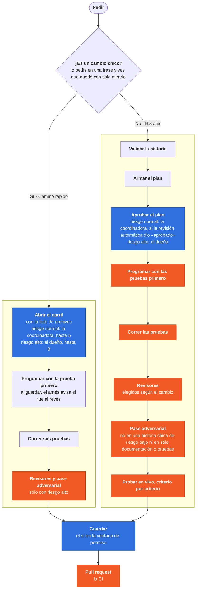

# Arnés TYCON

[English](README.md) · Castellano

**¿Recién llegás?** [El arnés en un minuto](getting-started/one-minute.es.md): qué es, el primer día en tres pasos y
las palabras que usa.

**El arnés en cuatro minutos.**

https://github.com/user-attachments/assets/3fbe4538-6b96-4b56-b2ed-92d36be1c6f8

**El sitio de la organización, con datos de ejemplo y sin cuenta:** [https://is.gd/tyconharnessdemo](https://is.gd/tyconharnessdemo)

**Un ciclo de desarrollo para agentes de código: completo, consistente, controlado y adaptable.**

- **Completo:** va del pedido a producción y a la medición; no se queda en escribir código.
- **Consistente:** cada historia hace el mismo recorrido, en cada máquina del equipo.
- **Controlado:** los controles frenan, no sólo avisan: no dependen de que el modelo se acuerde de las reglas. La
  instalación mínima trae uno (el de comandos destructivos); la completa suma los demás.
- **Adaptable:** cada organización suma sus revisores, sus skills y su configuración.

Tu agente de código escribe rápido; el arnés hace que lo haga con método. Anda con Claude Code y Codex, también con
modelos abiertos vía [Ollama](guides/integrations/ollama.md), y con [Cursor](guides/integrations/cursor.md).
El ciclo de desarrollo con IA (AI SDLC), paso por paso:

1. **Pedido e historia:** contás qué querés y el agente lo escribe como una historia (story): qué hay que hacer y cómo
   se prueba. Un cambio chico va por camino rápido: el motivo en una línea y la lista de archivos.
2. **Plan aprobado:** el agente arma el plan y te lo muestra; se aprueba antes de programar, nunca solo: con riesgo normal, la coordinadora, sólo si la revisión automática del plan dio «aprobado»; con riesgo alto, el dueño.
3. **Pruebas y código:** escribe las pruebas y el código, y corre las pruebas.
4. **Revisión:** en una historia, revisores especializados (seguridad, convenciones, cobertura) miran el cambio antes del commit; en un camino rápido, sólo con riesgo alto.
5. **Entrega:** el commit y el merge pasan por controles. Nada se commitea ni se sube sin tu permiso.
6. **Operación y medición:** cada merge a main deja su archivo de métricas, y los procesos de la noche de tu
   organización revisan las dependencias y arman el tablero del ciclo.

**La medida justa.** Al arrancar un producto se especifica entero, una vez —documento de producto, arquitectura,
épicos e historias—; después, historia por historia.

- **El tamaño decide: historia o camino rápido.** La pregunta: ¿es un cambio chico?
  - **Es chico** si lo pedís en una frase y, al terminar, ves que quedó bien mirando el resultado y corriendo sus
    pruebas. Ejemplo: «el combo de provincia muestra el nombre completo en vez de la sigla». Va por **camino rápido**.
  - **No es chico** si para saber que quedó completo hace falta una lista de criterios, si lleva más de una sesión o si
    espera a alguien de afuera. Ejemplo: «el combo trae las opciones de la base y recuerda la última elección». Va por
    **historia**.
  - **Si junta varios temas**, no es chico: son varios caminos rápidos, o una historia.

  **Quién decide y quién controla.** El tamaño lo juzga quien abre el trabajo, pero no lo decide solo: el camino rápido
  lo aprueba la coordinadora o el dueño. Y lo que sigue no depende de la buena fe de nadie. Lo hace cumplir el arnés:
  - Sin un camino rápido abierto o una historia, el arnés **no deja escribir código**.
  - El camino rápido tiene un **tope de archivos**: 5 si lo aprobó la coordinadora, 8 si lo aprobó el dueño. Al pasarlo,
    el arnés **lo cierra** y pide una historia.
  - Un camino rápido con varios temas en el motivo **no lo puede aprobar la coordinadora**.
- **El riesgo decide quién aprueba.** Es alto si el cambio toca algo sensible del repo, como producción, una migración
  o seguridad, o si trae una decisión del dueño: alcance, seguridad, una dependencia nueva, plata, clientes u otras
  personas. Ante la duda, alto. Con riesgo normal aprueba la coordinadora, que al abrir un camino rápido le avisa al dueño; con
  riesgo alto, el dueño. El dueño es la
  persona que tu organización designa para aprobar lo delicado; si trabajás solo, sos vos. Sin coordinadora, lo suyo
  lo hace el dueño. El plan nunca se aprueba solo.
- **Guardar es un sí en la ventana de permiso, en los dos caminos.** Antes de cada commit, push y pull request el
  agente pregunta «¿guardo?», y con un sí guarda. No hay firma ni comando.

Los frenos, los controles y las firmas de control del arnés son de quien lo mantiene. El detalle:
[La medida justa](guides/que-hace-el-arnes.md#la-medida-justa-cuánto-papel-lleva-cada-cambio).



<sub>🟦 Decide alguien: una persona, o la coordinadora con riesgo normal · 🟧 Control que no se saltea</sub>

Los controles son una parte del ciclo: cuidan cada paso. Se arranca de dos maneras: [solo, en tu
máquina](#empezá-solo), o [para tu equipo](#para-equipos).

**Mirá cómo funciona.**

Dos caminos en videos cortos, el de quien trabaja solo y el del equipo, y un resumen que los une. Cada video dura de uno a cuatro minutos.

### Si trabajás solo

Para quien usa el arnés en su máquina: de instalarlo a sumar las reglas de tu proyecto.

**0. Qué es y qué ganás**

https://github.com/user-attachments/assets/916e33d9-5e58-44de-9367-8a8c7c16c4ea

**1. Instalarlo**

https://github.com/user-attachments/assets/74a74b69-856e-4367-95bb-52159325c8af

**2. De la idea a las historias**

https://github.com/user-attachments/assets/24124d87-ebca-4069-8d82-d0b498f09518

**3. Tu primera historia**

https://github.com/user-attachments/assets/e7504a1b-a65e-4956-919f-25753cf64e18

**4. Una historia con pantalla**

https://github.com/user-attachments/assets/8aa2c03a-03d7-42ab-b4ae-daf90a53e3c9

**5. Las reglas de tu proyecto**

https://github.com/user-attachments/assets/1ef473c6-f088-413f-8560-9d801e6a0c75

### Si armás un equipo

Para quien arma el arnés para su organización: de las tres capas a lo que corre de noche.

**0. Las tres capas**

https://github.com/user-attachments/assets/582a4581-141c-486e-a19d-1f5eb01d6129

**1. Dar de alta tu equipo**

https://github.com/user-attachments/assets/fa77d543-85b8-4564-8530-d583679b15c5

**2. Un recorrido por el sitio**

https://github.com/user-attachments/assets/9cc321d7-9410-43ef-a842-9d27f98e4dc5

**3. Configurar desde el sitio**

https://github.com/user-attachments/assets/61438ad4-9f29-4719-b298-c74dddb19d93

**4. Del commit a producción**

https://github.com/user-attachments/assets/41082543-3c5e-4e25-9e64-3e0c48fd985c

**5. Lo que corre de noche**

https://github.com/user-attachments/assets/0fc6e458-74d8-4338-b997-3e87841680c6

### Para cerrar

Para todos: el resumen de los dos caminos.

**Del dev solo al equipo**

https://github.com/user-attachments/assets/75368083-6788-405d-8cde-8bc3d8557e51

## Empezá solo

**Sirve hoy para .NET, JavaScript, TypeScript, Python, Go y Java**: el paso de pruebas corre de fábrica .NET, Vitest,
Jest, Node (`node --test`), pytest, Go, Maven, Gradle, Karma y Playwright. Con otra herramienta, ese paso todavía no reconoce tus
pruebas hasta que tu equipo la declara en su configuración («Tu tecnología», en el sitio).

Antes de instalar necesitás tu agente de código (Claude Code o Codex) con tu sesión iniciada, y Node 22 o posterior.
La lista completa está en [Qué necesitás](#qué-necesitás).

Para que tu agente siga el ciclo, instalá el arnés en tu máquina ([▶ video](https://github.com/user-attachments/assets/74a74b69-856e-4367-95bb-52159325c8af)). Abrí la terminal (en Windows, PowerShell 7) y
escribí:

```bash
npx @tyconsa/harness@latest
```

No te pregunta nada antes del plan: instala para vos, con la instalación mínima, sin conexiones opcionales y sin
revisores para una tecnología. Te muestra en cinco renglones qué va a cambiar y pregunta una sola vez
«¿Instalo? [s/N]»: con un «no», no queda nada. Si no tenés Claude Code ni Codex, te dice cómo instalarlos y no baja
nada. Con el «sí» tarda menos de un minuto y termina con «arnés instalado» y la versión. La instalación mínima suma a
tu agente el índice de guías del arnés en cada sesión; no toca git ni las reglas de cómo te contesta. Para sacarla,
`harness.js uninstall --dry-run` muestra qué quitaría y `harness.js uninstall --yes` la quita.

Si usás Codex, falta un paso: al final te pide abrir `codex`, correr `/hooks` y aprobarlos una vez. Codex
aprueba sus hooks uno por uno; sin ese paso, los controles del arnés no corren en Codex y no avisan.

La instalación completa suma los frenos en los repos que trabajan con el arnés y cambia cómo te contesta el agente en todos tus proyectos:
[qué cambia](getting-started/reference.es.md#qué-cambia-la-instalación-completa).

## Tu primera historia

Una historia es tu pedido escrito, con sus criterios y sus pruebas: el agente la sigue y los revisores la controlan. Que la primera sea chica, como una función nueva en un archivo: una así tarda unos 10 minutos. · [▶ video](https://github.com/user-attachments/assets/e7504a1b-a65e-4956-919f-25753cf64e18)

1. **Abrí tu agente de código en la carpeta de tu repo**: ahí escribe la historia, crea la rama y guarda los cambios. Si lo tenías abierto desde antes de instalar, cerralo y abrilo de nuevo: las reglas del arnés entran al abrirlo.
2. **Decí que confiás en la carpeta**: la primera vez que abrís tu agente en esa carpeta, te pregunta si confiás en ella: contestá que sí.
3. **Si la idea es grande, primero las historias.** Tu agente la lleva por etapas —entender el problema, el PRD, la arquitectura, las épicas— hasta dejar las historias; vos revisás cada etapa, y cada artefacto se commitea al repo, al lado del código. Para una idea acotada no hace falta: pedí la historia directo. · [▶ video](https://github.com/user-attachments/assets/24124d87-ebca-4069-8d82-d0b498f09518)
4. **Pedí la historia con tus palabras**, para que el cambio quede escrito antes de programar: «creá una historia para agregar un filtro por fecha».
5. **Revisá la historia.** El agente la arma con lo que le pediste, contestando tres preguntas en llano (qué tiene que hacer, cómo se ve que anda y qué no tiene que tocar), y te marca lo que supuso. Te la muestra y la escribe con tu «sí». Si tu repo ya trae la carpeta `_bmad/`, la arma con lo que hay ahí.
6. **Pedí «implementemos la story»**, para arrancar el recorrido: la frase va así. Si no hay git, lo inicia; si estás en `main`, crea la rama. Valida la historia y, si le falta algo, te pregunta si la arregla. Te muestra el plan y espera tu "sí" antes de programar. Después escribe las pruebas y el código, corre las pruebas y los revisores, y prueba cada criterio corriéndolo.
7. **Revisá el resumen.** Antes de commitear te pregunta «¿guardo?» en la ventana de permiso, y con un sí guarda: nunca commitea ni sube cambios sin tu permiso. Al cerrar la primera historia te ofrece la instalación completa.
8. **Una historia con pantalla.** El agente arma una maqueta para que la apruebes antes de programar; si tu repo no tiene cómo probar en un navegador, te ofrece prepararlo; y te deja una guía para probarla a mano. · [▶ video](https://github.com/user-attachments/assets/8aa2c03a-03d7-42ab-b4ae-daf90a53e3c9)
9. **Las reglas propias de tu proyecto.** Pedile a tu agente un revisor que controle una regla tuya (por ejemplo, «el email de un cliente nunca se muestra completo»): queda en tu repo de reglas y revisa cada historia junto con los del arnés. · [▶ video](https://github.com/user-attachments/assets/1ef473c6-f088-413f-8560-9d801e6a0c75)

Si algo no anda, `/tycon-harness` (en Claude Code) o `node ~/.claude/tycon-harness/scripts/setup/harness.js doctor` dicen qué falta, sin tocar nada.

## Qué necesitás

- Tu agente de código, Claude Code o Codex, instalado y con tu sesión iniciada: es donde se usa el arnés.
- Node 24 y `tar` (para correr la línea de instalación alcanza con Node 22 o posterior). En Mac y Linux, además, Python 3.
- Windows 11 con PowerShell 7, Mac o Linux. En WSL no se probó.
- Git **no** hace falta para instalar el arnés: se baja como archivos, no se clona.
  Tampoco hace falta una cuenta de GitHub: este repo es público. Para commitear tus historias sí hace falta git, con
  tu nombre y tu correo configurados (`git config --global user.name` y `user.email`).
- Tu Node hace falta para instalar. Después el arnés baja su propio Node 24 (unos 50 MB, de nodejs.org) y sus hooks
  corren con él; tus proyectos siguen con tu Node, que no se toca. Se apaga con `TYCON_HARNESS_NODE=0`.
- Lo que tu proyecto necesita para compilar (por ejemplo, el SDK de .NET). Sin eso, la implementación frena al compilar.

Si te falta algo, el instalador te dice qué y no instala nada. Para instalar a mano, sin npm, o sin nadie delante:
[Instalar a mano](getting-started/reference.es.md#instalar-a-mano).

## Instalar con Claude Code

Es la alternativa si preferís que te guíen, y lleva unos 10 minutos. Claude corre casi todos los comandos; la
instalación corre en tu propia terminal. Por este camino queda la instalación completa (`full`).

1. Abrí las instrucciones de tu sistema: [Windows](getting-started/windows.md), [Mac](getting-started/mac.md) o [Linux](getting-started/linux.md).
2. Copiá el bloque entero de la «Parte 1». Abrí Claude Code en cualquier carpeta y pegalo en una conversación nueva.
3. Claude te da la línea npx para tu propia terminal: la corrés vos, así ves el plan antes de contestar. Nada te pide
   iniciar sesión: el arnés nunca abre un navegador.
4. Claude te muestra el plan de instalación y espera tu «sí». El plan dice si va a configurar `core.hooksPath`.
5. Al final te arma un resumen que termina en «OK» o «NO OK». Cerrá Claude Code y abrilo de nuevo.

Si en el camino instalás una herramienta, Claude te pide cerrar y abrir la terminal y Claude Code. Si el resumen dice
«NO OK», guardalo: es lo que hay que mostrar al pedir ayuda.

El arnés queda en `~/.tycon/harness`, como archivos bajados (sin git). `~/.claude/tycon-harness` es un acceso directo a
esa misma carpeta, y es el que usan los comandos de esta página. No borres ni muevas esa carpeta: tu agente lo usa
desde ahí, y se actualiza solo en ese lugar. Usar el arnés nunca necesita un clon de este repo.

**La instalación mínima.** Al pegar el bloque, escribí arriba «quiero el perfil mínimo». Claude instala `minimal` y no
toca `core.hooksPath`.

## Para equipos

**Primero probalo solo.** Instalalo en tu máquina como dice arriba: no hace falta nada de tu organización. Si te sirve,
se arma para el equipo con dos repos de la organización, que sólo ve tu equipo, además de éste, que es el mismo para
todos:

| Repo | Qué guarda | ¿Llega a cada máquina? |
|---|---|---|
| Éste (público) | el arnés | Sí |
| El **repo del equipo** (por ejemplo `harness-team-profile`) | la configuración que comparte el equipo y la lista de dónde vive cada repo de la organización (`team-repos.json`) | Sí, a cada máquina que instala con `--team` |
| Las **operaciones del equipo** (por ejemplo `harness-team-operations`) | lo que corre de noche para la organización (dependencias, tablero, retrospectivas) y a quién se le asignan sus avisos (`operations.json`) | No: lo leen sólo esos procesos |

Un ejemplo: en ACME, Pedro es el admin y Juan programa.

1. Pedro da de alta ACME con `npx @tyconsa/harness@latest --audience org`. La línea instala su máquina y sigue con `harness.js team-init`: pregunta el nombre, la plataforma y
   la dirección del repo del equipo, arma sus tres archivos (`team-layer.json`, `team-profile.json` y `team-repos.json`)
   a partir de [un ejemplo](https://github.com/TYCON-SA/harness-team-profile-example) y los valida antes de escribir. No
   crea repos ni pide credenciales: le dice dónde crear el repo vacío, con acceso sólo para el equipo, y si dice que sí
   lo sube con su git. Con el arnés ya instalado, lo mismo es `node ~/.tycon/harness/scripts/setup/harness.js team-init`.
   El repo de operaciones se crea aparte (abajo, «Los procesos de la noche»).
2. Todo lo que se personaliza —dónde vive cada repo, a quién se le asignan los avisos, los umbrales— se configura desde
   la pestaña **Configuración** del [sitio del equipo](guides/organization-site.md) (sólo para los admins): valida con
   los mismos lectores del arnés y propone cada cambio con un pedido de cambio (pull request), nunca escribe `main`.
   Mientras ACME no tiene su sitio, cada archivo se cambia con un pedido de cambio a su repo: lo que llega a las
   máquinas, al repo del equipo; lo de la noche y del sitio, al de operaciones. El arnés funciona entero así: qué
   necesita cada caso y dónde vive cada configuración, en [Con sitio o sin sitio](getting-started/reference.es.md#con-sitio-o-sin-sitio).
   La página local (`node ~/.tycon/harness/scripts/setup/harness.js team-config`) muestra, de sólo lectura y sin nada
   en internet, lo que hay en sus clones y los problemas que ven los lectores; no guarda ni propone nada.
3. Juan instala con npx y el repo del equipo: `npx @tyconsa/harness@latest --team acme/harness-team-profile` si está en
   GitHub, o `npx @tyconsa/harness@latest --team https://dev.azure.com/acme/<proyecto>/_git/harness-team-profile` si
   está en Azure DevOps. Como ese repo lo ve sólo el equipo, antes de bajar nada la línea mira si lo puede leer y, si
   no, le pide el permiso de lectura. Desde ahí, cada actualización le trae también lo del equipo.

Cómo se extiende el arnés para tu organización —qué suma cada organización, la página de configuración y un recorrido de ejemplo— en un
[mapa interactivo](https://www.bizuit.com/sdd-harness/more/mapa-del-arnes.html).

**Los procesos de la noche.** En Azure DevOps, la revisión de dependencias, las métricas del ciclo y el tablero corren en
tu organización con tres procesos modelo y tu repo de operaciones: [cómo darlos de alta](pipelines/operations/README.md).
En GitHub, los mismos tres corren como workflows de GitHub Actions, y los hallazgos de dependencias son issues en el
repo de cada producto: [cómo darlos de alta](pipelines/operations/github/README.md).

**Paso a paso, para quien arma el equipo.**

1. **Entendé las tres capas.** Este repo, el arnés, igual para todos; el repo del equipo, con lo que llega a cada máquina; y las operaciones del equipo, con lo que corre de noche. La tabla de arriba dice qué guarda cada uno. · [▶ video](https://github.com/user-attachments/assets/582a4581-141c-486e-a19d-1f5eb01d6129)
2. **Da de alta tu equipo.** `npx @tyconsa/harness@latest --audience org` instala tu máquina y sigue con `harness.js team-init`, que arma los tres archivos del repo del equipo y los valida. Creá el repo vacío, con acceso sólo para el equipo, y subilos. Cada dev instala con `npx @tyconsa/harness@latest --team <repo del equipo>`. · [▶ video](https://github.com/user-attachments/assets/fa77d543-85b8-4564-8530-d583679b15c5)
3. **Mirá el sitio de la organización.** Cada persona entra con la cuenta de la organización y ve lo suyo: sus corridas, sus pedidos de cambio, lo que tiene asignado; quien mantiene el arnés ve todo. Es opcional: el arnés funciona entero sin él. **Miralo sin instalar nada:** el sitio demo, [https://is.gd/tyconharnessdemo](https://is.gd/tyconharnessdemo), se abre sin cuenta con datos de una organización inventada y no escribe nada; la primera visita puede tardar unos segundos, mientras se despierta. [Levantar el sitio: guía paso a paso](guides/organization-site.md#qué-hace-falta-antes) (probarlo con Docker, Azure Container Apps, Render o una máquina propia). · [▶ video](https://github.com/user-attachments/assets/9cc321d7-9410-43ef-a842-9d27f98e4dc5)
4. **Configurá desde el sitio.** La pestaña **Configuración** (sólo para quien mantiene) personaliza la organización: quién es responsable de qué, el canal del aviso, los umbrales. Valida cada cambio y lo propone con un pedido de cambio; nunca escribe `main`. Sin sitio, el mismo cambio va con un pedido de cambio al repo que corresponde. · [▶ video](https://github.com/user-attachments/assets/61438ad4-9f29-4719-b298-c74dddb19d93)
5. **Del commit a producción.** El commit y el merge pasan por controles en cada máquina, y [el portón de CI](guides/ci-gate.md) vuelve a verificar en el servidor lo que llegó a `main`. Si declarás en `operations.json → deployments` los pipelines de staging y de producción de cada producto, el tablero muestra sus despliegues ([cómo](pipelines/operations/README.md)). · [▶ video](https://github.com/user-attachments/assets/41082543-3c5e-4e25-9e64-3e0c48fd985c)
6. **Lo que corre de noche.** La revisión de dependencias, las métricas del ciclo y el tablero corren en tu organización con tu repo de operaciones, y a la mañana llega el aviso (Telegram, Slack o Teams) con cantidades y el enlace al sitio. Cómo darlos de alta: en [Azure DevOps](pipelines/operations/README.md) o en [GitHub](pipelines/operations/github/README.md). · [▶ video](https://github.com/user-attachments/assets/0fc6e458-74d8-4338-b997-3e87841680c6)

## Qué más hace

- **Se vigila a sí mismo.** Un banco de pruebas comprueba, en cada cambio al arnés, que cada control siga frenando lo
  que dice. Si lo prendés, además observa tus sesiones y propone reglas nuevas, que vos aprobás.
- **Controles que nacieron de incidentes.** Con la instalación completa, los controles frenan, no sólo avisan. La
  mayoría nació de un incidente real.
- **Revisores para tu tecnología.** Cada organización suma los suyos en su repo del equipo. TYCON trae los suyos para
  plugins de BIZUIT, con los guiones que despliegan a pruebas y a producción.
- **Lo que todavía es propio de TYCON:** el vigilante de producción no se publicó.

Las palabras del arnés (historia, recorrido, freno, procesos de la noche…), una línea cada una, en
[Las palabras del arnés](getting-started/reference.es.md#las-palabras-del-arnés).

## Dónde seguir

| Si querés… | Leé |
|---|---|
| Instalar a mano, en Linux o sin nadie delante | [Instalar a mano](getting-started/reference.es.md#instalar-a-mano) |
| Saber qué escribe en tu máquina y cómo apagar cada cosa | [Qué escribe en tu máquina](getting-started/reference.es.md#qué-escribe-en-tu-máquina-y-qué-hace-solo) |
| Actualizar, volver atrás o desinstalar | [Cómo se actualiza](getting-started/reference.es.md#cómo-se-actualiza) |
| Usarlo con Codex | [Qué es opcional](getting-started/reference.es.md#qué-es-opcional) |
| Usarlo con un modelo abierto por Ollama, en cualquiera de las dos herramientas | [Usar el arnés con modelos de Ollama](guides/integrations/ollama.md) |
| Usarlo con Cursor | [Usar el arnés con Cursor](guides/integrations/cursor.md) |
| Entender una palabra del arnés | [Las palabras del arnés](getting-started/reference.es.md#las-palabras-del-arnés) |
| Cambiar el arnés | [CONTRIBUTING.md](.github/CONTRIBUTING.md) |

## Licencia y marcas

Apache License 2.0: ver [LICENSE](LICENSE). [NOTICE](NOTICE) lista el titular, las marcas y las atribuciones de
los archivos derivados de trabajo de terceros.

TYCON y Bizuit son marcas de sus dueños, y la licencia no las otorga.
Este arnés usa BMad Method, MIT; no está afiliado ni respaldado por BMad Code, LLC.

Para contribuir, leé [CONTRIBUTING.md](.github/CONTRIBUTING.md). Para reportar una vulnerabilidad, leé
[SECURITY.md](.github/SECURITY.md). Participar sigue el [código de conducta](.github/CODE_OF_CONDUCT.md).
