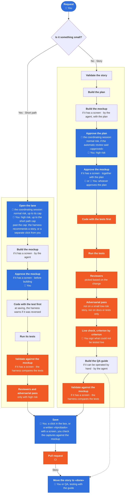

# TYCON Harness

English · [Castellano](README.es.md)

**The harness in four minutes** (in Spanish, with subtitles).

https://github.com/user-attachments/assets/3fbe4538-6b96-4b56-b2ed-92d36be1c6f8

Today an AI agent writes in minutes the code that used to take hours. Models program so well that they seem to no longer need anything to guide them, ask them for tests and stop them when they get it wrong.

There is no longer any need to give them guides for each language and framework: good coding practices in React or in .NET, how errors are handled or how the data that reaches the system is validated. Nor do they need to be reminded of design patterns, such as separating responsibilities, injecting dependencies or keeping coupling low.

But knowing a good practice is not the same as always applying it the same way in a project. And there is something they cannot know on their own: each organization's process, rules and decisions, because the organization defines them. For example, specifying before programming, writing and running the tests, showing a mockup to a person before building, or not closing a piece of work without meeting its definition of done. And even when they have all of that in writing, they sometimes forget or skip steps, and no one can depend on the developer reminding them every time.

And when each team works with agents in its own way, it delivers with a quality different from the others. The client ends up seeing the difference, when something has to be redone or when a delivery runs late.

Besides, the better the models get, the more work is delegated to them: longer tasks and several agents at once. For the developer, following everything the agents do becomes harder and harder. And the less can be watched, the more necessary it is for the process to enforce itself.

That is why we created TYCON Harness, an agentic SDLC. It covers the complete software life cycle, from the requirement to operation in production. And it surrounds each AI agent with a harness: it guides it, decides what it can and cannot do, and stops it when it gets it wrong.

The harness takes each agent through a defined process, step by step, and no step is skipped silently. Everything starts with a request: a new feature, an improvement or a fix. The agent writes a story together with whoever asked for it: what is being asked and what it has to meet. It does so with an AI-guided requirements specification method. The story is validated and a plan is built from it. If there is a screen, the agent builds a mockup, which is approved together with the plan. The plan is approved before programming. Then the tests are written, before the code, and the harness verifies that order. Before it joins the rest, that code and its tests are reviewed by other agents, different from the one that wrote them and each with its own rules. And the tests are tested too: the harness breaks the code on purpose and verifies that some test fails.

Not all approvals weigh the same. What can be undone can be approved by a coordinator agent, if the organization enables it. What is delicate is always approved by a person: what the harness recognizes as production, data or security, and any change that loosens a control.

Each step adds a review, but finding a problem during development costs much less than discovering it after delivery. For a small change, the process provides a short path, with fewer steps. To control spending, each organization chooses which model it uses in the different steps and can put a ceiling on the automatic steps. The site shows how much each run consumed.

Once finished, the work moves on through the continuous integration and deployment pipeline. The harness brings ready-made pipelines for some platforms; for the others, it joins the one the organization already has. There it is built, the tests are run again and it is deployed to a test environment. In the pipelines the harness brings, production is reached only with a person's approval.

And none of this depends on the model not forgetting or on the developer reminding it: the controls live outside the model. For example, if an agent tries to close a story without the evidence of its tests, the harness stops it on the machine. Before the work joins the code, the continuous integration pipeline verifies that the story carries the evidence of its tests and the record of who reviewed it. If a control has to be skipped, it is recorded and the person in charge sees it. Loosening a control is always approved by a person. And every night, the harness's controls are put to the test with examples built for that purpose: what each one has to stop and what it has to let through.

So each piece of work that goes through the process is left with its story, its tests, which reviewers ran and who approved what was delicate. And what comes in through the short path, or directly outside the harness, is not lost: the site counts how many changes came in without a story. When a client asks how AI is used to work on their product, the answer is written down and can be shown. The stories, the evidence of the tests and the record of the reviewers are stored in the project's own repositories.

Each organization adjusts it to its own measure: its rules, its reviewers and who approves what.

And the cycle does not end there. Every night, TYCON Harness looks for vulnerabilities in the third-party components each product uses and reports each one so that a decision is made; if the decision is to fix it, a task is created for the team. It can also watch production errors and leave a diagnosis ready. In both cases, a person decides. It also learns from everyday work. It looks at which controls blocked too much or let something through. When a control blocks work that was fine, it is corrected, turned into a warning or retired, with a person's approval. That way the control stays useful. And it looks at how developers work with the agents. With that it proposes improvements to its rules and to its way of working. None is applied without a person approving it.

An administrator configures and follows the SDLC from a website. Each organization installs the site on its own infrastructure. Everything that is measured stays there, and the organization decides who sees it. Each configuration change is recorded, with who asked for it. The organization decides whether, before it is applied, another person has to approve it. From the site, the administrator defines how the team works, follows and measures what happens, and decides.

**See it with sample data and no account needed:** [open the site demo](https://is.gd/tyconharnessdemo)

**Define.** First, what governs the work: who approves each thing and the organization's own reviewers, with the house rules. Then, the people and their permissions, the repositories and products, which model each kind of work uses, and each team's technology with its testing tools. Also the integrations: where the notices arrive, such as Telegram, Slack, Teams or email, and which tool records the hours. And which version of the harness each machine of the team has and how it is updated.

**Follow.** In each product, the stories in progress, stopped and blocked, which version is in test and which in production, the open vulnerabilities, and what one product does that the others do not. And how the agent works: each step of the process, with its reviewers and its controls, and which part belongs to the harness and which to the organization.

**Measure.** The agents' work: for each story or change, how long it took, how much it consumed, where the time went, which reviewers ran and what the controls found or stopped. Quality: how much work comes back and why, how many review rounds a change takes, the coverage of what was touched, whether the tests detect errors planted on purpose and how long they take to run. Estimates: how much each part of a product was estimated at and, if hours are recorded, how long it really took. And risk: the changes that came in without a story, the products that depend on a single person and those that have no pipeline to production.

**Decide.** Every morning, the result of the nightly review arrives: vulnerabilities in third-party components, production errors, controls that failed and work that got stuck before joining the code. What is chosen to be fixed becomes a task for the team. The improvements the harness proposes from how the team works are approved or discarded. And the harness itself is controlled: whether each control keeps stopping what it has to stop, whether the reviewers keep finding what they should, and which rules never found anything and can be retired.

The problem from the beginning remains: with several agents working at once, following what they do gets harder and harder. For that, the site gathers the offices of the whole team. Each developer's machine has its own: a virtual room where its agents work, each at its desk. At a glance, a lead sees all the work under way: what is moving, which agent got stuck and what is waiting for a decision. Without asking. Without interrupting anyone. On the side, a board shows what is pending, what is in progress and what is done, and it builds itself: no one has to fill it in. If someone disconnects, their office keeps showing the last thing they did.

It works with the most widely used coding agents, such as Claude Code, Codex and Cursor. Each team keeps the agent it already uses, and what becomes the same for everyone is the process. It supports models from Anthropic, from OpenAI or open-weight models through Ollama. And it is not tied to any language: each organization configures it for its own technology.

And it is open source: there is no license to pay and the code can be reviewed in full. It can start on a single machine, without a site, and add the team, the site and the nightly review later.

The agents bring the speed. TYCON Harness brings the method, the quality and the control. Together, they do software engineering with AI.

**Want to start right away?** [The harness in one minute](getting-started/one-minute.md): your first day in three
steps and the words it uses.

## How it works

**The right measure.** When a product starts it is specified in full, once —product document, architecture, epics
and stories—; then, story by story.

- **Size decides: story or short path.** The question: is it something small? A fix or a new feature: you ask in one
  sentence, and when it's done you know it came out right without checking a list.
  - **It is small** if you ask for it in one sentence, knowing it came out right only takes looking at the result and
    running the tests, and it is one topic, in one session, without waiting on anyone outside. Examples: "the province dropdown shows the full name instead of the abbreviation" or "a button that exports this table to Excel". It
    goes by **short path**.
  - **It is not small** if knowing it is complete takes a list of criteria, if it takes more than one session or if it
    waits on someone outside. Example: "the dropdown loads its options from the database and remembers the last
    choice". It goes by **story**.
  - **If it bundles several topics**, it is not small: it is several short paths, or a story.
  - **Risk is another matter.** A small high-risk feature also goes by short path, and the person approves it.

  **Who decides and who checks.** Whoever opens the work judges the size, but if you work with a coordinating session,
  you do not decide alone: the short path is approved by the coordinating session or you. The harness enforces it:
  - Without an open short path or a story, the harness **does not let you write code**.
  - The short path has a **file cap**: one if the coordinating session approved it, another if you did. Each organization sets the caps; by default, 5 and 8. Past it, the harness
    **closes it** and recommends a story. To stay on the short path, you ask with a separate click, which is recorded; the coordinating session cannot.
  - A short path with several topics in its reason **cannot be approved by the coordinating session**.
- **Risk decides who approves.**
  - **High risk** is when the change touches something sensitive in the repo, such as production, a migration or
    security. Also when it brings a decision for you or your organization: scope, security, a new dependency, money,
    customers or other people. When in doubt, high risk.
  - **The coordinating session** is an agent session your team can use to approve routine work; it is not a person.
  - **Who approves what:** you always approve the delicate work. The rest goes as the diagram shows, and the
    coordinating session tells you when it opens a short path. Without one, you approve its part.
- **Saving is a click or a written "Aprobado".** Before every commit, push and pull
  request the agent asks "save?". If your tab asks for permissions, the yes goes in the permission window. There is no
  signature and no command.

The harness brakes, controls and control signatures belong to whoever maintains it. The detail:
[The right measure](guides/que-hace-el-arnes.md#la-medida-justa-cuánto-papel-lleva-cada-cambio) (in Spanish).



<sub>🟦 Someone decides: 👤 **You** · 🤖 the coordinating session · 🟧 A control that is not skipped</sub>

The checks are one part of the cycle: they guard every step. There are two ways to start it: [on your own, on your
machine](#start-on-your-own), or [for your team](#for-teams).

**See how it works.**

Two paths in short videos, the one of someone working on their own and the team's, and a summary that ties them together. Each video lasts one to four minutes, and they are in Spanish.

### If you work on your own

For whoever uses the harness on their machine: from installing it to adding your project's rules.

**0. What it is and what you get**

https://github.com/user-attachments/assets/916e33d9-5e58-44de-9367-8a8c7c16c4ea

**1. Installing it**

https://github.com/user-attachments/assets/74a74b69-856e-4367-95bb-52159325c8af

**2. From the idea to the stories**

https://github.com/user-attachments/assets/24124d87-ebca-4069-8d82-d0b498f09518

**3. Your first story**

https://github.com/user-attachments/assets/e7504a1b-a65e-4956-919f-25753cf64e18

**4. A story with a screen**

https://github.com/user-attachments/assets/8aa2c03a-03d7-42ab-b4ae-daf90a53e3c9

**5. Your project's rules**

https://github.com/user-attachments/assets/1ef473c6-f088-413f-8560-9d801e6a0c75

### If you set up a team

For whoever sets up the harness for their organization: from the three layers to what runs at night.

**0. The three layers**

https://github.com/user-attachments/assets/582a4581-141c-486e-a19d-1f5eb01d6129

**1. Setting up your team**

https://github.com/user-attachments/assets/fa77d543-85b8-4564-8530-d583679b15c5

**2. A tour of the site**

https://github.com/user-attachments/assets/9cc321d7-9410-43ef-a842-9d27f98e4dc5

**3. Configuring from the site**

https://github.com/user-attachments/assets/61438ad4-9f29-4719-b298-c74dddb19d93

**4. From commit to production**

https://github.com/user-attachments/assets/41082543-3c5e-4e25-9e64-3e0c48fd985c

**5. What runs at night**

https://github.com/user-attachments/assets/0fc6e458-74d8-4338-b997-3e87841680c6

### To wrap up

For everyone: the summary of both paths.

**From working on your own to the team**

https://github.com/user-attachments/assets/75368083-6788-405d-8cde-8bc3d8557e51

## Start on your own

**It works today for .NET, JavaScript, TypeScript, Python, Go and Java**: out of the box the test step runs .NET,
Vitest, Jest, Node (`node --test`), pytest, Go, Maven, Gradle, Karma and Playwright. With another tool, that step does not recognize
your tests yet until your team declares it in its configuration ("Your technology", on the site).

Before you install you need your coding agent (Claude Code or Codex) signed in, and Node 22 or later. Full list:
[What you need](#what-you-need).

For your agent to follow the cycle, install the harness on your machine ([▶ video](https://github.com/user-attachments/assets/74a74b69-856e-4367-95bb-52159325c8af)). Open the terminal (on Windows, PowerShell 7)
and type:

```bash
npx @tyconsa/harness@latest
```

It asks nothing before the plan: it installs for you, with the minimal install, no optional connections and no
reviewers for a stack. It shows you in five lines (in Spanish) what will change and asks once "¿Instalo? [s/N]"
(install?): with a "no", nothing is left behind. Without Claude Code or Codex it tells you how to install them and
downloads nothing. After the "s" (yes) it takes less than a minute and ends with "arnés instalado" (harness
installed) and the version. The minimal install adds the harness's guide index to your agent in every session; it
does not touch git or the rules on how the agent answers you. To remove it, `harness.js uninstall --dry-run` shows
what it would remove and `harness.js uninstall --yes` removes it.

If you use Codex, one step is left: at the end it asks you to open `codex`, run `/hooks` and approve them once. Codex
approves its hooks one by one; without that step the harness's controls do not run in Codex, and nothing warns you.

The full install adds the guards in the repos that work with the harness and changes how the agent answers you in all your projects:
[what it changes](getting-started/reference.md#what-the-full-install-changes).

## Your first story

A story is your request in writing, with its criteria and its tests: the agent follows it and the reviewers check it. Make the first one small, like a new function in one file: about 10 minutes. · [▶ video](https://github.com/user-attachments/assets/e7504a1b-a65e-4956-919f-25753cf64e18)

1. **Open your coding agent in your repo's folder**: that is where it writes the story, creates the branch and saves the changes. If it was open from before you installed, close it and open it again: the harness's rules load when it starts.
2. **Say you trust the folder**: the first time you open your agent there, it asks whether you trust it: say yes.
3. **If the idea is big, the stories come first.** Your agent takes it through stages —understanding the problem, the PRD, the architecture, the epics— until it leaves the stories; you review each stage, and each artifact is committed to the repo, next to the code. A bounded idea does not need it: ask for the story directly. · [▶ video](https://github.com/user-attachments/assets/24124d87-ebca-4069-8d82-d0b498f09518)
4. **Ask for the story in your own words**, so the change is written down before any code: "create a story to add a date filter".
5. **Review the story.** The agent builds it from your request, answering three plain questions (what it must do, how you can tell it works, and what it must not touch), and marks what it assumed. It shows it to you and writes it on your "yes". If your repo already has a `_bmad/` folder, it builds it with what is there.
6. **Ask "implementemos la story" (let's implement the story)**, to start the run: the phrase stays in Spanish. If there is no git, it initializes it; if you are on `main`, it creates the branch. It validates the story and, if something is missing, asks whether to fix it. It shows you the plan and waits for your "yes" before any code. Then it writes the tests and the code, runs the tests and the reviewers, and checks each criterion by running it.
7. **Read the summary.** Before committing it asks "save?" and saves with your yes: it never commits or pushes without your permission. When the first story closes, it offers you the full install.
8. **A story with a screen.** The agent builds a mockup for you to approve before any code; if your repo has no way to test in a browser, it offers to set it up; and it leaves a guide for testing it by hand. · [▶ video](https://github.com/user-attachments/assets/8aa2c03a-03d7-42ab-b4ae-daf90a53e3c9)
9. **Your project's own rules.** Ask your agent for a reviewer that checks a rule of yours (for example, "a customer's email is never shown in full"): it lives in your rules repo and reviews every story along with the harness's own. · [▶ video](https://github.com/user-attachments/assets/1ef473c6-f088-413f-8560-9d801e6a0c75)

If something doesn't work, `/tycon-harness` (in Claude Code) or `node ~/.claude/tycon-harness/scripts/setup/harness.js doctor` says what is missing, without changing anything.

## What you need

- Your coding agent, Claude Code or Codex, installed and signed in: it is where you use the harness.
- Node 24 and `tar` (Node 22 or later is enough to run the install line). On Mac and Linux, also Python 3.
- Windows 11 with PowerShell 7 and Git for Windows, Mac or Linux. WSL was not tested.
- Git is **not** needed to download the harness: it comes as files.
  A GitHub account is not needed either: this repository is public. To commit your stories you do need git, with
  your name and email set (`git config --global user.name` and `user.email`).
- Your Node is needed to install. After that the harness downloads its own Node 24 (about 50 MB, from nodejs.org) and
  its hooks run with it; your projects keep your Node, which is not touched. Turn it off with `TYCON_HARNESS_NODE=0`.
- What your project needs to build (for example, the .NET SDK). Without it, the implementation stops at the build.

If something is missing, the installer tells you what and installs nothing. To install by hand, without npm, or with
nobody at the keyboard: [Install by hand](getting-started/reference.md#install-by-hand).

## Install with Claude Code

It is the alternative if you would rather be guided, and it takes about 10 minutes. Claude runs most of the commands;
the install runs in your own terminal. This path gives you the full install (`full`).

1. Open the instructions for your system: [Windows](getting-started/windows.md), [Mac](getting-started/mac.md) or [Linux](getting-started/linux.md).
2. The instructions are in Spanish. Copy the whole "Parte 1" block (part 1). Open Claude Code in any folder and paste it into a new conversation.
3. Claude gives you the npx line for your own terminal: you run it, so you see the plan before you answer. Nothing
   asks you to sign in: the harness never opens a browser.
4. Claude shows you the install plan and waits for your "yes". The plan says whether it will set `core.hooksPath`.
5. At the end it writes a summary that ends in "OK" or "NO OK". Close Claude Code and open it again.

If you install a tool along the way, Claude asks you to close and reopen the terminal and Claude Code. If the summary
says "NO OK", keep it: it is what to show when you ask for help.

The harness lives in `~/.tycon/harness`, as downloaded files (no git). `~/.claude/tycon-harness` is a shortcut to that
same folder, and the commands on this page use it. Don't delete or move that folder: your agent uses it from there,
and it updates itself in place. Using the harness never needs a clone of this repository.

**The minimal install.** When you paste the block, write "quiero el perfil mínimo" (I want the minimal profile) above
it. Claude installs `minimal` and does not touch `core.hooksPath`.

## For teams

**Try it alone first.** Install it on your machine as described above: nothing from your organization is needed. If it
works for you, it is set up for the team with two repos of the organization, which only your team can see, besides
this one, which is the same for everybody:

| Repo | What it holds | Does it reach every machine? |
|---|---|---|
| This one (public) | the harness | Yes |
| The **team repo** (for example `harness-team-profile`) | the configuration the team shares and the list of where each repo of the organization lives (`team-repos.json`) | Yes, every machine that installs with `--team` |
| The **team operations** (for example `harness-team-operations`) | what runs at night for the organization (dependencies, dashboard, retrospectives) and who gets its notices (`operations.json`) | No: only those jobs read it |

An example: at ACME, Pedro is the admin and Juan writes code.

1. Pedro sets ACME up with `npx @tyconsa/harness@latest --audience org`. The line installs his machine and goes on with `harness.js team-init`: it
   asks for the name, the platform and the address of the team repo, builds its three files (`team-layer.json`,
   `team-profile.json` and `team-repos.json`) from [an example](https://github.com/TYCON-SA/harness-team-profile-example)
   and validates them before writing. It creates no repos and asks for no credentials: it tells him where to create the
   empty repo, with access only for the team, and if he says yes it pushes it with his git. The operations repo is created
   separately (below, "What runs at night").
2. Everything that is customized —where each repo lives, who gets the notices, the thresholds— is configured from the
   **Configuration** tab of the [team site](guides/organization-site.en.md) (admins only): it validates and proposes
   every change as a pull request. While ACME has no
   site, each file is changed with a pull request to its repo. What each case needs and
   where each setting lives, in [With or without the site](getting-started/reference.md#with-or-without-the-site).
3. Juan installs with npx and the team repo: `npx @tyconsa/harness@latest --team acme/harness-team-profile` if it is on
   GitHub, or `npx @tyconsa/harness@latest --team https://dev.azure.com/acme/<project>/_git/harness-team-profile` if it
   is on Azure DevOps. Since only the team sees that repo, before downloading anything the line checks that it can read
   it and, if not, asks him for read permission. From then on, every update also brings him what belongs to the team.

How the harness extends for your organization, with a worked example, in an
[interactive map](https://www.bizuit.com/sdd-harness/more/mapa-del-arnes.html).

**Step by step, for whoever sets up the team.**

1. **Understand the three layers.** This repo, the harness, the same for everybody; the team repo, with what reaches every machine; and the team operations, with what runs at night. · [▶ video](https://github.com/user-attachments/assets/582a4581-141c-486e-a19d-1f5eb01d6129)
2. **Set up your team.** `npx @tyconsa/harness@latest --audience org` installs your machine and goes on with `harness.js team-init`, which builds the three files of the team repo and validates them. Create the empty repo, with access only for the team, and push them. Each dev installs with `npx @tyconsa/harness@latest --team <team repo>`. · [▶ video](https://github.com/user-attachments/assets/fa77d543-85b8-4564-8530-d583679b15c5)
3. **Look at the organization site.** Each person signs in with the organization's account and sees their own: their runs, their pull requests, what is assigned to them; whoever maintains the harness sees everything. It is optional: the harness works fully without it. **See it without installing:** the [demo site](https://is.gd/tyconharnessdemo) opens without an account, with made-up data, and writes nothing; the first visit may take a few seconds. [Setting up the site, step by step](guides/organization-site.en.md#what-you-need-first) (Docker, Azure Container Apps, Render or your own machine). · [▶ video](https://github.com/user-attachments/assets/9cc321d7-9410-43ef-a842-9d27f98e4dc5)
4. **Configure from the site.** The **Configuration** tab (maintainers only) customizes the organization: who is responsible for what, the notice channel, the thresholds. It validates every change and proposes it as a pull request; it never writes `main`. · [▶ video](https://github.com/user-attachments/assets/61438ad4-9f29-4719-b298-c74dddb19d93)
5. **From commit to production.** The commit and the merge go through controls on each machine, and [the CI gate](guides/ci-gate.md) (in Spanish) checks again on the server what reached `main`. If you declare in `operations.json → deployments` the staging and production pipelines of each product, the dashboard shows their deployments ([how](pipelines/operations/README.md), in Spanish). · [▶ video](https://github.com/user-attachments/assets/41082543-3c5e-4e25-9e64-3e0c48fd985c)
6. **What runs at night.** The dependency review, the cycle metrics and the dashboard run in your organization with your operations repo, and in the morning the notice arrives (Telegram, Slack or Teams) with counts and the link to the site. How to set them up: on [Azure DevOps](pipelines/operations/README.md) or on [GitHub](pipelines/operations/github/README.md) (in Spanish). · [▶ video](https://github.com/user-attachments/assets/0fc6e458-74d8-4338-b997-3e87841680c6)

## What else it does

- **It watches itself.** A test bench checks, on every change to the harness, that each check still blocks what it
  says it blocks. If you turn it on, it also watches your sessions and proposes new rules for you to approve.
- **Checks born from incidents.** Most of them were born from a real incident.
- **Reviewers for your stack.** TYCON brings its own for BIZUIT
  plugins, with the scripts that deploy to test and to production.

## Where to go next

| If you want to… | Read |
|---|---|
| Install by hand, on Linux or with nobody at the keyboard | [Install by hand](getting-started/reference.md#install-by-hand) |
| Know what it writes on your machine and how to turn each thing off | [What it writes on your machine](getting-started/reference.md#what-it-writes-on-your-machine-and-what-it-does-on-its-own) |
| Update, go back or uninstall | [How it updates](getting-started/reference.md#how-it-updates) |
| Use it with Codex | [What is optional](getting-started/reference.md#what-is-optional) |
| Use it with an open model through Ollama | [Use the harness with Ollama models](guides/integrations/ollama.en.md) |
| Use it with Cursor | [Use the harness with Cursor](guides/integrations/cursor.en.md) |
| Work with several sessions at once | [Working with a coordinator](guides/working-with-a-coordinator.en.md) |
| Understand a word of the harness | [The harness's words](getting-started/reference.md#the-harnesss-words) |
| Change the harness | [CONTRIBUTING.md](.github/CONTRIBUTING.md) |

## License and trademarks

Apache License 2.0: see [LICENSE](LICENSE). [NOTICE](NOTICE) lists the owner, the trademarks and the
attributions of the files derived from third-party work.

TYCON and Bizuit are trademarks of their owners, and the license does not grant them.
This harness uses BMad Method (MIT); it is not affiliated with or endorsed by BMad Code, LLC.

To contribute, read [CONTRIBUTING.md](.github/CONTRIBUTING.md). To report a vulnerability, read
[SECURITY.md](.github/SECURITY.md). Participation follows the [code of conduct](.github/CODE_OF_CONDUCT.md).
