# The organization site: what it is, how to use it and how to install it

This guide is for whoever has never seen the site. It serves those who use it every day and whoever installs it for the
first time. First it tells what it is and how to use it; then, how to install it.

- **[Using the site](#what-it-is-and-what-it-is-for):** what it is, signing in for the first time, each tab, the
  configuration, what each person sees and the common problems.
- **[The demo site](#the-demo-site):** the same site with example data, open and without an account, to show it.
- **[Installing it](#what-you-need-first):** what you need, how to try it on your machine and how to get it running.

Every step in this guide comes from the code or from a real run. What has not been tested for real yet says so on the
same line.

The screenshots come from a lab site with a made-up organization, **Acme**: its people, machines and products do not
exist. The screenshots show the site in Spanish, so each one is described in English in the text around it. Your site looks the
same, with your names.

## What it is and what it is for

It is a web page for the whole organization. Each person signs in with the organization's account and sees their own
things: their tasks, their change requests, their runs. Whoever maintains the harness sees everything, and also gets
the **Configuration** tab (*Configuración*), where the organization is customized (who is responsible for what, the
notice channel, the thresholds).

**The words the site uses**, for whoever does not program:

- **The harness:** the set of rules, controls and helpers the team uses to program with Claude. This site shows what the
  harness measures.
- **A story:** a programming task described in writing, with what it has to meet.
- **The pipeline and a run:** the pipeline is the step-by-step path the harness walks someone through to do a story
  (validate it, plan, program, test, review). A **run** is one time someone went through that path.
- **A repo:** the shared folder where the code or the configuration lives, with its history of changes. Its **main
  branch** is the version that counts.
- **A change request** (*pull request*; in Spanish, *pedido de cambio*): a proposal to change a repo. Another person
  looks at it and, if it is fine, **merges** it: adds it to the main branch.
- **The reviewers** (also "agents"): automatic helpers that review the work of each run.
- **Tokens:** the measure of how much text the model read and wrote; it is what a run costs.
- **The night snapshot:** what the night processes measured and saved. On the cards it shows as "source of"
  (*fuente del*) and a date.
- **The refresh:** how often the site reads everything again (15 minutes, unless the organization picks another
  interval).
- **The median:** the middle value; half of the runs are below it and half above.

Each team machine uploads its runs to a shared place, the **runs mailbox**. At night, some harness processes check the
dependencies (the third-party packages each product uses), the tests and the products, and leave what they measured in
the organization's **operations repo**. The site reads those two places and shows them.

**A day of whoever maintains it.** At 4 in the morning the night processes run and leave their snapshot in the
operations repo. A while later the morning notice arrives (Telegram, Slack or Teams), with counts and the link to the
site. The maintainer opens the link and lands on **Home** (*Inicio*), in "What to decide today" (*Qué decidir hoy*): a
yellow card is something waiting for a decision (a new dependency, a test that turned red last night) and it says where
it is decided. If someone's run got stuck, they look it up in **Runs** (*Corridas*) and open its detail: there they see
which step the time went to and what a control found. If a new machine started sending runs, Home counts it and
**Configuration** asks to confirm whose it is: they confirm it, the change is proposed as a request to the operations
repo, and when the request goes in (by itself, with the organization's rule; otherwise, when someone approves it), that
person starts seeing their own things.

**A day of a developer.** They come in from the same link, or from the site address they saved. In **Home** they see
their own things: how many runs they did this week, their open pull requests and what is assigned to them. In **Runs**
they see only their runs, and in **Projects** (*Proyectos*), the products they work on. Nobody has to clone or run
anything on their machine to see it.

**Who uses it:**

- **Whoever maintains the harness:** installs it once, updates it deliberately, and edits the configuration from the
  Configuration tab.
- **Each person in the organization who programs with the harness:** signs in and sees their own things, if they are
  in the site's list. Whoever does not use the harness on a machine has no runs of their own, but still sees the rest of
  what is theirs.
- **Someone who is not in the list:** sees nothing. With "any Microsoft account" they can get past the sign-in, but the
  site shows them only a page with no data.

**What it does not do.** The site shows; it does not act. It writes to no repo, except the change requests that the
Configuration tab proposes, and those go in as the operations repo's branch policy says: by themselves with the
organization's rule, or when someone approves them if the organization asks for approval ("The branch policy of the
operations repo", in "Common to every installation"). It does not run pipelines, deploy or touch any machine. What it shows is, at most, as old as the last night snapshot or the last download of the mailbox.

**It is optional.** The harness works fully without the site: the configuration lives in the profile and operations
repos, and without the site it is changed with a pull request to each one. What each case needs (a solo dev or a team,
with or without the site), where each setting lives and what each machine can override, in the harness reference:
`getting-started/reference.md`, "With or without the site".

## Signing in for the first time

**The address.** Whoever installed the site gives it out: it comes in the morning notice, and maintainers have it in the
site's configuration (for maintainers: `site.url`, in the "Who gets into the site" section, *Quién entra al sitio*).
If you do not have it, ask whoever sent you the link or whoever installed the harness on your machine.

**Signing in.** The site asks for the account your organization chose when installing it: Microsoft, Google or GitHub.
If your organization installed it on Azure, the first screen is Microsoft's. With "any Microsoft account", the first
screen has two buttons: one for your Microsoft account and one for guests of the organization's directory. Getting past
the sign-in is not enough: you get in only if you are in the site's list. After you sign in, the site shows you Home. At the top right are your email and the **Sign out** button (*Salir*); at
the bottom left, the **Theme** (*Tema*: automatic, light or dark).

**The language.** At the bottom left, next to the Theme, there is the **Español / English** selector, on every page
(also on the page for someone who is not in the list). The first time, the site comes up in your browser's language:
English if your browser is in English, Spanish if it is in Spanish or any other language. Once you choose one, it is
remembered per person: you sign in from another machine or another browser and you see the same. The site stores only a
fingerprint of your email and the language, never the email, and deletes it if you leave the list. What comes from
outside the site (names of repos, products and machines, what each person wrote) shows as it is. The help comes up in
the language you chose.

**What you see the first time** depends on who you are for the site:

- **A maintainer** sees the five tabs, and in Home what is waiting for a decision across the organization.
- **A confirmed person** sees three tabs (Home, Runs and Projects), with their own things.
- **Someone who is not in the list** sees only a page saying which account they signed in with, that the account is
  not in the list, whom to ask and how to sign in with another one. They see neither the menu on the left nor any data.

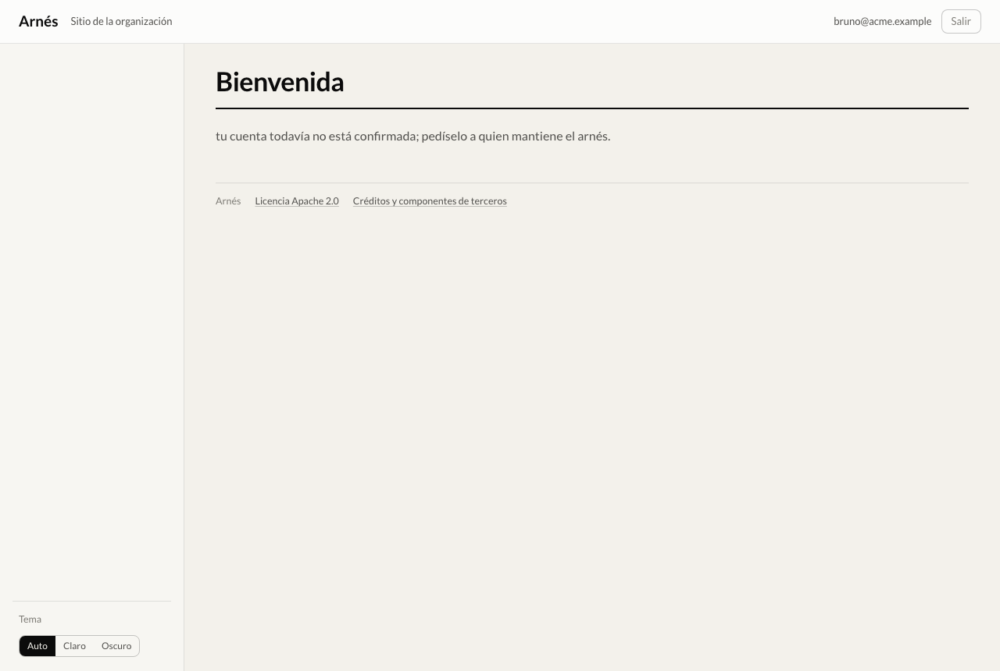

**Your machine, not confirmed yet.** Each team machine uploads its runs with the git email of whoever uses it. A
maintainer has to confirm that the machine is yours. Until they do, only maintainers see your runs; you still get in,
if you are in the list, and see the rest. Ask whoever maintains the harness (if you do not know
who, whoever sent you the link or whoever installed the harness on your machine). They confirm it in Configuration, the
change goes in (by itself or when someone approves it, depending on the organization), and from the next refresh on (at most 15 minutes later) you see your own
things.

## The tabs

On the left is the menu, with the numbered tabs. Each tab answers a question.

**"Not measured"** (*no medido*). A gray, striped card says **not measured** and the reason, for example "there is no
snapshot of this source". "Not measured" is not zero and not green: it means that today that piece of data could not be
known. If a card stays like that for more than a day, tell a maintainer: the reason says what is missing. Some cannot
be measured from the site and always say so (for example, "Pending retrospectives": they live on the machine of whoever
merged); those do not need a notice.

### Home (Inicio)

**What it answers:** what is waiting for a decision of mine today?

For **a maintainer** it is "What to decide today": one card for each thing the night can bring. Each has a label
(**Decide**, *Decidir*, in yellow if there is something; **Nothing**, *Nada*, in green if there is not; **Not measured**
if it could not be known), a count and the date of the snapshot it came from ("source of"). Some carry the "where it is
decided" link (*dónde se decide*); the others are decided in the operations repo, where the night left its snapshot.
The cards are:

- **Dependencies:** the new ones with a vulnerability, the accepted ones not fixed yet, and the rejected ones without a
  declared debt (a date to pay it).
- **Watcher:** what the production watcher (a process that looks at the products in production) left pending, or
  accepted without a story.
- **Pull requests open more than two days** and **requests closed with the vulnerability alive**.
- **Red suites** and **red bench cases tonight:** the harness tests and the harness controls that turned red last
  night.
- **Declared data about to expire:** numbers someone wrote down by hand with a date to review them.
- **Unconfirmed machines with runs** and **pending retrospectives**.

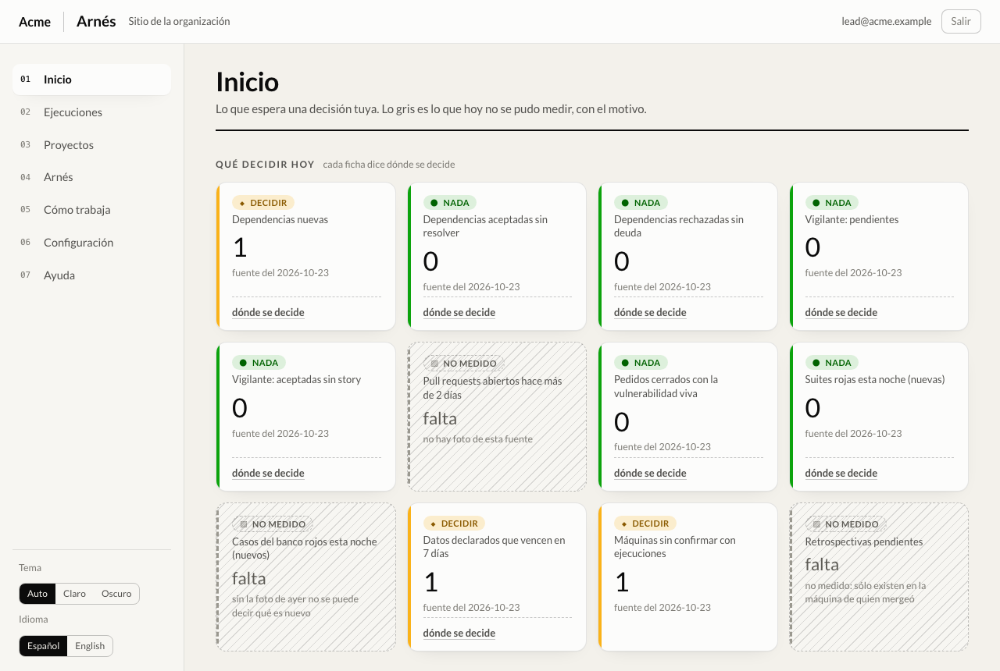

For **a person** it is "Your things" (*Lo tuyo*): their runs of the last 7 days (with a link to Runs), their open change
requests, what is assigned to them (up to a day behind, since it comes from the night snapshot) and their projects.

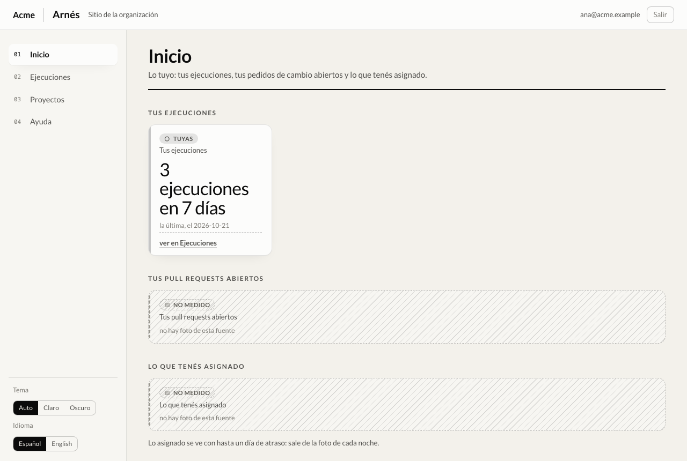

**What to do:** a card in Decide is resolved where its link says, not on the site. Once it is resolved, the card turns to
Nothing with the next night's snapshot.

### Runs (Corridas)

**What it answers:** how are the pipeline runs going? Where did the time go, and what did the controls find?

At the top, the scope: how many runs were read and from which machines. Then "What to look at first" (*Lo que se mira
primero*) explains the two outcomes of a control: **found an error** (*encontró un error*: a test or the build did not
pass and was fixed right there) and **stopped** (*frenó*: the control did not let something through). Both are the
control doing its job, not a problem. Next to each median, **n=** says how many runs the number comes from.

Below there is a **filter** (dates, product, machine, only runs with measured usage, only runs that reached the last
step) and cards with the filter's numbers: how many reached the end, how long a run takes, in how many a control found an
error, how many agents were launched and how much was used. Maintainers then see the three Runs cards from the night
dashboard: how long a run takes and how many steps it has (medians), and how many times a control blocked.

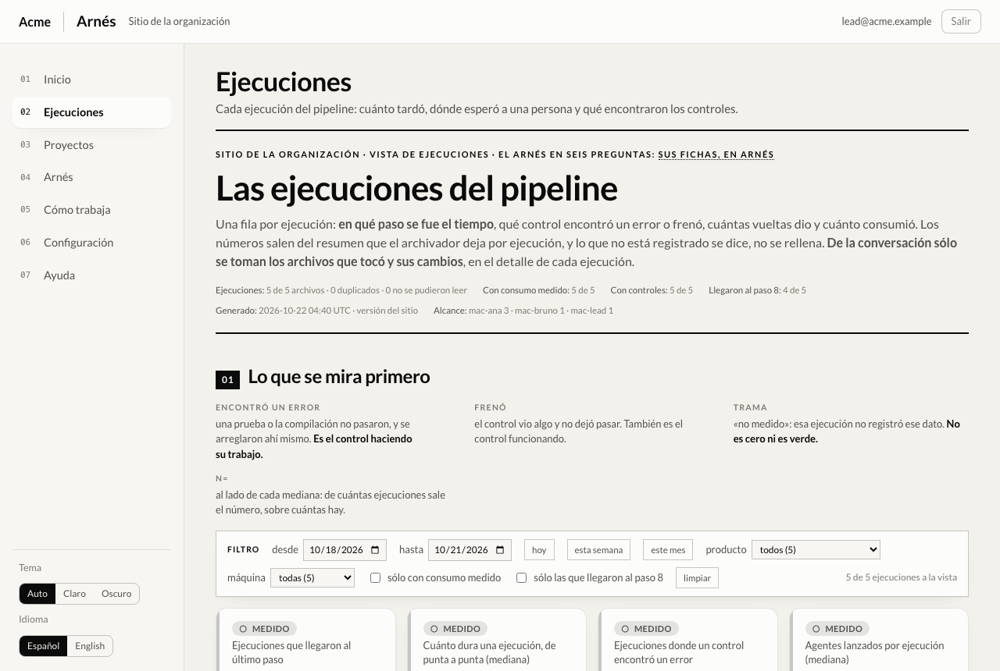

Further down is **"Run by run"** (*Corrida por corrida*): one row per run, newest first. Each row's bar splits the time
among the pipeline steps, with the legend's colors: 0 Start, 1 Validate the story, 2 Build the plan, 3 Approve the plan,
4 Implement and run the tests, 5 Reviewers, 6 Findings: the report, 7 Findings: the decision and 8 Prepare the commit.
"No mark" (*sin marca*) is a stretch the run did not record.

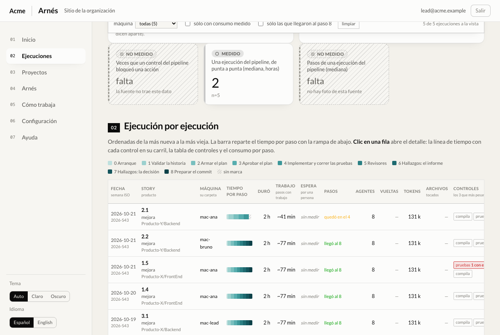

**Clicking a row** opens its detail: the timeline with each step and each control in its lane, what the controls found,
the reviewers that ran, the token usage per step and the files it touched. The timeline legend: a **green circle** means
the control looked and let it through; a **red triangle**, that it found an error; a **black square**, that it did not
let it through; a **dotted circle**, that how it came out was not recorded; an **orange line**, that another round of
reviewers starts; a **vertical bar**, a step marked together with the previous one; the **gray**, the time between
steps; and an **orange box**, the time waiting for a person (an unanswered question). If the detail shows a command to
run, it is for whoever maintains the harness. The files show only if the
organization chose to download the conversations ("Run conversations" section, *Conversaciones de las corridas*).

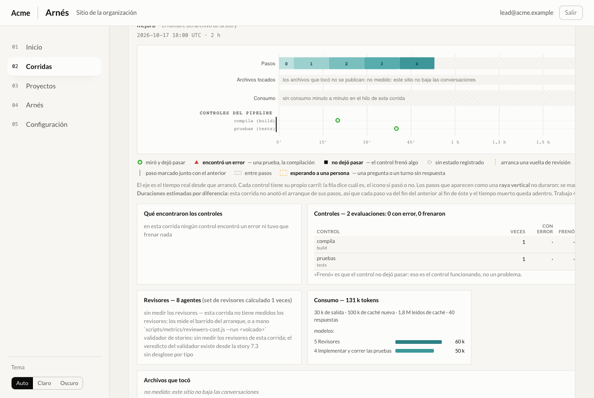

**What to do:** a run that "stayed at 4" (*quedó en el 4*) may be in progress or abandoned; its detail says how far it
got. A person sees only the runs of their confirmed machines; a maintainer sees them all.

**After a restart** (a deployment, or the site that switched itself off for lack of use), the tab shows the last saved
view, with the date it is from, while the mailbox is downloaded in full again; a banner says so and the page catches up on
its own. Each run's changes come back when the new view finishes building. The saved view lives on the site's disk
(`SITE_DATA_DIR`): **with no disk**, after a restart the tab waits for the first full download.

### Maintenance (Mantenimiento)

Only for **maintainers**: what the night found, ordered by who has the ball. Next to the name, in the menu, goes how
many findings wait for your decision, for example "Maintenance (12)"; with none, just the name. The screen has three
blocks:

- **Your decision**: what the production watcher and the review of the runs found, and the pending package
  vulnerabilities. Production first, because those are real customers. Within each group, first what the analysis
  recommends fixing, then what it recommends archiving, and last what has no analysis; packages, the most severe first.
- **Waiting for approval**: what you already sent and someone else has to approve, grouped by pull request, with its
  link. Once approved, it is applied that night. If the platform does not answer, a sentence says so and the findings
  stay to decide, but nothing is sent until it answers: that way no duplicate pull request is opened.
- **In progress** (closed at first): what was already decided and someone is doing, with its work item number and who
  it is assigned to, and the package vulnerabilities. Each team follows its own in its work item and, if it cannot
  update the package, declares the debt in its repo, with a deadline.

A package vulnerability is decided with **Accept** or **Reject**. Accept merges its pull request, which upgrades the
package. Reject closes it and asks for a one-line reason, which stays as a comment on the pull request and in the
finding. A finding without a pull request is decided too: Accept moves it to be fixed in its work item and Reject records
it. The night applies it, and only if the pull request is still the finding's. If it could not, the morning summary says
so and the row comes back to "Your decision" with the reason. The work item type does not change.

Each card says **what happened** with the finding's data, for example "It happened 4 times, from 21/10 to 24/10". With
an analysis, it says **why** it happens, what it **recommends** and what fixing it would do, and whether the night's model
or a person wrote it (the analysis is in Spanish). Without one, it says why, and the buttons stay behind "Decide without
analysis".

**Archive** means "this is normal, nothing to touch". **Fix** means the night creates a work item to correct it. You
mark an option on each card (or "Follow the recommendations" for all the analyzed ones) and then **Send for approval**:
it opens a single pull request to the operations repo with all your choices. Nothing changes until someone else
approves it. Your marks stay saved in the browser until you send or clear them. Each term has its "?" with the
explanation.

### Projects (Proyectos)

**What it answers:** how is each product doing?

One row per product: the stories in progress (and how many in review), the stalled ones, their age in state («more than
30 days: 2 · more than 60: 1»), the blocked ones, which version is in test and which in production, whether it is
waiting for an approval, whether the watcher looks at it, its live vulnerabilities and how it compares with the other
products (parity). At the bottom, the total without counting shared things twice. A person sees the products they work
on. **Parity** compares each product with the others: what one does and the rest do not.

A story is **stalled** when it is in progress and has been in its state longer than the first of the two days in
`params.edad_en_estado_dias` of `sources.json` (for example `[30, 60]`); the age counts what has started, in progress
and blocked, against both. It is the same count as the night dashboard's age card. Without those days, stalled and age
say «not measured» with their reason: the site has no number of its own.

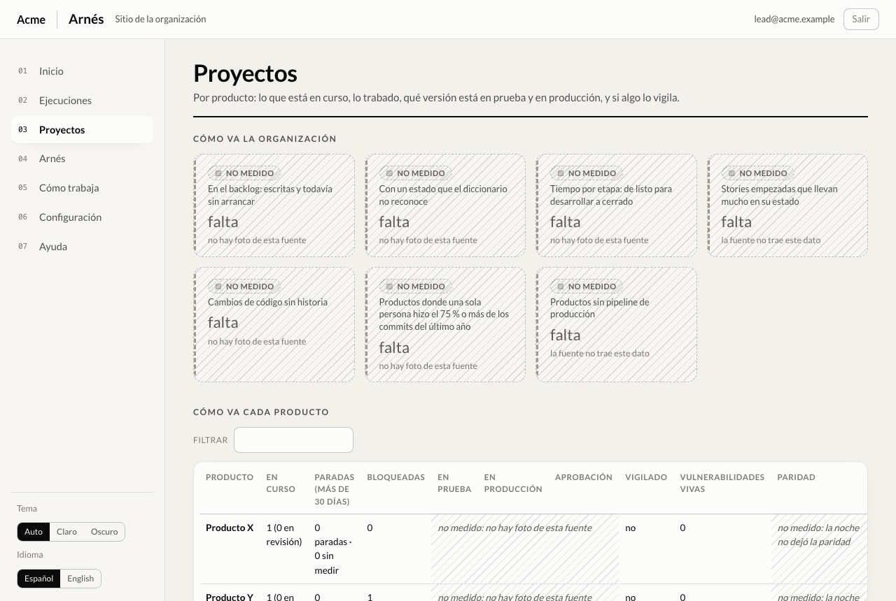

Maintainers also see, above the table, «How the organization is doing»: the night dashboard cards that are about the
whole organization (see «The dashboard cards»).

Further down, **Estimates** (*Estimaciones*): per product, one row per story repo and epic, with the range the epic was
given, the plan total, the current total (each story's adjustment, or its plan) and the actual hours of what was
closed; at the end, the product total. An epic whose current total falls outside its range is marked with how much
(«above by 25 h»). A repo without a log says «no estimates»; an old snapshot, or one from before estimates, says «not
measured». How to estimate: `guides/estimates.en.md`.

**What to do:** a stopped or blocked story gets unstuck in its repo, with its team; the site only shows it.

### Harness (Arnés)

**What it answers:** do the harness controls work? Only maintainers see it.

It shows whether each night snapshot arrived on time, how many cases of the **controls bench** (tests that confirm each
harness brake stops what it has to stop) and how many **test suites** (the harness's own tests) came out red, the
**reviewers' exam** (whether the automatic reviewers keep finding what they have to find), and the harness version the
site runs. Below, the night dashboard cards, grouped by their questions (see «The dashboard cards»).

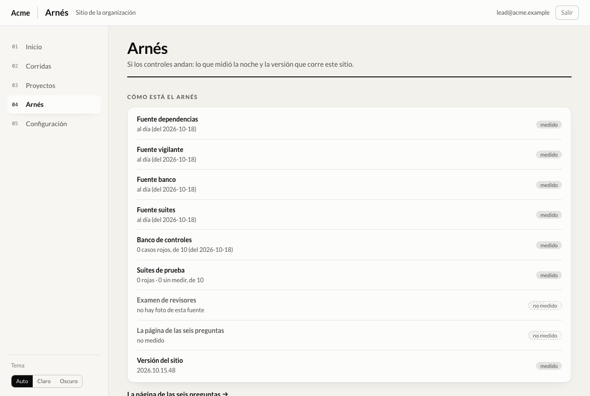

**What to do:** a snapshot that did not arrive or a new red is looked at in the night process that produced it.

### The dashboard cards

The night dashboard measures the harness and the projects in six questions. The site shows those cards in their tab,
with the same number as the dashboard: Harness groups them by question, and Projects and Runs put them in a grid above
their table. There are 26, all of them about the organization: only maintainers see them. A person sees
their tabs as before.

**In Harness (Arnés):**

- **Per-merge records that meet the format contract** (`contrato_v2`). Whether the records written when each merge closes are machine-readable.
- **Per-merge records with a date declared inside** (`fechas_declaradas`). A date inferred from the file name sorts, but it can't be used to draw a trend.
- **Closed stories that left proof it works at runtime** (`dod`). Of the closed stories, how many left evidence that they were tested live.
- **What comes back: stories with a later follow-up** (`rework`). How much of what was delivered had to be touched again.
- **Why it came back: our defect vs. a requirement change** (`rework_por_causa`). Separates what came back because of our mistake from what came back because what was asked changed.
- **Does what went through the pipeline come back less?** (`rework_por_carril`). Compares, per repo, rework with a pipeline record against rework without one.
- **Mutation score: share of mutants the tests kill** (`mutacion`). Whether the tests break when the code is broken on purpose.
- **Test runs that evaluated the 75% threshold on the changed lines** (`cobertura_tocada_evaluo`). How many times the coverage of what was touched was actually measured.
- **Closed stories that needed a manual testing guide, and had one** (`qa_guia`). The bridge between automated tests and a person who tests.
- **How long verifying takes: duration of the test suite** (`gates_dur`). A suite that takes hours is not run before committing: it gets skipped.
- **Pre-tool brakes: how many times they stopped something and how many times they were skipped** (`frenos`). The two numbers of the same rule together: without the first, a brake that worked looks useless.
- **Closing hooks: decisions that rejected a piece of evidence** (`evidencia_cierre`). How many times the brakes that prevent closing without evidence rejected it.
- **Escapes concentrated in a single rule** (`escapes_regla_dominante`). Whether what escapes the controls comes almost entirely from a single rule.
- **Rules that are candidates for retirement: tested, never found anything** (`reglas_candidatas`). Rules that can turn red but never found anything, despite plenty of mileage.
- **Rules the test bench actually tested** (`reglas_probadas`). A rule without a test that forces it to fire is not judged: it shows as "not tested", never as a candidate.
- **Commits per lane: pipeline, declared shortcut or none** (`carriles`). How many commits went through the pipeline, how many through a declared shortcut and how many through none.
- **Machines with an active rollback: they do not update on their own** (`vueltas_atras`). How many machines undid an update and hold it back until a later version comes out.

**In Projects (Proyectos):**

- **In the backlog: written and not started yet** (`backlog`). How many stories are written and not started.
- **With a status the dictionary does not recognize** (`estados_sin_diccionario`). The statuses nobody translated: they are the work list for the next dictionary.
- **Time per stage: from ready for development to closed** (`tiempo_por_etapa`). Where work stalls between one stage and the next.
- **Started stories stuck in the same status for a long time** (`edad_estado`). Started work that has not moved for days.
- **Code changes without a story** (`sin_historia`). Changes that reached main in the last 28 days without naming their story. Only measured: it blocks no one.
- **Products where a single person made 75% or more of last year's commits** (`bus_factor`). The engineering risk is not the code: it is the only person who knows how to change it.
- **Products without a production pipeline** (`sin_pipeline_de_prod`). It is not quality: it is exposure. For them "deployments" is zero because there is nowhere to look.

**In Runs (Corridas):**

- **Times a pipeline control blocked an action** (`bloqueos`). How many times a control actually stopped something.
- **A pipeline run, end to end (median, hours)** (`corridas`). How long a full run lasts.
- **Steps of a pipeline run (median)** (`pasos`). A run's cost depends on how many steps it takes: that is the variable that explains it.

**How to hide one.** In Configuration, section «Notices and night runs», «Cards the site shows» has one checkbox per
card. Uncheck the ones you do not use and propose the change: it goes to `operations.json` in the operations repo
(`site.hidden_cards`). A hidden card is not built and does not reach the screen, and Harness says how many are hidden.

#### What is not measured yet

A card without its source shows **not measured**, with the reason and the date of the last snapshot; never zero. Today
they depend on sources that are not always there:

- The story contract and declared dates need the records of the night capturer.
- Process improvement, rework, backlog and time per stage need the night stages snapshot; age in status also needs the
  per-project snapshots.
- The quality and control ones (mutants, coverage, tester guide, brakes, escapes, lanes) and the three in Runs come from
  the runs mailbox: without a read mailbox, they stay not measured.
- Bus factor needs the declared products (`repos.json`), and products without a production pipeline need the declared
  pipeline debt.

If the card calculation fails, every card says so with its own reason: «the card calculation failed».

### How it works (Cómo trabaja)

**What it answers:** what does the agent do with a story, step by step, in this organization? Only maintainers see it.

At the top, **Your organization**: the integrations that are on and off (crossed out), the active reviewer packs and the
rules (how tests are named, which screens need an end-to-end test, which language the app uses). Below, the steps of the
run in order, and apart the two that are outside the main path (another round of reviewers and the closing in Azure
DevOps). Choosing a step shows:

- **Guides it cites:** the step file and the guides it names.
- **Depending on the story:** what is added only for some stories, with its condition. For example, for a story that
  touches a screen: the mockup in "Draft the plan", its approval in "Approve the plan", and the browser test, the
  screenshots and the readability review in "Try it live".
- **Reviewers:** the harness ones, grouped by when they join, and the ones from each pack, with their condition.
- **Checks:** the ones that block, warn or only record in that step. At the very bottom, the ones that act at any step.

Each piece says whether it belongs to the **harness** or to **your organization**. What depends on an integration that
is off shows as **off in your organization**.

Everything comes from what the harness runs on: the step table, the reviewer selection, the list of checks, the
detectors that decide each piece, and your organization's profile. When one of those sources changes, the tab changes
by itself.

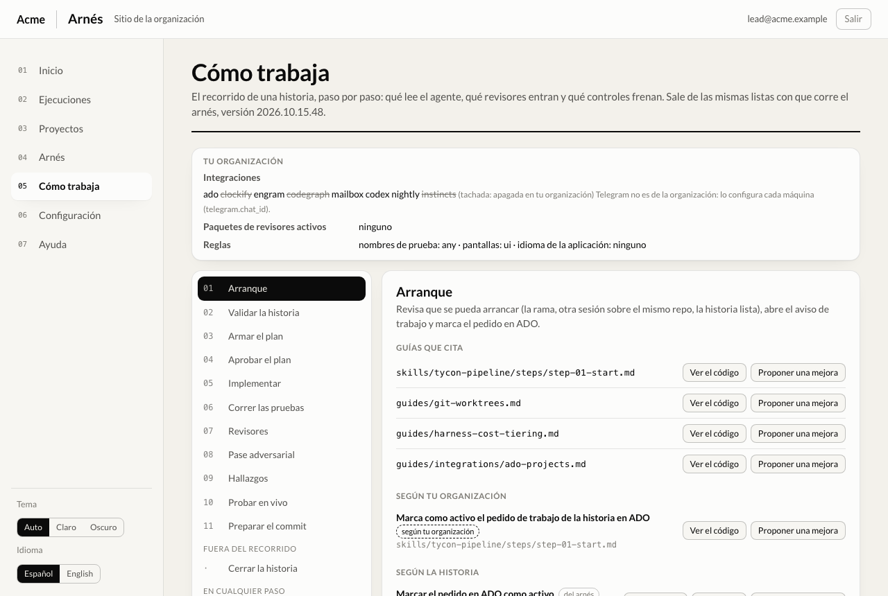

**Improving a harness piece.** The harness is not edited from the site. "View code" opens the file in the public repo;
"Suggest an improvement" opens a box where you write, in your own words, what you would change and why. "Open the
request on GitHub" opens a new request in the public repo with your text, the piece, the step and the version already
written: you send it with your own GitHub account. The site keeps no key for this.

**Editing a reviewer of your organization.** The reviewers of the packs that live in the profile repo have "Edit", and
each pack has "+ Add reviewer". You change the name, when it joins, what the change has to touch, which files it looks
at, the prefix of its rules and its instructions. "Check" runs it through the same reader the harness uses to load packs:
if something is wrong, it says so and "Propose" stays off. "Propose" opens a single request to the profile repo with the
pack and the reviewer's instructions, and another maintainer approves it, as in Configuration. Removing a reviewer is
done by hand in the profile repo.

**What to do:** if a piece is unclear or something is missing, "Suggest an improvement". If a pack of your organization
says it cannot be used, it is fixed by hand in the profile repo: until then the harness does not load it either.

### Configuration (Configuración)

**What it answers:** how is the organization configured, and how is it changed? Only maintainers see it. The next part
goes through it section by section.

At the top there are four cards: machines to confirm, sections with something to fix, sections up to date, and machines
with an old harness version or "no news" (*sin noticias*: they have not sent runs for a while, so their version is not
known). Below, five tabs: **People** (*Personas*), **Repos and products** (*Repos y productos*),
**Notices and night runs** (*Avisos y la noche*), **How the agent works** (*Cómo trabaja el agente*) and **Installation and
updates** (*Instalación y actualización*). A number next to a tab says how many things are waiting there.

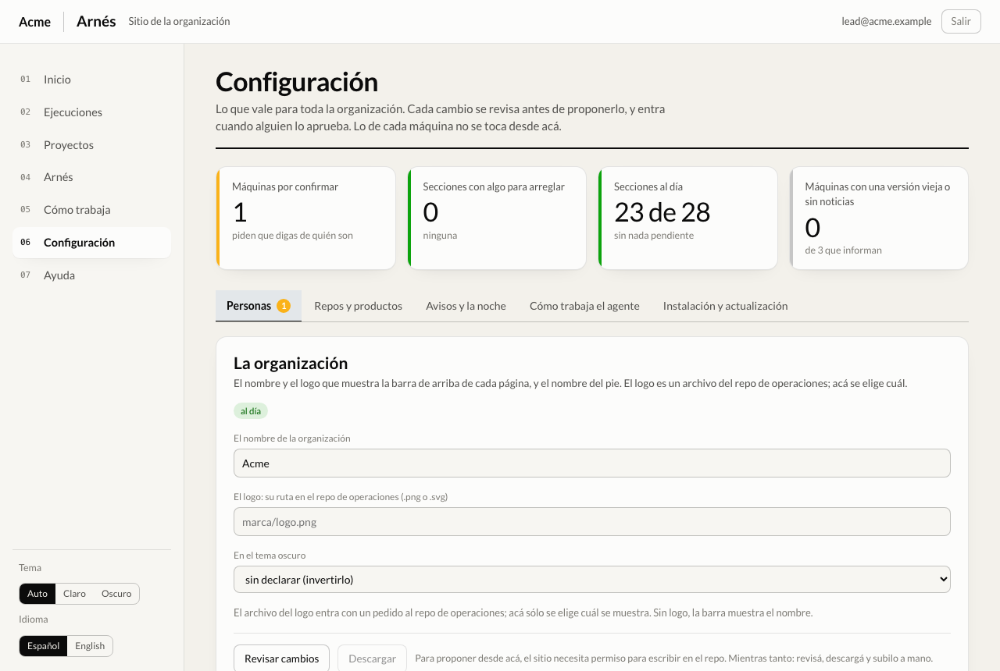

## Configuration, section by section

Each section is a part of a configuration file that lives in an organization repo: the **operations repo** (the night's
and the site's things) or the **team profile repo** (what reaches each machine). Each one says at the top right how it
is: **up to date** (*al día*), **to confirm** (*por confirmar*), **not configured** (*sin configurar*), **view only**
(*sólo para mirar*), or **reviewed** (*revisada*) while you have a reviewed change not proposed yet.

**The cycle of a change.** Nothing is written directly. You change a section's fields and press **Review changes**
(*Revisar cambios*): the site validates the change with the same rules the harness uses and says "Reviewed: it is well
written" (*Revisado: está bien escrito*) or what is wrong. Then **Propose the change** (*Proponer el cambio*) shows,
at the top, a plain-language summary of what changes ("You add x@acme.example as dev in Who gets into the site",
"You change "Character limit" from 1300 to 1500") and, below it, only the lines that change, with three lines of
context: what goes out is red with a `−`, what comes in is green with a `+` (the sign is there so it reads without
relying on color), and the unchanged stretches are folded into "… N unchanged lines". **See the full files** (*Ver los
archivos enteros*) opens both files in full. The file is written in a format with braces and quotes; you do not need to
understand it: check that the only thing that changes is what you changed. **Confirm and propose** (*Confirmar y
proponer*) opens a change request (a pull request) in that section's repo, and the section shows the link to the request.
It is sent only once: while the site works, the section's buttons and fields are switched off, and each proposal
carries its own mark, so a double click does not create two requests. If the response is cut off (the network, a site
restart in the middle of the request), the page does not show the error right away: it checks up to three times, after
2, 5 and 10 seconds, whether the request for that proposal exists, and shows its link if it does. Only when it finds
nothing does it show the error, which asks you to reload and check whether the request was opened before repeating it.
The page never resends the proposal by itself.
Someone on the team reviews it and merges it.

You do not need to reload the page. While the request is open, the page asks every 10 seconds whether it went in, for
up to 10 minutes; with the tab hidden it stops asking and resumes when you come back. When the request goes in or is
closed, the site rereads the repo and the page takes the new version. If, while you were editing, someone changed
**another part** of the same file, your change is put on top of the new version and the difference shows it before you
confirm again. If they changed **the same thing** as you, the section shows each value with both versions: **Keep
mine** (*Quedarme con el mío*) or **Take the current one** (*Tomar el de ahora*), and what you entered is not lost. A
list counts as a single value: if you both touched the same list, you choose the whole list. If you reload the page with
something not yet proposed, the section offers **Recover what you were entering** (*Recuperar lo que estabas
cargando*). What you entered lives in your browser while the tab is open and never goes to the site. In a browser that
does not allow storing it (a private window, for example) the page works the same, without that offer. The accepted
differences between products are not merged: if their file changed, they ask you to reload as before.

**Download** (*Descargar*) downloads the changed file, for when the
site cannot propose: you hand it to whoever has access to that repo, who uploads it with a change request.

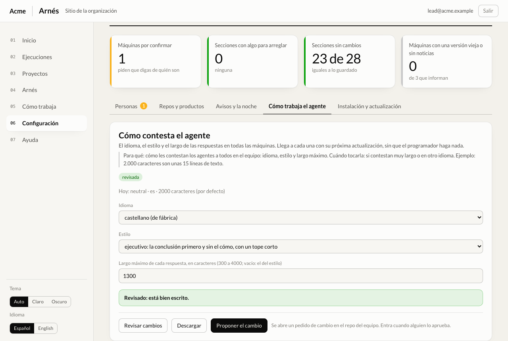

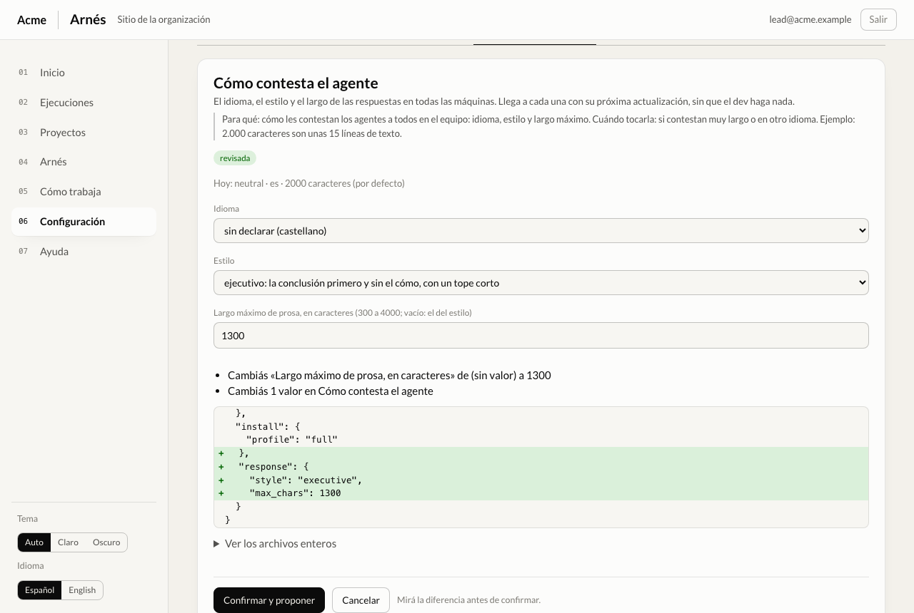

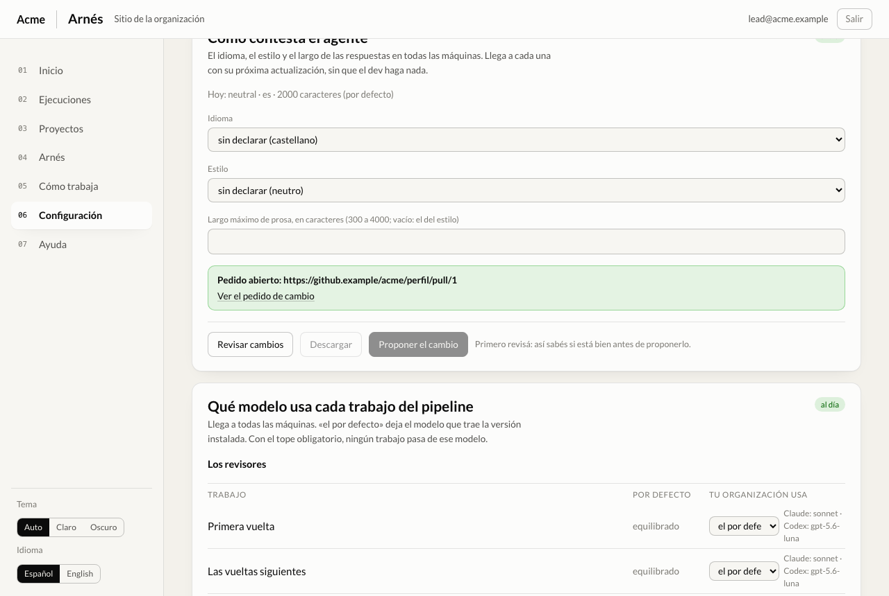

**What shows as "view only".** Some sections are shown without being editable, and they say why. For example, "Azure
DevOps" when the profile repo lives on GitHub, a section that the harness version the profile asks for cannot read yet
(the section says which version to ask for), or the thresholds while the night does not read the organization's file
yet. To change them, first do what they say.

The sections, in the order of the screen:

### People (Personas)

- **The organization** (*La organización*): the name and logo shown in the top bar and the footer. It lives in
  `operations.json`, in the operations repo. A maintainer reviews it.
- **Who gets into the site** (*Quién entra al sitio*): the list of who gets in and what they see, one row per person,
  with their role ("Maintains the site", *Mantiene el sitio*, or "Dev") and one or more emails. Nobody gets in if they
  are not here, with any sign-in. Maintainers see the Configuration tab and propose changes; devs see their own things.
  A person gets in with any of their emails and sees the same. To add someone: Configuration, in People, "Who gets into
  the site" → **+ Add person** (*+ Agregar persona*), their email and their role; it is done here, without the Microsoft
  portal. For someone from outside the organization's directory, **Invite** (below, "Inviting someone") adds them and
  sends them the Microsoft invitation. The first time, the section brings the list built from what there was before (the maintainers and each person
  with a confirmed machine) and warns that it is not saved yet: it is saved when you propose it. If someone leaves the
  list, as soon as the request is approved and the site refreshes (at most 15 minutes), their next page is "Your
  account is not in the list", with no data. Above the list you see how people sign in to the site; that is changed at
  installation. The runs mailbox, the refresh and the site's address go here too. It lives in `operations.json`, in the
  operations repo. Another maintainer reviews it. **"How often the site updates"** (*Cada cuánto se actualiza el
  sitio*) takes 5 to 120 minutes; undeclared, 15. Shorter, a change shows sooner, but the site reads the operations
  repo, the profile repo and the mailbox again more often while it is awake: more reads to the cloud, which cost a bit
  more on an installation billed by use. It does not keep it awake: asleep it reads nothing, and on waking it reads
  everything.
- **How often the site rereads its data** (`site.refresh_minutes`, also in "Who gets into the site"): how many minutes
  pass before the site reads again the configuration (this operations repo), the runs mailbox and the team profile. It
  goes from 5 to 120 minutes; if you do not declare it, it is 15. It does not install versions: that is "How the site
  updates", in Installation and updating.
- **"A maintainer's changes"** (*Los cambios de un mantenedor*): whether a change proposed by a site maintainer goes in
  by itself, or stays as a request for another person to approve. It is off by default: undeclared, the request stays.
  The organization's rule turns it on ("The branch policy of the operations repo", below).
  On ("yes", `site.auto_apply` in `operations.json`), "Propose" opens the request, approves it with the site's identity
  and completes it; right after, the site reads the repo again and the section says "Applied" (*Aplicado*). It only
  happens if the main branch's policies are met with that vote: if they ask for more (another reviewer, a named
  reviewer, a build), the site says what is missing and leaves the request to be approved. On GitHub, where whoever
  opens a request cannot approve it, the site does not vote: it merges directly if the repository lets its identity
  bypass the review, and if it requires someone else's approval it turns on auto-merge and the change goes in as soon as
  someone approves it; if the repository does not allow auto-merge either, the request stays. Before proposing, next to
  the button, the section says what will
  happen. Who did it stays written: the request's description names who asked for it, and the site's log records
  `cambio aplicado: <file>, pedido <link>`. What counts is the option already in the repo: the change that
  turns it on is left to be approved like any other, and only after that do changes go in by themselves. It lives in
  `operations.json`, in the operations repo.
- **"How the site is updated"** (*Cómo se actualiza el sitio*): whether the site brings itself up to date with the new
  harness version or only notifies (`site.update` in `operations.json`). Undeclared, notice only. Automatic needs the
  update nightly and its permission: the recipe, in "How it keeps itself up to date".
- **People and machines** (*Personas y máquinas*): whose each machine that sends runs is, and which projects each
  person works on. A new machine shows up in "To confirm" (*Por confirmar*) with the email it claims; **Confirm**
  (*Confirmar*) puts it in that person's name. It lives in `operations.json`, in the operations repo. A maintainer
  reviews it.
- **Who gets the notices and the requests** (*A quién le llegan los avisos y los pedidos*): who gets assigned what the
  night finds (an old dependency, a watcher finding). It lives in `operations.json`, in the operations repo. A
  maintainer reviews it.

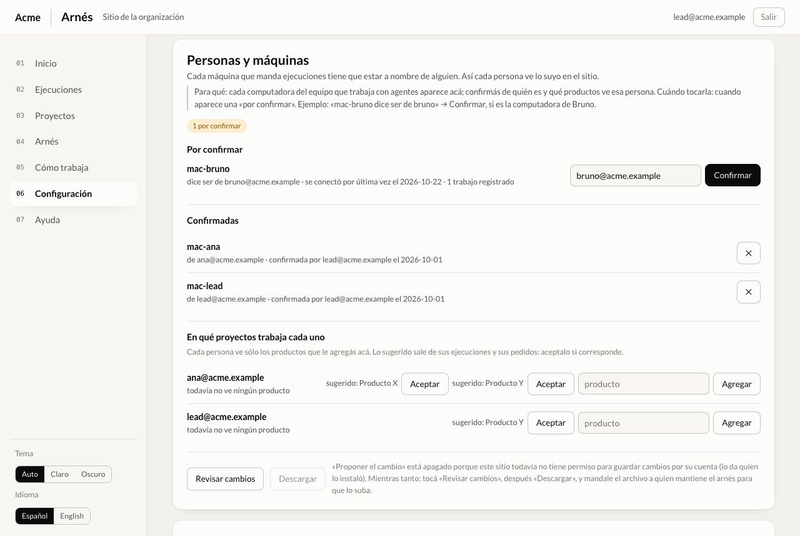

### Repos and products (Repos y productos)

- **Where each repo lives** (*Dónde vive cada repo*): where the harness, the team profile and the operations repo are.
  It reaches every machine. It lives in `team-repos.json`, in the profile repo. Whoever maintains the harness reviews
  it.
- **Each product's deployments** (*Despliegues de cada producto*): which step of each pipeline is test and which is
  production, so that Projects says which version is out. It lives in `operations.json`, in the operations repo.
  Whoever knows the product's pipelines reviews it.
- **Accepted differences between products** (*Diferencias aceptadas entre productos*): what a product does differently
  on purpose, with a date to look at it again; the night does not count it as a difference. It lives in
  `scripts/ci/product-parity.json`, in the operations repo. Whoever maintains the harness reviews it.
- **Azure DevOps**: the team's Azure DevOps organization. It reaches each machine. It lives in `team-profile.json`, in
  the profile repo. Whoever maintains the harness reviews it.

Below are **Products** (*Productos*: the ones the night checks) and **What the organization provides** (*Lo que trae la
organización*: the skills, reviewers, onboarding guides and packs of the profile repo, each with its link). They are view
only: they are changed with a request in their repo.

**The configuration of each repo** (*La configuración de cada repo*) shows, for each product repo, what the
`.tycon/advisors.yaml` of its main branch says. The repos are those of the dependency review and of `team-repos.json`,
without the public one, the profile repo or the operations repo. Each repo is read only when you open it. Today it edits
the **deprecated code** (`deprecated`): the old folders or files the agent must not copy or touch without a reason. It
goes row by row: path, level (frozen or dead), reason and a date to review it; on top, whether editing deprecated code
without a story warns or blocks. "Review changes" validates with the same reader the harness uses: a badly written row
says what it is missing and is not proposed. A row whose path no longer exists on the main branch, or whose date has
passed, is marked, but it can be proposed anyway. The request changes only that block of the file: the other keys and
the comments stay as they are. Without the file, the request creates it. Whoever maintains the site proposes it, with
`SITE_PRODUCTS_WRITE_TOKEN` (below); without that secret, the section shows what is declared and the file as it would
be, to copy it and open the request by hand.

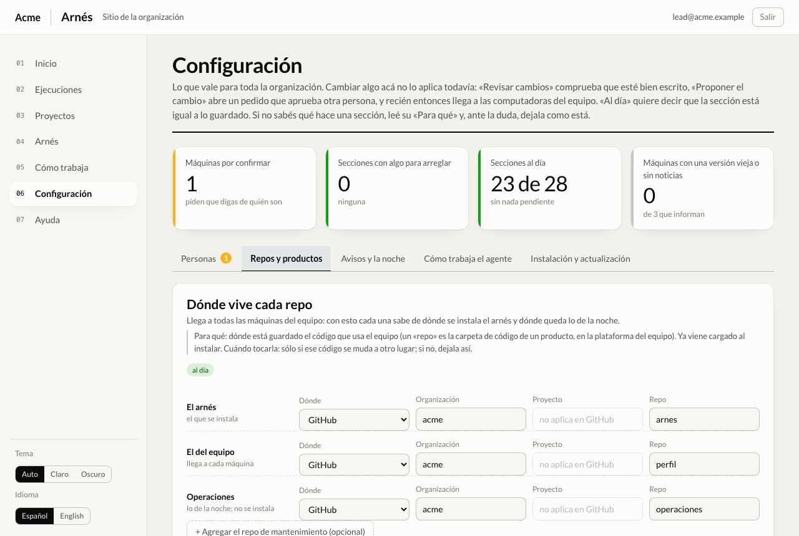

### Notices and night runs (Avisos y la noche)

- **Where the morning summary is sent** (*Dónde llega el resumen de cada mañana*): the notice channel, chosen from a
  list (Telegram, Slack, Teams, email or none); with email, the sender and the recipients. The chat, the channel address
  or the email password do not go here: they are secrets of the nightly processes. It lives in `operations.json`, in the
  operations repo. A maintainer reviews it.
- **Waiting notice** (*Aviso de espera*): whether the notice runs and how many minutes a run waits for a person before
  giving notice. It reaches every machine. Empty, it runs, as by default; "Off for every machine" turns it off, except
  on a machine that set `TYCON_WAIT_NOTICE` (the variable wins). It lives in `team-repos.json` → `wait_notice`, in the
  profile repo. A maintainer reviews it.
- **Thresholds: when something is painted green or red** (*Umbrales: cuándo algo se pinta verde o rojo*): the limits
  the dashboard uses to color each number; in between, yellow. It lives in `scripts/nightly/dashboard/sources.json`, in
  the operations repo. A maintainer reviews it.
- **Cards the site shows** (*Fichas que muestra el sitio*): one checkbox per card of the night dashboard that the site
  shows in Arnés, Proyectos and Corridas. Untick the ones you do not use: they stop being built and shown, and Arnés
  says how many are hidden. It lives in `operations.json`, in the operations repo (`site.hidden_cards`). A maintainer
  reviews it.
- **Work items** (*Pedidos de trabajo*): where and how the night requests work. At the top, the **organization** and
  the **project** that receive the work items of the run review and the watcher; if one is missing, the section says
  which one and that the night will not request work. Then, in a box, the **type** (empty, each project uses its
  backlog item) and the **fixed fields**. Below, **by severity**, a table with one row per field and one column per
  severity (critical, high, moderate and low); its values win over the fixed ones when the field matches. The fixed
  fields and the table apply to vulnerabilities only, and the section says so. With an organization and a project, the
  site reads the types, each type's fields and their allowed values from that project; without them, from the
  products' projects: each field shows its name (with its reference name, like `Microsoft.VSTS.Common.Priority`, underneath) and
  each value is picked from a dropdown. Values that start with a symbol, such as a colored circle, are shown without it
  and saved exactly as Azure DevOps accepts them. A field without fixed values is typed in. Without the work item read
  permission, or if Azure DevOps does not answer, a notice says why and everything is typed in by its reference name. A
  field's ✕ removes it (from all four severities, in the table) and can be undone until you save. The title, text, tags
  and assignment are set by the harness and cannot be changed here. "Review changes" validates it with the same reader
  the night uses: a field the harness sets, a value that is empty, starts with "@" or has a line break, or a severity
  that is not one of the four, is marked on its field and not proposed. A project without the chosen type uses its own,
  and the morning summary says so. It lives in `operations.json`, in the operations repo (`work_items`). A maintainer
  reviews it.

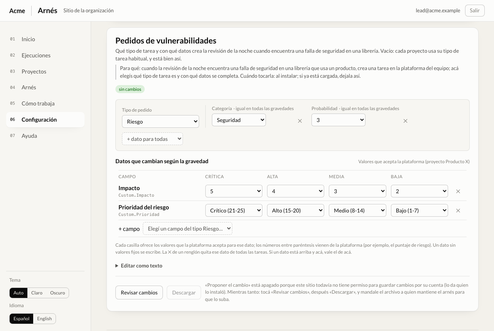

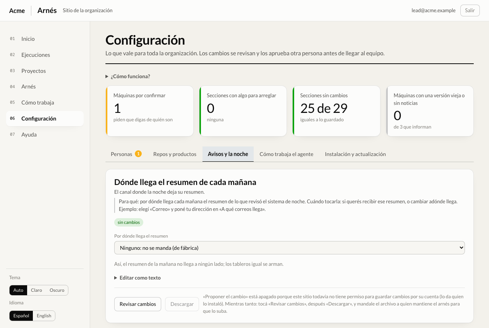

### How the agent works (Cómo trabaja el agente)

- **How the agent answers** (*Cómo contesta el agente*): the language, style and length of the answers on every machine. It
  lives in `team-profile.json`, in the profile repo. A maintainer reviews it.
- **Which model each pipeline job uses** (*Qué modelo usa cada trabajo del pipeline*): the model of the reviewers, the
  adversarial pass, the helpers and the session, as a level, in one table per group with each job's default next to it;
  «the default» keeps the one the installed version comes with. There are four levels, written in the file as
  `economy`, `balanced`, `strong` and `max` (the Spanish page shows económico, equilibrado, potente, máximo). Each provider translates them to its own models,
  and a small line next to each selector says which: «Anthropic: sonnet · OpenAI: gpt-5.6-luna · Ollama: the dev’s · Cursor: the dev’s». A configuration saved with
  Claude's names (sonnet, opus) still works: it shows as levels and the next change to the section saves it as levels.
  With levels, the profile has to require the harness version that reads them; otherwise the site does not let you
  propose and says which one to require. With the required ceiling, a job set above the ceiling is marked in red and
  the change cannot be proposed. Below the reviewers' general level, each installed reviewer, grouped by pack, with the
  level it uses today, where it comes from (the first round, its own, or changed by the organization) and its dropdown;
  «like the first round» lets it follow the general level. The list comes folded and opens by itself if the
  organization changed any. It lives in `team-repos.json`, in the profile repo. A maintainer reviews it, looking at the
  cost.
- **Which model each level is, by provider** (*Qué modelo es cada nivel, por proveedor*): below the job tables, one
  table per provider (Anthropic, OpenAI, Ollama, Cursor) with one row per level (`models.providers.<provider>.<level>`).
  Jobs still choose a level; this table says which model that level is in each provider, and each machine uses its
  provider's table (`models.provider` in `~/.claude/tycon.json`, or `TYCON_MODEL_PROVIDER`; undeclared, Codex is OpenAI
  and everything else Anthropic). Anthropic's is fixed: each level is its alias. OpenAI's comes with today's models.
  Ollama's and Cursor's start as «the dev's» (`inherit`): with no model loaded, each dev keeps their own. Cursor's is
  saved but not applied yet. Below each table, the provider's **allowed models list** (`models.allowed`,
  comma-separated): with a list, the site does not let you propose a model outside it, and a machine that still gets
  one uses the dev's and warns. With tables, allowed lists or the nightly row, the profile has to require the harness
  version that reads them.
- **The nightly process** (*El proceso de la noche*): one row with its provider (Anthropic or Ollama) and its level
  (`models.nightly`). The model comes from the same table: «today: gemma4:31b-cloud», or «no model loaded for this
  level», which blocks proposing (at night there is no dev, so «the dev's» does not apply). Switching from Ollama to
  Haiku is choosing Anthropic in that row. The row also names the secret variable the nightly pipeline needs
  (`OLLAMA_API_KEY` or `ANTHROPIC_API_KEY`); the key is created in the pipeline and never goes through the profile.
  Without the row, the nightly run does not run.
- **Where the full tests run on merge** (*Dónde corren las pruebas completas antes de sumar un cambio*): on the machine or on the
  server, repo by repo, one row per repo (✎ opens its details). A repo without a full tests pipeline says what happens
  with its rule. It lives in `team-repos.json`, in the profile repo. A maintainer reviews it.
- **Test coverage** (*Cobertura de las pruebas*): the percentage of covered new lines below which the test control gives
  notice (it warns, it does not stop). It lives in `team-repos.json`, in the profile repo. A maintainer reviews it.
- **Reviewer rounds** (*Vueltas de revisores*): how many reviewer rounds a story gets before it stops (1 to 6; empty,
  2). At the cap, a security or data critical is decided by a person and the rest stays as visible debt. You can also add
  rules that count as security or data. A repo can adjust the cap in its `.tycon/advisors.yaml`. It lives in
  `team-repos.json` → `review`, in the profile repo. A maintainer reviews it.
- **Your technology** (*Tu tecnología*): what the harness already recognizes, the file endings your team adds as code,
  the test tools (the built-in ones, and the ones your organization changed or added) and three rules: the test name
  style, which screens need a browser test and the application's language. Without saying anything, the harness does
  not impose any team's style. It lives in `team-repos.json` → `stack`, in the profile repo. A maintainer reviews it. A
  tool that is not on the list is requested with «Ask your agent» (below, §Your technology).
- **Who relays a developer's OK** (*Quién autoriza saltarse un control*): whether the organization works with a
  coordinating session that passes a developer's OK on to the session doing the work, to waive a reviewer's critical
  finding or sign off a criterion that cannot be tested live. «No» (the default): the developer writes the OK in their
  own session's chat. Here you only say yes or no, and it only counts from here, never from a machine. Which session is
  the coordinator is designated on each machine: in that session's chat, the developer writes a sentence that names the
  role and says it is this session, and the session records it with
  `marker.js designate-relay --approved-by "<the developer>" --quote "<their sentence>"`. It is recognized by its
  conversation, not by its name: it keeps counting after the session restarts, and has to be designated again after a
  new chat or a `/clear`. A session with the same name cannot relay.
  Below it is **who signs each thing** (*Quién firma cada cosa*): one row for each signature in the catalog
  (`guides/firmas-del-arnes.md`), with three choices. "In the owner's window" is the default: the owner answers in the
  permission window or signs at their terminal. "Delegated to the coordinator" (`approvals.delegated_signing`) lets that
  session sign it on the owner's behalf, and its sentence is recorded; what is delegated is not protected against an
  agent: if the coordinator decides to approve it on its own, the harness cannot tell it apart from the owner's ok, so
  delegate only low-risk things. "Owner only" (`approvals.owner_only`) locks it: the site does not offer to delegate it,
  and it does not offer it for what cannot be signed from another session's tab either. The fixed notice says so:
  "Loosening a control is always signed by a person, at their terminal; this does not change that." Without a
  designated session, delegation does nothing, and the section warns about it. Delegation applies only on the machines
  in the list below (`approvals.delegated_machines`), named by their fingerprint: the ones the runs mailbox saw are
  added with a button, and another one by typing its fingerprint. By default, on none. All of it counts only from
  here, never from a machine.
- **Hand-testing each criterion** (*Prueba a mano de cada punto*): whether, besides what the harness tests, a person
  has to mark each criterion of the tester guide before the story is closed. «No» (the default): the guide says what the
  harness tested. «Yes»: closing stops until a person marks each criterion by answering in their own session's chat,
  naming it; the harness first shows them what they are about to mark, and neither the agent nor a relayed message can
  mark it. It only counts from here, never from a machine. It lives in `team-profile.json` → `qa.manual_check`, in the
  profile repo.
- **Brakes and meters** (*Frenos y medidores*): which brakes and meters run on every machine. **Brakes** stop a command
  before it runs: the unscoped-tests brake, the two-sessions-in-one-folder brake and the one-pull-request-per-repo
  brake. From here they can only be turned on: "As it comes by default" or "On for every machine"; written by hand,
  "on" in any case or `true` is accepted. Turning a brake off is not done from the profile: it belongs to each machine,
  with its variable (for example, `TYCON_SESSION_GUARD=0`), and an "off" written by hand in the profile is ignored, the
  reader names it and the site does not propose it. The dangerous-command brake and the brake on pull requests to main
  that do not complete on their own are not here: they are always on and can only be turned off on each machine.
  **Meters** (response length and long waits) do not stop anything: they can be turned on or off. Either way, a
  machine that set the variable keeps its own setting. Empty, each one as it comes by default. Beware of any other value
  written by hand (a number, a text that is none of these): the reader does not understand it and treats the whole
  configuration of every machine as broken, not just this switch; the site does not let you propose it. It lives in
  `team-profile.json` → `switches`, in the profile repo.
- **How many sessions work at once** (*Cuántas sesiones trabajan a la vez*): when one session coordinates the others,
  how many can be working at the same time on one machine (1 to 20; empty means 3) before the next one waits its turn.
  Each machine can change it for itself, because how much it can take depends on the machine. The folder where the
  owner's signatures are left belongs to each machine and is not set here. It lives in `team-profile.json` →
  `coordination.max_working`; the whole recipe is in `guides/coordination.en.md`.
- **Integrations** (*Integraciones*): which services each machine uses (the time clock, the memory, the mailbox, the
  night, the CodeGraph code index); a machine can turn one off for itself. With CodeGraph on, the installer sets it up
  for each dev and the harness warns when a machine lacks it. It lives in `team-profile.json`, in the profile repo. A
  maintainer reviews it. The **«Avisos»** (notices) row chooses where the harness notifies (a run waiting for a person,
  the morning summary, the watcher): one or more of Telegram, Slack, Teams and email, or none; not declared, Telegram,
  as until now. With email, the server and its port. It never asks for a credential: each dev's session notices use
  their own (`harness.js config set notify.<key>`, on their machine; Telegram, the machine's bot) and the night ones,
  the server's secret variables (`pipelines/operations/README.md`). Saving the channels also raises the profile's
  `requires.harness` to the first version that reads them.
- **Run conversations** (*Conversaciones de las corridas*): whether the site also downloads what was said in each run;
  with that, the Runs detail shows the files it touched. It lives in `operations.json`, in the operations repo. A
  maintainer reviews it.
- **Estimates** (*Estimaciones*): the unit your organization estimates in (hours, days or points), the hours in a
  working day (1 to 24; empty, 8) and the hours a point is worth (empty: no rate, and with points the error is not
  calculated). Below, the unit the machines read today. Changing the unit does not rewrite what was already estimated.
  It lives in `team-repos.json` → `estimates`, in the profile repo; the profile has to require a harness version that
  reads the key. A maintainer reviews it.

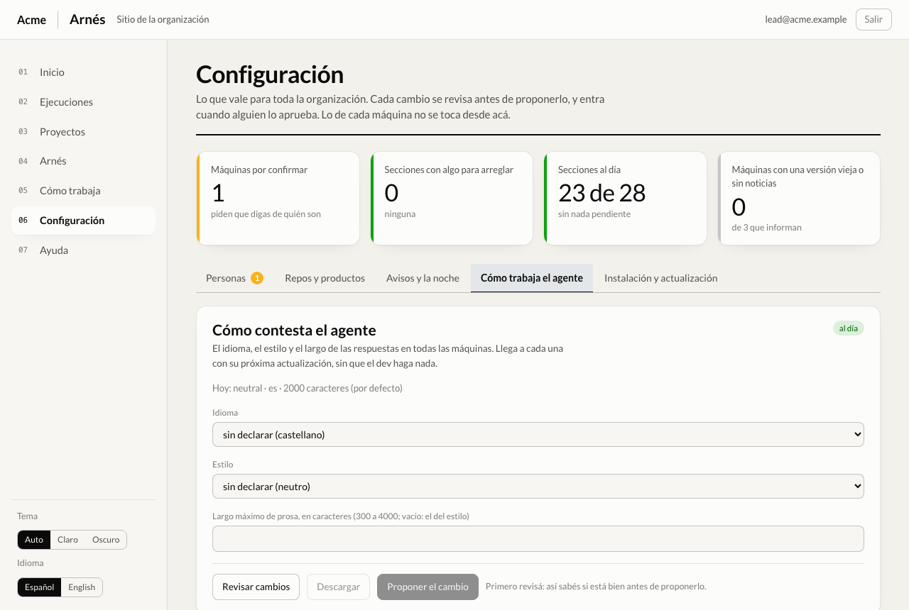

### Your technology

What the person sees in the section, and what the agent does when asked for a tool that is not there.

- **On the site**: the languages the harness already recognizes, the endings your team adds, the test tools table and
  the three rules. Each tool shows its name, the file that detects it, its origin and what can be done:
  - **included in the harness · not editable**: .NET, Vitest, Jest and Node, which the test gate runs internally.
    «Replace» copies (if the browser allows it) and shows the phrase for the agent, built for that tool: the agent
    builds an organization recipe detected by the same file, which wins; an admin approves it, and from the next
    execution on yours is used.
  - **built in · can be changed**: pytest, Go, Maven, Gradle, Karma and Playwright. «Change» brings the form filled
    with the built-in one, and saving leaves an organization copy with the same name that replaces it.
  - **changed by your organization**: that copy. «Back to the built-in one» deletes it.
  - **added by your organization**: a new tool, like the .NET Framework one with vstest.
  A tool's command runs on every team member's computer.

  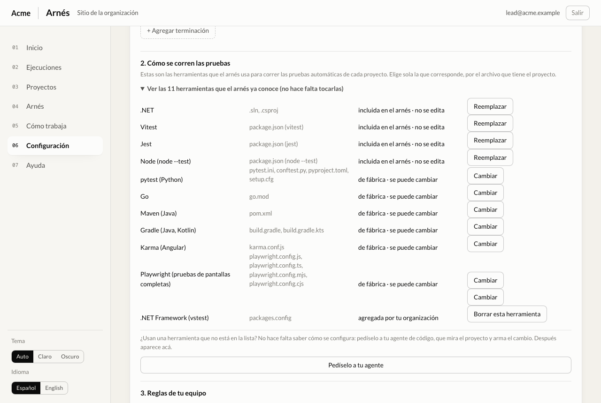

- **«Ask your agent»** leaves the sentence «set up my project's tests in the harness configuration». The person pastes
  it into their coding agent, opened in the project.
- **What the agent does** with that sentence:
  1. Looks at the project: which tool runs the tests, the **detection file** (the one in the project folder, for
     example `Cargo.toml`), the command, which report it leaves (JUnit or the Vitest/Jest JSON) and where, and whether it
     measures coverage and in what format (Cobertura, lcov, istanbul, JaCoCo or the Go profile). `{results}` is the
     run's folder.
  2. Writes the `stack.test_runners` entry in `team-repos.json` of the profile repo: `name` (lowercase and hyphens),
     `label` (the name a person sees on the site, for example «.NET Framework (vstest)»), `detect`, `command`,
     `results` and, if it measures, `coverage`.
  3. Validates it with the machines' reader before proposing:
     `node -e 'console.log(JSON.stringify(require("<harness>/scripts/lib/team-repos.js").parse(require("fs").readFileSync("team-repos.json","utf8")).sectionProblems || {}))'`.
     With no problems in `stack`, it proposes it as a request to the profile repo.
  4. An admin approves the request and the tool shows up in the list, where it can be changed.
- **What the recipe allows**, so the agent does not propose something the reader rejects or that never applies:
  - **The report** is `junit`, `jest-json` or `trx` (vstest's, `/Logger:trx`); `path` may use `*` and `**`.
  - **The detection file** is an exact name. It is looked for in the folder under test and, with `detect_depth` (0 to
    3), in its subfolders, skipping `bin`, `obj`, `node_modules` and dot folders. Pick one that belongs to the tool:
    `packages.config` is .NET Framework's; a bare `.sln` or `.csproj` is any .NET's and would take `dotnet test`'s
    place in the other repos.
  - **An organization tool wins over .NET** when its detection file is in the solution's folder (or its subfolders,
    with `detect_depth`). It runs once, from the solution.
  - **What changes from one repo to another** (a category filter, say) does not go in the command: it goes in `repos`,
    one `{ "repo": <repo>, "args": "…" }` entry per repo, with this same file's `<repo>` shape. The command uses it as
    `{args}`; a repo with no entry uses `args_default`, or nothing. `args` cannot hold quotes, `$`, backticks,
    backslashes or line breaks, because it goes inside quotes in the command. The repo is recognized by its `origin`
    remote.
    On the site, «Change» shows «Each repo's filter»: «Add a repo» picks from the organization's repos (those in the
    dependency review and those this file already names), and each row has its filter and its «Remove».
  - **The command runs with bash** and its first word has to be on the PATH (otherwise the gate says it is missing).
    Nothing is read from the repo under test.
- **Where the profile clone is**: `harness.js team-config --no-open` says which folder this machine uses (the
  `paths.team` key). If there is none, clone the `profile` repo from `team-repos.json` into a folder of your own.
- **The request** goes to the profile repo's main branch, **without auto-complete**: an admin reads and approves it.

### Installation and updates (Instalación y actualización)

- **How the machines update** (*Cómo se actualizan las computadoras del equipo*): which version each machine takes and whether it
  updates itself on start. It lives in `team-profile.json`, in the profile repo. A maintainer reviews it.
- **Installation profile** (*Perfil de instalación*): how much the harness installs on each machine (minimal or full),
  with the list of what each one brings. It lives in `team-profile.json`, in the profile repo. A maintainer reviews it.
- **The organization's packs** (*Paquetes de la organización*): which harness packs (the reviewers and guides of a
  product or a client) are turned on on every machine. It lives in `team-profile.json`, in the profile repo. A
  maintainer reviews it.
- **How the production guard updates** (*Cómo se actualiza el freno de producción*, `guard.update`): how the guard that
  protects the production databases gets up to date on the authorized machines. The two options, each with its cost:
  - "With the person's password" (the default, the safest): each update is done by that machine's person, typing their
    password. Until someone does it, the machine keeps the old guard.
  - "On its own, from the published version": the machine updates itself, with no password, using the published
    version, checked against the team's repository. The cost: a looser published guard arrives without anyone approving
    it on that machine, and any program running as the person's user can ask for the update (it cannot choose what gets
    installed). Each update is recorded and the startup notice shows it.
  Choosing "on its own" changes no machine: each person installs the permission once, with their password
  (`install-guard.sh --allow-auto-update`), and the startup notice gives them the command. If the organization goes
  back to "with the password", the notice on each machine with the permission says how to remove it
  (`--remove-auto-update`). It counts only from here, never from a machine. It lives in `team-profile.json` →
  `guard.update`, in the profile repo.

By default, both new options are at the safest setting: delegated signing off and the guard with the password.

Below is **Which harness version each machine has** (*Qué versión del arnés tiene cada máquina*), the one each machine
reported with its last run. It is view only: the machines update themselves on start.

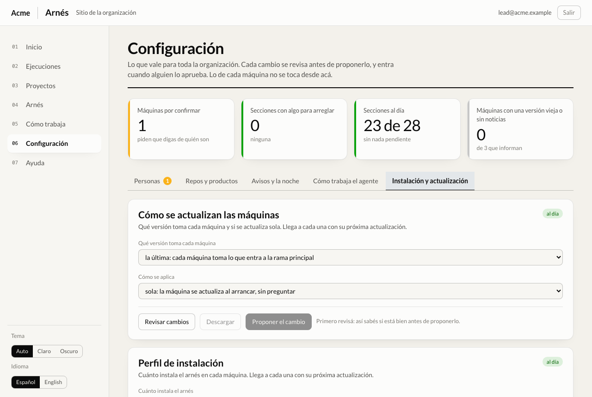

## What each role sees

The site decides who you are by your email, and only with the "Who gets into the site" list:

| Role | Home | Runs | Maintenance | Projects | Harness | How it works | Configuration |
|---|---|---|---|---|---|---|---|
| **Maintainer** | "What to decide today", for the whole organization | all runs | yes, and decides each one | all products | yes | yes, and proposes changes to its reviewers | yes, and proposes changes |
| **Confirmed person** (a dev in the list) | "Your things" | those of their confirmed machines | no | the products they work on | no | no | no |
| **Person with an unconfirmed machine** (a dev in the list) | "Your things" | those of their confirmed machines; the new machine's, not yet | no | the products they work on | no | no | no |
| **No role** (not in the list) | only the page "Your account is not in the list" | no | no | no | no | no | no |

**How you move from one role to another.** A maintainer decides it, in Configuration, and it goes in when someone
approves the request:

- To get in as a **dev**, your email has to be in "Who gets into the site" with the role "Dev". To see your runs, a
  machine of yours also has to be confirmed in your name ("People and machines"): it shows up by itself in "To confirm"
  when it uploads its first run.
- To **maintain**, your email has to be in "Who gets into the site" with the role "Maintains the site". Whoever installs
  puts the first person, while the list has nobody who maintains.
- To stop seeing, the email is removed from the list.

**The help, inside.** This guide is also inside the site, in the "Help" tab (*Ayuda*), and each role sees its part: a dev
sees how the site is used and its common problems; whoever maintains also sees the configuration section by section and
how it is installed. It comes from this same guide, in the site's language.

## Common problems

### I cannot sign in

**What you see:** "Could not sign in" (*No se pudo entrar*), with the reason; or the Microsoft, Google or GitHub page
does not let you through.

**Why it happens:** the site asks for an email your provider vouches for. Common cases: your account has no email in its
directory; your organization did not verify your email's domain; or you signed in with a personal Microsoft account
through the main button (personal accounts signing in directly are not accepted yet). It also happens if the browser
signs in by itself with another account.

**What to do:** if you are a guest of the organization's directory, sign in through the guests' button. If not, sign in
with your organization's account: sign out of the other one or open a private window. If the message is about the email,
ask whoever runs your directory to add or verify your email. To be in the site's list, ask a maintainer.

### I sign in and see nothing

**What you see:** the page "Your account is not in the list", with the account you signed in with.

**Why it happens:** you got past the sign-in, but that account is not in the "Who gets into the site" list. Maybe you
are using another email than the one in the list.

**What to do:** if you have another account, use "sign in with that one". If not, ask a maintainer to add you, with the
email you sign in with. It goes in when someone approves the request and the site refreshes (at most 15 minutes).

### I do not see my runs

**What you see:** you get in, but some of your runs are missing in Runs.

**Why it happens:** the machine they came from is not confirmed in your name yet. Or the email you sign in with is not
that machine's git email: for example, the Microsoft account has a user name different from the email.

**What to do:** ask a maintainer to confirm the machine. If the email does not match, a maintainer can record the other
one as yours in the organization's configuration.

### The site is stopped

**What you see:** the "Site stopped" page (*Sitio frenado*), which says since when.

**Why it happens:** the organization's configuration (`operations.json`, in the operations repo) has not validated for
more than 24 hours. During those 24 hours the site keeps the last good configuration and maintainers see a notice; past
that, it stops for everyone.

**What to do:** a maintainer fixes the file with a request in the operations repo. The site unblocks itself on the next
refresh.

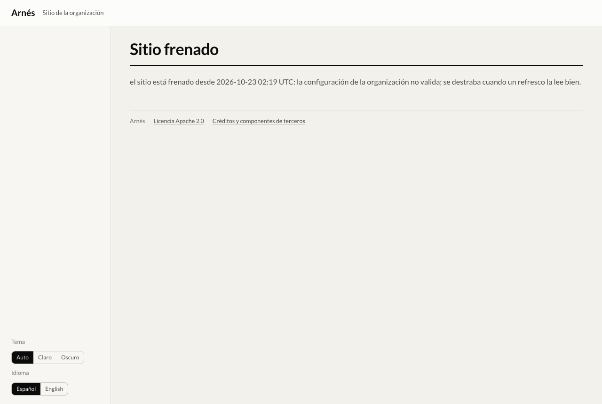

### Loading the runs

**What you see:** "loading the sources" (*cargando las fuentes*) or "loading the runs" (*cargando las corridas*), and
the page reloads by itself.

**Why it happens:** the site has just started and is still reading the operations repo or downloading the runs mailbox.
The first mailbox download can take a few minutes.

**What to do:** wait. If it stays the same for more than ten minutes, tell a maintainer.

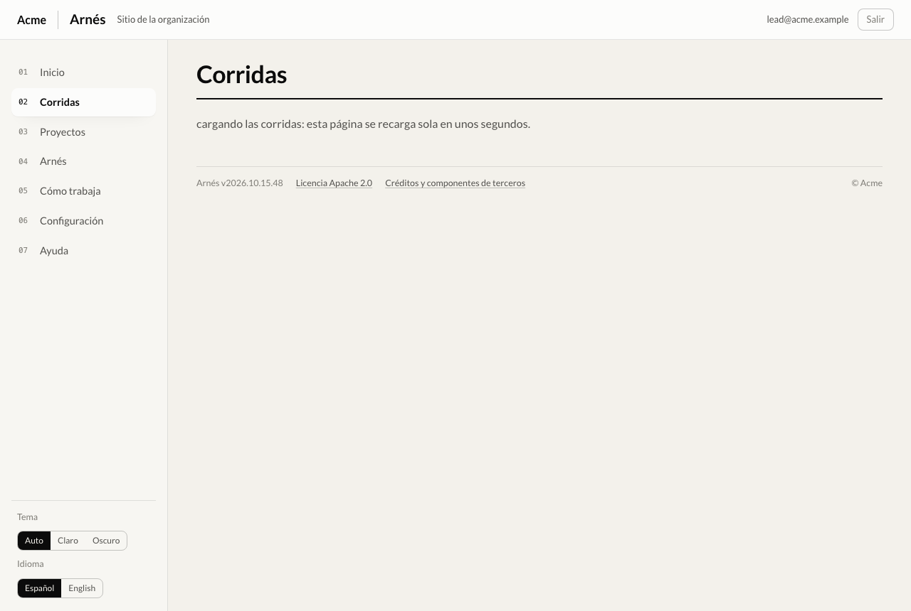

### Could not update

**What you see:** a red band at the top, "could not update since" (*no se pudo actualizar desde*) a time, with the
reason.

**Why it happens:** the last refresh could not read a source (the operations repo or the mailbox). The site keeps showing
the last thing it read well.

**What to do:** nothing, if it goes away on the next refresh. If it stays, a maintainer looks at the reason: it is
almost always an expired credential or a permission that changed.

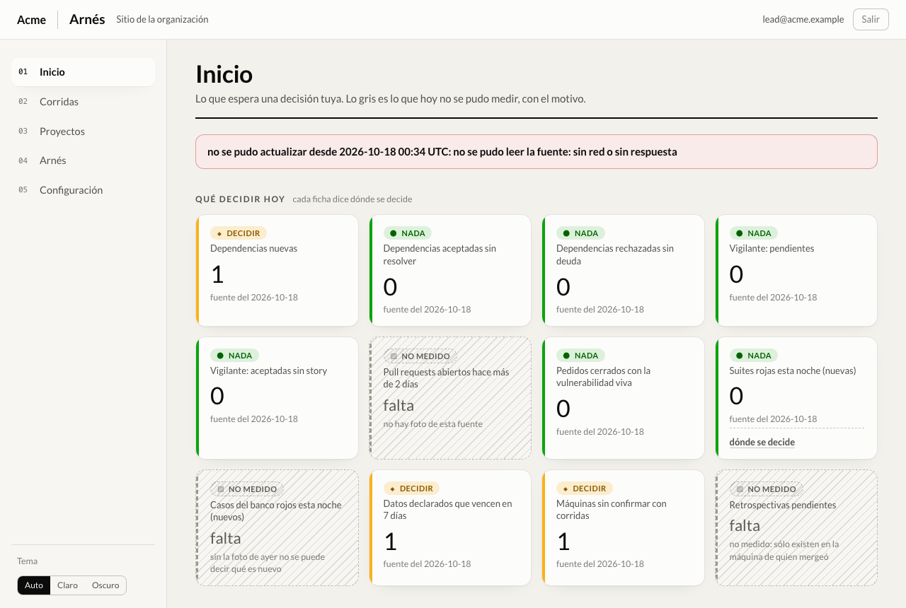

### "Propose" is off

**What you see:** in a Configuration section, "Propose the change" is not there, or it is gray, and next to it it says
why.

**Why it happens:** the site only proposes if the repo's main branch has a review policy (the one in "The branch policy
of the operations repo"); without any, the site could change the repo without leaving a request. Also when the policy
lets whoever creates the request approve it ("Allow requestors to approve their own changes", on Azure DevOps) and "A
maintainer's changes" is off: the site creates the request, and it would approve itself without the organization having
asked for it. On GitHub, with the push rule by path, the site does not propose `operations.json`. And when the site has
no permission to write to that repo, or when there is already an open request on the same file (the section shows its
link).

**What to do:** review, press **Download**, and hand the file to whoever has access to the repo. A maintainer can set
the organization's policy (with "A maintainer's changes" on) or grant the write permission. With an open request, wait
until it is merged or closed.

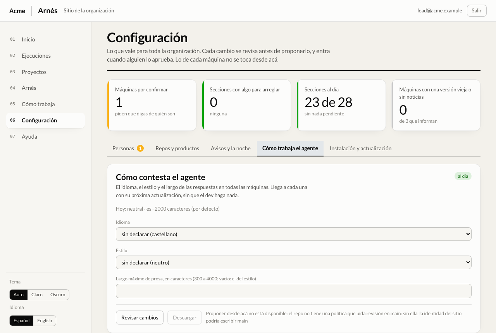

### Configuration says the site rejected the request

**What you see:** when reviewing or proposing, a red box with the reason: "the session expired or was closed: reload
the page" (*la sesión venció o se cerró: recargá la página*), "your account … is not among those who maintain the
site", "the site is loading…", or "the request was rejected by what stands in front of the site, not the site" (*el
pedido lo rechazó lo que está delante del sitio*).

**Why it happens:** the session expired; or you signed in with another account (the message says which one); or the
site was restarting; or the cloud's sign-in, in front of the site, stopped the request.

**What to do:** reload the page. If it says your account does not maintain the site, sign out and sign in with the
organization's account. If it says it was rejected by what stands in front of the site and it persists after reloading,
tell a maintainer (the installation guide, in the Azure recipe, says how to fix it).

### The first page is slow to open

**What you see:** after a while without use, the first page is slow to open, sometimes more than half a minute.

**Why it happens:** in an installation that sleeps when nobody uses it (Azure Container Apps, Render), the first visit
wakes it up.

**What to do:** wait; the next pages open quickly.

## The demo site

It is the same site, with example data from a made-up organization (**Acme**), open to anyone with a link and with **no
account**, to show what it does without giving access to anything real. It runs as a separate instance: it is not the
organization's site and does not replace it, and nothing you see in it exists.

**What you see.** Every tab with the example data: Home, Runs (with their detail and their texts), Projects, Harness, How
it works, Configuration and Help. At the top of every page a fixed strip says **Example data**, and so does the title of the
browser tab. The **View as** selector lets you look at the site as its maintainer (everything, with Configuration) or as a
team member ("Yours", without Configuration). The buttons that change something (**Propose** in Configuration and in How it
works, **Invite** and **Revoke**) check as usual and show what would happen, and say that the demo site writes nothing.

**What it does not do.**

- **It writes nothing.** Not to a repo and not to disk, except in its own temporary folder, which is deleted when it shuts
  down. The language you pick lives only in the browser cookie.
- **It does not reach out.** It opens no outside connections and launches no `git` or any other process: what the real site
  asks the platform (pipelines, stages, request types, the review policy) is answered from inside, with example data. If
  something tried, it is logged and fails.
- **It has no accounts and no credentials.** It starts only with `SITE_DEMO=1` (with any other value it does not start, and
  the real site says `demo: false` in its startup line and in `/livez`). It accepts only `SITE_DEMO`, `PORT` and
  `SITE_PUBLIC_URL`: with any other site variable, or a platform identity, it does not start and says which.
- **The bare minimum of a public site.** It asks search engines not to index it (`noindex`) and limits each address to 60
  requests per minute (the last one in `X-Forwarded-For`, the one the platform's entry point adds).

**Try it on your machine.** From the harness clone: `SITE_DEMO=1 PORT=8080 node scripts/site/server.js` and open
`http://localhost:8080`. Under another machine name, add `SITE_PUBLIC_URL=http://<name>:8080`: the buttons compare the
origin of the request with that address.

**Install it on Azure Container Apps.** It is a separate instance; give it its own resource group. With the installer of the
Azure recipe, in two phases and with a configuration file without secrets (`subscription`, `resourceGroup`, `location`,
`environment`, `app`, `logAnalyticsWorkspace`, `logAnalyticsQuotaGb` and `image`, the published image by its digest
`@sha256:…`, from a version that carries the demo mode):

1. `node scripts/site/deploy/azure-container-apps.js --config demo.json --phase ambiente --dry-run` and then `--apply`:
   creates the environment. Ignore the two Entra ID redirect URIs it prints: the demo has no sign-in.
2. `node scripts/site/deploy/azure-container-apps.js --config demo.json --phase demo --dry-run` and then `--apply`:
   creates the app and prints the link.

The app comes up with **no lock** from the platform, **no disk**, **no identity** and no secrets; open from the start
(HTTPS only) and scaling to zero: it switches itself off when unused (zero replicas), and the first visit after a while takes
a few seconds to wake it. The configuration file does not accept a mailbox, a repo, a tenant or a disk: if it has them, it
does not run and says which. Running the `demo` phase again on an instance that already exists updates it (it does not create
another); if a step fails, it stops, says which one and what was created, and running it again finishes the job. It never
touches an app that is not a demo instance.

**Up to date.** The site updater also keeps it up to date with `stable`: `update-site.js` with `--demo` and the demo's
app and group. Since the demo is open, it does not run the check without a session on it: it asks for `/livez` with
`demo: true` and for the home page with the "Example data" strip. If that fails, it goes back to the previous digest, as
with the real site. The nightly runs it in its own step, with the same credential; that credential needs its role on the
demo's app too.

**Deleting it.** Everything of the demo is in its resource group: `az group delete --name <group> --subscription
<subscription>` deletes it all (it asks for confirmation). Do it only if that group is the demo's own. Without deleting it,
it is already off: with zero replicas no container runs.

## What you need first

- **The site image.** It is published automatically in the package registry of the harness public repo every time
  something it carries changes. You can also build it yourself (below).
- **A way to sign in to the organization:** Entra ID, Google Workspace, GitHub, or any OIDC provider (Okta, Keycloak).
  An application for the site is registered in that provider.
- **The organization's operations repo**, and an identity that can read it (that repo only). If you do not have it
  yet: how to create it and which files it holds, in the harness's `pipelines/operations/README.md` §2 (the examples, in
  `pipelines/operations/examples/`). The site only needs `operations.json`; the minimum, in the Docker trial.
- **Optional: the runs mailbox**, if the organization collects the runs of its machines.
- **A place to run a container** with HTTPS in front: a cloud, a free service or your own machine.

## Try it on your machine with Docker

About ten minutes, most of it building the image. You need Docker running, a clone of the harness public repo and
Node 22 or newer (for the check in step 3).

Here the site address is `http://127.0.0.1`: the site requires `https://` for any other address, but accepts `http` on
your own machine, for trying it out. The same goes for the operations repo address.

1. **Build the image** (from the root of the clone; run for real: about 2 minutes the first time):

   ```bash
   docker buildx build -f scripts/site/Dockerfile -t sitio:local .
   ```

   **Or pull the image that is already published**, with nothing to build: `ghcr.io/<organization>/<repo>` (the organization and name of the harness public repo, in lowercase; the exact address is on the repo page, under "Packages"), with the
   `stable` tag (the latest one that passed the scan and the signature) or with a version, `v<number>`, the same one the
   site shows (for example `v2026.10.18.21`). There is never a `latest` tag.

   ```bash
   docker pull ghcr.io/<organization>/<repo>:stable
   ```

   The steps that follow work with either one: with the published image, replace `sitio:local` with
   `ghcr.io/<organization>/<repo>:stable` (or the version you chose) in the `docker run`.

2. **Start it**, with the port only on your machine and a volume for its disk:

   ```bash
   docker run --rm -p 127.0.0.1:8080:8080 -v sitio-datos:/data -e SITE_DATA_DIR=/data \
     -e SITE_PUBLIC_URL=http://127.0.0.1:8080 -e SITE_SESSION_KEY="$(openssl rand -hex 32)" \
     -e SITE_AUTH_PROVIDER=github -e SITE_AUTH_GITHUB_ORG=<your GitHub organization> \
     -e SITE_OIDC_CLIENT_ID=<the Client ID> -e SITE_OIDC_CLIENT_SECRET=<the secret> \
     -e SITE_OPERATIONS_REPO=<the https address of the operations repo> -e SITE_OPERATIONS_TOKEN=<a read token> \
     -e SITE_FIRST_MAINTAINER=<your email> sitio:local
   ```

   At startup the log says each variable is "presente" or "ausente", never its value. If a required one is missing, it
   does not start and says which one.

3. **Check that it is alive** (in another terminal):

   ```bash
   curl -s http://127.0.0.1:8080/livez
   node scripts/site/check-deploy.js --url http://127.0.0.1:8080
   ```

   `/livez` answers `{"ok":true}`. The check without a session makes sure that, without signing in, nothing is visible.
   With made-up values (a repo that does not exist) we measured it: the site starts, `/livez` gives 200, `/` redirects to
   the GitHub sign-in, `/api/inicio` gives 401, and the site is **stopped** because it cannot read the repo (`/healthz`
   gives 503 and the check says "el sitio está frenado"). With the real repo and its token, the site loads.

   **The minimum operations repo.** For the site to start without being stopped, `operations.json`, at the root of
   `main`, needs at least this (with your email instead of the example one). Measured: with this file, `/healthz` gives
   200 and the check without a session passes.

   ```json
   {
     "version": 1,
     "owners": { "default": "you@acme.example" },
     "reviewers": { "dependencies": ["you@acme.example"] },
     "site": { "access": [{ "role": "maintainer", "emails": ["you@acme.example"] }] }
   }
   ```

   `owners` and `reviewers` belong to the night processes, but the file does not validate without them (the container
   log says what is missing: "owners: falta"). If the site is stopped, the exact reason is in that log, not in
   `/healthz`. With a repo like this, the log also says "el repo de operaciones no trae repos.json" and "sin_foto":
   that is normal until the night has run.

4. **Sign in.** Open http://127.0.0.1:8080 and sign in with your account. For that you first register the application
   on GitHub (*Settings → Developer settings → OAuth Apps → New OAuth App*, with the address `http://127.0.0.1:8080` and
   the callback `http://127.0.0.1:8080/auth/callback`). Signing in with a real account has not been tested for real yet.

To stop it: `Ctrl+C` in the terminal. The `sitio-datos` volume stays; remove it with `docker volume rm sitio-datos`.

## Common to every installation

This part applies wherever you install it.

### HTTPS in front

The site requires its public address (`SITE_PUBLIC_URL`) to be `https://` and uses a cookie that only travels over HTTPS.
Whoever installs it provides the TLS: the platform, a proxy or a tunnel. The container listens on port 8080.

### The disk

A persistent volume mounted as a folder at `SITE_DATA_DIR`. It holds the mirror of the mailbox (the runs' dumps and,
with `site.mailbox.threads: true`, a small summary of each conversation) and the last good configuration. Conversations
are not kept: each one is downloaded once, summarized and deleted, and a pass downloads at most 300 MB of conversations
at a time. The repos' clones and the change texts go to the container's disk, never to the volume (a network disk
mounted over SMB does not allow the `chmod` git does when cloning). Measured with a 6.9 GB mailbox: without
the conversations it takes 163 MB, plus the summaries (a few kilobytes per run) and, while a pass lasts, up to 300 MB of
conversations waiting to be summarized. **2 GB is enough**, with room to grow. **Without a volume the site still works**: it uses a temporary folder and says so. But what comes from the conversations in the Runs tab stays "not
measured", every restart downloads everything again, and a restart resets the 24-hour window a broken configuration has
before the site stops (and lifts the stop until it expires again).

### The memory

1 GB. Building the runs view with its conversations measures about 700 MB at peak.

### The organization's sign-in

The site does its own sign-in (`SITE_AUTH_PROVIDER`): generic `oidc` (Okta, Keycloak or another with discovery),
`microsoft`, `google` or `github`. It is chosen at installation, and Configuration shows it. In the provider you register
an application with the callback `<site address>/auth/callback` and a secret of 6 months at most. With any provider, who
gets in and what they see is decided by the site's list ("Who gets into the site"): getting past the sign-in is not
enough.

- **`google` and `github`** are limited to the organization: the domain (`SITE_AUTH_ALLOWED_DOMAINS`) or the GitHub
  organization (`SITE_AUTH_GITHUB_ORG`).
- **`microsoft`, one tenant** (`SITE_AUTH_MICROSOFT_ACCOUNTS=organization`, the default): the accounts of the
  organization's directory and its guests get in. `SITE_OIDC_ISSUER` is the tenant's. **This is the choice
  when everyone who signs in is a member or guest of the directory:** a single door, your own tenant's issuer with
  `SITE_AUTH_MICROSOFT_ACCOUNTS=organization`.
- **`microsoft`, any account** (`SITE_AUTH_MICROSOFT_ACCOUNTS=any`): work or school accounts from any organization get
  in, without inviting them to the directory. `SITE_OIDC_ISSUER` is `https://login.microsoftonline.com/organizations/v2.0` and
  `SITE_AUTH_MICROSOFT_TENANT` is the organization's tenant: its guests get in through it, with their own button. You get
  in only with an email verified by your organization. Microsoft personal accounts signing in directly are not accepted
  yet: it could not be checked that their email is reliable (a guest with a personal account uses the guests' button). Use this form only to accept any work account from other
  organizations, with the `organizations` issuer; never `common`. The measured case: an email that exists both as a
  work account and as a personal account lands on the personal account with `common`, and on the work account of another
  tenant with `organizations`. With neither does it reach the account in your own directory.
- **The risk, plainly:** with "any account", the first door is open to any Microsoft account, and all the control is in
  the site's list. Whoever is not in the list sees a page with no data; no request answers them with data. That is why
  the list is guarded like a password: each change is a request with who proposed it and who approved it.
- The site gets no permission on anybody's directory: it does not assign, invite or read users.
- **Signing out.** The **Sign out** button ends the session and leads to a "You signed out" page, with "Sign in again"
  and "Sign in with another account". **Sign out** does not go through the platform's lock or through Microsoft: the way
  back stays on the site, and the Microsoft session stays open (closing it would also sign you out of the portal and of
  your organization's repos). That is why, when you sign out, the site leaves a "signed out" mark in your browser (no data
  about you, it lasts 30 days): while it is there, the site does not sign you back in without a click from you. Reloading,
  going back or opening any page shows "You signed out", and both buttons ask you to choose the account at Microsoft.
  The mark is removed when you sign in.
  "Sign out" ends the session for a copy of the cookie too: the session is recorded as closed on the site's disk until it
  expires, and a copy somebody kept stops working. If the disk fails, or the site has no disk (`SITE_DATA_DIR`),
  "You signed out" warns that the session could not be invalidated on the server instead of saying you signed out: after a
  restart, a copy of the cookie would work again. With several replicas, the disk has to be shared: otherwise one replica
  does not know what another closed.
  If the folder of closed sessions cannot be read, the site lets people in anyway (locking everyone out would be worse)
  and maintainers see "closed sessions cannot be verified" above the tabs.

### The probes

If your platform has probes, **both go against `/livez`**, with a response timeout of about 5 seconds.

- **Liveness, never against `/healthz`.** `/healthz` gives 503 when the site is stopped by a broken configuration. A
  liveness probe against it would restart the container in a loop, and restarting does not fix the configuration.
- **Readiness, not against `/readyz` either.** The platform sends no traffic until that probe passes, and `/readyz`
  waits for every source, the whole mailbox included. The site already serves each tab as soon as it can build it: one
  that is still waiting says «loading» and reloads itself, and a stopped one explains why. `/readyz` gives 200 as soon as it read every
  source once, **also with the site stopped**: on purpose, so the site stays visible and explains why it is stopped. The
  stop shows in `/healthz`. `/readyz` is for whoever wants
  to know whether everything finished loading.

### The secrets, with the least privilege

Each installation says where each one is stored and how its value gets in. **No value goes in a file of the repo, in
`operations.json`, in an installation's configuration file, on the command line or in a printed plan.**

| Secret | What for | Minimum scope |
|---|---|---|
| `SITE_SESSION_KEY` | signing the session | 32 random bytes, only for the site |
| `SITE_OIDC_CLIENT_SECRET` | the sign-in | a registration only for the site, with no API permissions beyond `openid email profile` (with `github`, which is not OIDC, the site asks for `read:user user:email read:org`: read the account, its emails and whether it belongs to the organization); expires in 6 months at most |
| `SITE_OPERATIONS_TOKEN` (or the platform identity, `SITE_OPERATIONS_IDENTITY=managed`, no secret) | reading the operations repo | an identity of its own with read access to that repo only; if it is a token, for one organization, code read only, 90 days; on GitHub, fine-grained, one repo, `contents: read` |
| `SITE_MAILBOX_SAS` (or `SITE_MAILBOX_IDENTITY=managed`) | reading the runs in the mailbox | a read-and-list SAS (`rl`) tied to a stored access policy of the container, 6 months at most; or the platform identity with a read role on the container |
| the notice channel | sending the morning notice | it does not reach the site: the night process uses it. Telegram: the token is for the whole bot, use a dedicated one. Slack or Teams: the webhook address IS the credential |
| `SITE_OPERATIONS_WRITE_TOKEN` | proposing configuration changes from the site | on GitHub, fine-grained on the operations repo with `contents: write` and `pull_requests: write`; on Azure DevOps, a dedicated account with *Contribute*, *Create branch* and *Contribute to pull requests* on that repo only, *Force push* denied and no permission to bypass policies |
| `SITE_PROFILE_REPO` and `SITE_PROFILE_TOKEN` | reading the team profile (where each repo lives, the packs) | part of the normal installation: without them the Configuration tab says "falta el repo del perfil" (the profile repo is missing). The address of the profile repo and a read-only code token on that repo (it can be the same permission as the operations repo's, if both live in the same organization) |
| `SITE_PIPELINES_TOKEN` | read the pipelines, to choose them by name in the Configuration tab («Tests at merge» and «Deployments») and to see the name of each stage | part of the normal installation on Azure DevOps: only *Build: Read*, for the organization, 90 days; it can be the same token as the operations repo's with *Build: Read* added. Without it, the tab asks for the pipeline number by hand and says what is missing, and the saved stages show their identifier |
| `SITE_PROFILE_WRITE_TOKEN` | propose changes to the team profile | off by default: empty or commented out, never with a value; one dedicated identity and one repo per credential |
| `SITE_PRODUCTS_WRITE_TOKEN` | read and propose the `.tycon/advisors.yaml` of the product repos ("The configuration of each repo") | optional. On Azure DevOps, *Code: Read & write* and nothing else, only on the projects of the product repos; on GitHub, fine-grained on those repos with `contents: write` and `pull_requests: write`. Without it, the section reads with the operations credential (if it reaches those repos) and does not propose |

`SITE_FIRST_MAINTAINER` is not a secret: it is the email of whoever signs in first as maintainer, while the site's list
(`site.access` in `operations.json`) has nobody who maintains. Remove it afterwards.

### Where it reads operations from

The site reads its configuration and what the night leaves from the operations repo. There are three ways, depending on
where the site lives and where the repo lives. Pick only one: with `SITE_OPERATIONS_SOURCE=copy`,
`SITE_OPERATIONS_TOKEN` and `SITE_OPERATIONS_IDENTITY` are left over and the site does not start if they are set. `SITE_OPERATIONS_REPO`, though, is still
required with the copy: it is the address of the repo where «Propose» opens its pull requests, and without it the site
does not start.

1. **Copy with the platform identity, in Azure** (`SITE_OPERATIONS_SOURCE=copy`,
   `SITE_OPERATIONS_COPY=<account>/<container>`). A job in the operations repo (`site-copy.yml`, in
   `pipelines/operations/` for Azure DevOps and in `pipelines/operations/github/` for GitHub) copies what the site reads
   to a container, on every change to `main` and once a day. The site reads it with its identity and a reader role on
   that container. The Azure setup creates the account with the key turned off: only identities with their role get in.
   What it costs: one more pipeline and its identity, with the write role on the container. No secret that expires, and
   no Azure DevOps license for the site. A change takes as long as the job plus one refresh to show.
2. **Copy with a SAS, outside Azure** (another cloud or your own machine): the same copy, and the site reads it with
   `SITE_OPERATIONS_COPY_SAS`, a read-only container SAS (`sp=r` or `rl`), tied to a stored access policy on the
   container so it can be revoked (the commands, in the recipe for your own machine).
   What it costs: the SAS is signed with the account key, so that account needs the account key turned on, and that key
   opens the whole account (read, write and delete everything). That is why the copy goes in its own account, never the
   mailbox's; and the SAS expires (6 months at most) and is renewed by hand.
3. **Reading the repo directly** (`SITE_OPERATIONS_SOURCE` empty or `repo`, as always): the site clones the repo with
   `SITE_OPERATIONS_TOKEN`. In GitHub, an app installed on that one repo with `contents: read`, or a fine-grained token
   for one repo; in Azure DevOps, the site's identity added to the organization (`SITE_OPERATIONS_IDENTITY=managed`) or a
   personal access token with read-only code access.
   What it costs: the personal token expires (90 days) and belongs to a person; the identity in Azure DevOps takes a
   license. In exchange, a change shows on the next refresh, with no copy job.

With the copy, if the job stops running the site says so: with a copy older than 24 hours, maintainers see the last-good
banner ("the operations copy is N hours old"); older than 48, the site stops, as when the repo cannot be read. "Propose",
in the Configuration tab, still uses `SITE_OPERATIONS_WRITE_TOKEN`: it fetches a fresh `main` into a separate clone and
builds the pull request on that tip.

### Whoever can edit the installation can read its secrets

Whoever has permission to change the installation (its variables, its image) can read all its secrets and make
themselves a maintainer: change the session key or point to another repo. That permission is only for those who
maintain the harness. Removing `SITE_FIRST_MAINTAINER` protects against an oversight, not against that administrator.

### The branch policy of the operations repo

The rule is **"everything automatic"**: what the night saves and what the site proposes goes into `main` of the
operations repo without a person approving it. It is the same one the READMEs of the operations models say
(`pipelines/operations/README.md` and `pipelines/operations/github/README.md`). Set it before publishing the site: with
no policy at all, "Proponer" (propose) stays off.

**On Azure DevOps**, in *Project settings → Repositories → the operations repo*:

1. *Policies → Branch Policies → main*: **Require a minimum number of reviewers** at 1, on the whole branch, with *Allow
   requestors to approve their own changes* **on**, *Prohibit the most recent pusher from approving their own changes*
   off and *Reset code reviewer votes when there are new changes* on. No named reviewers: a "Required reviewers" policy
   leaves the request waiting for those people.
2. *Security*: **Bypass policies when pushing** set to "Allow" only for the build identity of the night processes, which
   save by pushing to `main`. Nobody else, not the site's identity either.
3. In `operations.json`, `site.auto_apply: true` ("A maintainer's changes", in People).

With that the night pushes directly, and the site opens its request, approves it with its identity and completes it
(the section says "Applied", *Aplicado*). A person cannot push to `main` (it bounces with `TF402455`): they go in through
a request, which they can approve themselves.

**On GitHub** the night goes in by itself; the site, not yet: whoever opens a pull request cannot approve it. The rule
is the push rule by path in the GitHub README: the site validates and downloads `operations.json`, and a maintainer
opens the pull request by hand.

**What you give up.** Nobody reviews those changes before they go in. A record remains: each change from the site is a
request with who asked for it, and the site's log records `cambio aplicado: <file>, pedido <link>`. Whoever
can write to the operations repo can make themselves a site maintainer or change a night process without anyone else
looking: what you guard is who has write access to that repo.

**Asking for approval again.** If the organization prefers another person to look at each change, turn off *Allow
requestors to approve their own changes* in the policy of step 1. The site keeps proposing, and the request stays for
another person to approve; with `site.auto_apply` on, the section says why it did not go in by itself. To ask for it
only on some files, keep the policy of step 1 and add one with a path filter (the Azure DevOps README says how).

### The permission for "Propose"

"Propose the change" opens a change request in the section's repo. For that the site needs to write to that repo:
`SITE_OPERATIONS_WRITE_TOKEN` for the sections of the operations repo and `SITE_PROFILE_WRITE_TOKEN` for those of the
team profile. On Azure DevOps, a token with *Code: Read & write* on those repos, **without** *Bypass policies when
pushing* or *Bypass policies when completing pull requests*: the site creates a branch and a request, it never writes
`main`. With a personal token, the requests come out in that person's name. If the policy lets whoever creates the
request approve it ("Allow requestors to approve their own changes", the organization's rule), the site proposes only
with "A maintainer's changes" on (below): off, the author would approve it without the organization having asked for
it. Without the permission, each section says
"To propose from here, the site needs permission to write to the repo. Meanwhile: review, download and upload it by
hand" (*Para proponer desde acá, el sitio necesita permiso para escribir en el repo…*).

The product repos have their own secret, `SITE_PRODUCTS_WRITE_TOKEN`. To set it up:

1. Create the credential with the least permission. On Azure DevOps, an organization token with *Code: Read & write*
   and nothing else, limited to the projects of the product repos. On GitHub, a fine-grained one with *Contents: Read
   and write* and *Pull requests: Read and write*, only on those repos. The repos are the ones "The configuration of
   each repo" shows.
2. Load it as a site secret with that name and restart the site.
3. Check that the main branch of each repo requires at least one reviewer other than whoever creates the request.
   Without that policy, the site does not propose to that repo and says so.

With that secret the site only creates `team-config/...` branches and opens requests. It never writes `main` or
completes the request, even with "A maintainer's changes" on: that option applies to the profile and to operations, not
to the product repos.

An organization can choose not to require that reviewer on its product repos, for example because each dev merges to
`main` alone. Then "Propose" stays off on those repos: you review the change, download it and open the request by hand.

### Inviting someone

With Microsoft in "organization only", someone from outside the directory (a personal account, someone from another
company) gets in only once they are in the directory and on the site's list. In Configuration → People, "Who gets into
the site" → **Invite someone** (*Invitar a alguien*): their email and their products. "Invite" opens a request that adds
them to the list as a dev, with their products and a mark (`site.invitations`: who invited and when). Once the request
is approved and the site reads the new list, the site sends them the Microsoft invitation, which brings them to the
site. The invitation goes out in the site's first cycle after the request is approved; if nobody is using the site, it
may wait until someone signs in. Microsoft does not resend the email to an address invited shortly before (measured:
a second invitation to the same address, 36 minutes later, was created with no email). In that case whoever runs the
directory can get the invitation's redeem link and pass it on. The invitation email may land in spam; the sender is `invites@<directory>.onmicrosoft.com`. Next to their email you see the status: "invitation sent, has not signed in yet", "accepted" (signed in),
"waiting for tomorrow's limit" or "could not be sent" with the reason; a failure is retried on the next refresh (if
Microsoft never answered, the person may get a second email). Up to 10
invitations a day (`SITE_INVITATIONS_PER_DAY`); the rest wait for the next day.

- An email from one of the organization's own domains is not invited: that person needs an account in the organization's
  Microsoft 365, and the screen says so.
- An email that is not a Microsoft account accepts with a **one-time passcode** Microsoft emails to them, if the
  directory has it on. The installer reads it and leaves it in `SITE_INVITE_EMAIL_CODE`; if it is off or unknown, the
  screen warns when inviting and says where to turn it on.
- **Revoke** (*Revocar*) opens a request that removes them from the list and deletes their mark; if the invitation has
  not gone out yet, it no longer does. It does not delete them from the directory: for that, the Entra portal, with the
  link the screen gives.
- With another sign-in there is no button: with "any account" from Microsoft no invitation is needed (add them to the
  list); with Google or GitHub, add them to the list and they sign in with their Google or GitHub account for that email;
  without a managed identity, invite by hand in the portal and add them to the list.

### The invite permission

To send the invitation, the site's managed identity needs **one** Microsoft Graph permission: `User.Invite.All`, an
application permission. No other: the site does not read, change or delete users.

**Its risk, plainly**: whoever controls the site's identity can invite **any email** as a guest to the whole directory,
not just to this site. An accepted guest gets into any of the organization's applications that do not require
assignment, and sees what the organization shares with "everyone, including guests". How it is kept small: only
maintainers see the button; the invitation goes out only once the request is approved; the code calls Graph in one
place, with a fixed body (guest, back to the site, no groups or roles); the token lives only in memory; there is a daily
limit. Recommended: the directory's tightest guest restrictions, and requiring assignment in the other applications.

**How it is granted**: a directory administrator (Privileged Role Administrator or Global Administrator) grants it once,
with the installer and their `az` session:

```bash
node scripts/site/deploy/azure-container-apps.js --config <your file> --phase permiso-de-invitar --dry-run   # what it does
node scripts/site/deploy/azure-container-apps.js --config <your file> --phase permiso-de-invitar --apply
```

It assigns the role to the site's identity and leaves `SITE_INVITE_EMAIL_CODE`. Without the administrator role it says
so and changes nothing. While it is missing, the button says "The invite permission is missing", who grants it and this
command.

**To remove it**: in Entra → Enterprise applications → the site's identity → Permissions, revoke `User.Invite.All`. The
button says it is missing again, and nothing else changes.

### Changes that apply by themselves

With `site.auto_apply: true` in `operations.json` ("A maintainer's changes", in People), the site approves and completes
each request a maintainer proposes. For that its write identity needs, on Azure DevOps, *Code: Read & write* and
*Contribute to pull requests* on the repo, and never *Bypass policies*: the site skips no policy, and if one is not met
with its vote, the request stays. The review policy of `main` is the organization's (above): it lets the vote of whoever
creates the request count, asks for a single reviewer, does not prohibit the most recent pusher from approving and names
no reviewers. If it asks for more, the request stays and the section says what is missing. With no policy at all on `main`,
"Propose" stays off even with the option on. To turn it on, first the new image, then the key: an older image does not
know `site.auto_apply` and would take `operations.json` as invalid (it keeps the last good one). Each applied change
leaves its line in the site's log with the link to its request; the email of whoever asked for it does not go to the
log: the request says it.

### How it keeps itself up to date

The harness publishes the site image with its version number and moves the `stable` tag to that image **only** when it
passed the scanner and its signature was verified; `stable` never moves back. With that, each installation knows whether
there is something new:

- **The notice, the same for everyone.** Maintainers see at the top of every tab "there is a new version of the site: X
  (yours: Y)", and the Harness tab adds "last published". The site looks at the registry once an hour at most, without
  credentials; if it cannot look, it says so and never says "up to date" without having looked. The morning summary
  brings the site line. The version is not visible without a session.
- **Automatic or notice only**, in Configuration → People → "How the site is updated" (`site.update` in
  `operations.json`). **Without the key, notice only**: automatic needs permissions the organization grants
  deliberately. Before turning it on, a manual update that goes well, and the morning notice channel configured: a
  rollback leaves the nightly green and is reported in that notice.
- **Automatic** is done by the harness updater (`scripts/site/deploy/update-site.js`): it resolves `stable`, installs it
  **by digest**, wakes the site up and runs the check without a session on it. If the check fails, it goes back to the
  previous digest and says so; that digest is not retried until `stable` moves. It never installs a version lower than
  the one running. Each environment runs it with its own tool: each recipe has its **Up to date** paragraph.
- **From an old image, the first one goes by hand.** An image published before images carried their version does not
  tell the updater which version is running, and without knowing it, it installs nothing (it never downgrades): the
  result says "no se sabe qué versión corre" and the first update goes by hand, with your environment's recipe. From
  then on, the automatic mode carries on by itself.
- **A one-time step when moving to a version with the "You signed out" page.** If the site sits behind the platform's
  lock (the cloud's built-in sign-in), the "You signed out" page and what it loads should stay outside that lock: that
  way it shows even after the lock's session expired, without going through its sign-in first. The updater changes the
  image, not the lock's configuration. It is done once, by hand, with the command in your environment's recipe (under
  its "Sign-in"). New installations already include it.

### The two ways to start it

The same image with Docker (`docker run … sitio:local`, above), or with Node alone from the clone, with the same
variables:

```bash
node scripts/site/server.js
```

### The check without a session

After any installation, and every morning from the night process:

```bash
node scripts/site/check-deploy.js --url https://<site address>
```

It asks, without a session, what a stranger would ask. It exits 0 if nothing is visible; 1 with the reason ("el sitio
responde sin iniciar sesión", "/api contesta con datos", "el sitio está frenado", "/healthz cuenta de más", "falta
no-store", "acepta http", "sin Referer: el candado de la plataforma frenaría las escrituras de Configuración" — the
site sends `Referrer-Policy: no-referrer`); 2 if it could not ask. It waits up to 90 seconds for the first answer: a sleeping site takes a
while to wake up. The morning notice carries the link only if it passed that morning.

It also asks for the sign-out page (`/saliste`) without a session. If the platform's lock answers it instead of the
site, the check does not fail: it exits 0 and adds a warning, "la página de salida queda detrás del candado: con el
candado vencido, «Saliste» pasa antes por el inicio de sesión de la plataforma; la receta de tu entorno trae la orden de
una vez" (with the lock's session expired, the sign-out page goes through the platform's sign-in first). It means the one-time lock step is
missing (leave the sign-out page free); your environment's recipe has the command. The morning notice repeats it next
to the link. What to fix is the lock's setting, not the image.

## The recipes

Each recipe says what changes compared with the common part. **None of the three recipes has been tested for real
yet**: the first installation of each one tests it.

### Azure Container Apps

Free within the subscription quota, with scale to zero. The installation is a two-phase script that is first run as a
dry run:

```bash
node scripts/site/deploy/azure-container-apps.js --config <file outside any repo> --phase ambiente --dry-run
node scripts/site/deploy/azure-container-apps.js --config <file> --phase ambiente --apply
# add the two callbacks to the Entra ID registration
node scripts/site/deploy/azure-container-apps.js --config <file> --phase sitio --dry-run
node scripts/site/deploy/azure-container-apps.js --config <file> --phase sitio --apply
```

The `ambiente` (environment) phase creates the resource group, the log workspace (31 days, daily cap of 0.023 GB) and
the environment, and prints the address the site will have and the two callbacks to add to the registration. The `sitio`
(site) phase creates the disk, the application with internal ingress, the mailbox read role and the built-in sign-in, and
opens external ingress at the end. If a step fails, ingress stays internal, and running it again continues where it
stopped. It runs with your `az` session (it does not open a login). The configuration file holds subscription, group,
region, names, tenant, the image by its digest and the client identifier, and no secret; the script header lists each
key. The profile repo is part of the normal installation: its address goes in `profileRepo` in the file, and its token in
`SITE_PROFILE_TOKEN`, in the environment of whoever runs the setup, like the other secrets. Without both, the
Configuration tab says "falta el repo del perfil" (the profile repo is missing).

- **Sign-in:** two locks. In front, the platform's built-in sign-in with the same Entra ID registration. Behind it, the
  site's own, which decides with its list. `/healthz`, `/livez`, the "You signed out" page with what it loads, and `/idioma` stay outside the lock (without that, with the
  lock's session expired, the "You signed out" page goes through its sign-in first). A site already installed is fixed once:
  `az containerapp auth update -g <group> -n <app> --excluded-paths /healthz,/livez,/saliste,/idioma,/static/site.css,/static/site.js,/static/fonts/lato-400.woff2,/static/fonts/lato-700.woff2`. `microsoftAccounts` in the
  configuration file picks the mode:
  - `organization` (the default): a single tenant. If the registration has "assignment required", people are assigned
    one by one in the portal (assigning a group needs an Entra ID P1/P2 license).
  - `any`: after setting up the application, the script reads that the registration asks for `email` and `xms_edov`,
    moves it to any Microsoft account with v2 access tokens (Azure does not accept the change without them), removes the
    required assignment and puts the platform's lock on the common issuer. Your `az` session does it, and it has to own
    the registration; the site gets no new permission. Before running it, the site's list has to have everyone who gets
    in today (the section builds it by itself from what there was before: propose it and have it approved).
- **The lock and the writes:** the built-in sign-in protects against forged requests by looking at the browser's
  `Referer`, not the `Origin`. A POST with a session and without a `Referer` from the site itself is rejected with 403,
  sub-status 60 (it shows in the environment's logs, as the middleware's `RequestCompleted`). For "Review changes" and
  "Propose" to go through, the site sends `Referrer-Policy: same-origin`: the `Referer` travels within the site and never
  outside it. An earlier image sent `no-referrer` and the Configuration tab could not write; the session-less check warns
  about it. There is no need to touch the lock's CORS or proxy convention.
- **Disk:** an Azure Files share in a storage account of the site's own (cents per month), never in the mailbox
  account.
- **Secrets:** application secrets. Their values come from environment variables of whoever runs the installation, with
  the names in the table. The mailbox is read with the managed identity, no secret. The operations repo, in one of two
  ways (`operationsIdentity` in the configuration file): `managed`, the site's identity, no secret; or `token`, a
  read-only token (*Code: Read*) in `SITE_OPERATIONS_TOKEN`, which expires and has to be rotated.
- **Sleeps:** scales to zero, no cost while asleep. With 1 GiB the free quota covers about 100 hours awake per month,
  and going over is charged. The first request after a while takes time to answer. If it gets no request in 90 days,
  Azure may delete the environment and the installation has to run again.
- **Cost:** zero within the quotas. With `operationsIdentity: managed`, reading the operations repo on Azure DevOps
  needs a Basic license for the site's identity (the first 5 in the organization are free; after that, about 6 dollars
  per month). **No license cost:** `operationsIdentity: token`, with a read-only token from an account that already has
  its own; in exchange, the token expires and has to be rotated.
- **Updating:** run the `sitio` phase again with the changed configuration file (the new image, another identity, a
  rotated secret). With the application already created, it updates it: it says what changed (the image, the secrets and
  the variables that are added or removed) and leaves the ingress as it was.
- **Who runs it:** needs Contributor on the resource group and Owner or User Access Administrator on the mailbox account
  (only to grant the role). The region is that of the mailbox account.

**Up to date**: a nightly of its own in the operations repo, `site-update.yml` (in `pipelines/operations/` for Azure
DevOps and in `pipelines/operations/github/` for GitHub), one hour before the dependencies one. It uses **its own
connection**, authorized only for that nightly, with **a custom role on the site application and nothing else**:

```bash
az role definition create --role-definition '{"Name": "Site updater", "Description": "Changes the site image and nothing else", "Actions": ["Microsoft.App/containerApps/read", "Microsoft.App/containerApps/write", "Microsoft.App/containerApps/revisions/read", "Microsoft.App/managedEnvironments/join/action"], "AssignableScopes": ["/subscriptions/<subscription>/resourceGroups/<group>"]}'
az role assignment create --assignee-object-id <the connection identity> --assignee-principal-type ServicePrincipal --role "Site updater" --scope /subscriptions/<subscription>/resourceGroups/<group>/providers/Microsoft.App/containerApps/<application>
```

Container Apps sends traffic to the new revision only if it starts; the nightly checks it anyway. Negative check: with
that identity, `az storage account keys list` on the disk account and an `update` on another application in the group
must fail.

### Render

Render's free plan, with `scripts/site/deploy/render.yaml` as the *Blueprint*. Replace the image with the digest of the
version you install.

- **Sign-in:** only the site's own; Render puts no lock in front.
- **Disk:** the free plan has none. Without `SITE_DATA_DIR`, what comes from the conversations stays "not measured" and
  a restart resets the 24-hour window of a broken configuration. With a Render disk (paid) mounted at `/data` and
  `SITE_DATA_DIR=/data`, it is complete.
- **Memory:** 512 MB on the free plan, less than the 1 GB the site asks for to build the runs view with its
  conversations. Not yet measured whether building it without conversations fits: if not, a paid plan.
- **Secrets:** in the service panel. The blueprint asks for them only when the service is created (`sync: false`);
  rotating one is done in the panel. The mailbox, with the read-and-list SAS.
- **Sleeps:** after 15 minutes without traffic, and wakes in about a minute (the check without a session waits for it).
  750 hours per month per workspace: one service fits. Without a payment method, if it goes over, Render suspends the
  service until the next month: it does not charge.

**Up to date**: with `site.update: "auto"`, the nightly (`SITE_PLATFORM=render`) asks for the redeploy through the Render
hook with the `stable` digest (`imgURL=<image>@sha256:…`). The hook is a secret (`SITE_RENDER_DEPLOY_HOOK`): it never
shows in the log. Render does it in the background; the next night's check without a session confirms it. If Render
rejects the image (a 404), it has to be from the same registry and name as the service's.

### Your own machine

A Docker on an office server, with `scripts/site/deploy/local/compose.yaml` and the secrets in a `sitio.env` (copy
`sitio.env.example`) **outside any repo**. It starts with `start.js`, which refuses if the file is inside a git repo (one
extra commit would upload it with every secret) or if other users of the machine can read it:

```bash
cp scripts/site/deploy/local/sitio.env.example <folder outside the repo>/sitio.env && chmod 600 <folder outside the repo>/sitio.env
node scripts/site/deploy/local/start.js --secrets-file <folder outside the repo>/sitio.env
```

`compose.yaml` names no secrets file: it gets it from `start.js`. With `--dry-run`, `start.js` prints the command without
starting anything.

- **How to reach it**, the safest first: (1) **only the internal network** of the office, with an internal name and the
  certificate of the organization's internal authority; (2) through the organization's **VPN**; (3) only after that, a
  public **tunnel**, with the tunnel provider's lock in front (the organization's sign-in) in addition to the site's.
  The container publishes the port only on `127.0.0.1`, with a TLS proxy in front.
- **Sign-in:** the site's own, plus that of the proxy or the tunnel if the organization has one.
- **Disk:** the Docker volume `sitio-datos`.
- **Secrets:** `sitio.env`, outside any repo, readable only by whoever runs the container. The mailbox, with the SAS.
- **Sleeps:** no. The cost is the machine.
- **The night check:** it runs on a cloud agent and cannot reach an internal network. The notice says "sitio: no se pudo
  probar desde el nocturno" (could not be checked from the night run), without a link, unless the organization runs the
  night process on its own agent inside the network.

**Up to date**: first the harness script, with a `cron` or a systemd timer:

```bash
# every night at 03:00: resolves stable, recreates with SITE_IMAGE=<image>@<digest>, checks /livez and goes back if it fails
0 3 * * * node /opt/arnes/scripts/site/deploy/local/start.js --secrets-file /etc/sitio/sitio.env --update --image ghcr.io/<organization>/<repo>
```

With systemd, a `oneshot` `.service` with the same command and a `.timer` with `OnCalendar=*-*-* 03:00`. **Watchtower**
stays as an alternative (the community-maintained copy, limited to the site container with `--label-enable`): it does
not check or go back, and it has the Docker socket, that is, it is administrator of the machine.

**The operations copy outside Azure** (also for Render): the read-only SAS, tied to a stored access policy on the
container so it can be revoked. The copy's account needs its key turned on to sign it:

```bash
az storage container policy create --account-name <account> -c <container> -n site-read --permissions rl --expiry <date>
az storage container generate-sas --account-name <account> -n <container> --policy-name site-read -o tsv
```

### Kubernetes and other clouds

**Not tested by the harness.** The image is pinned by digest and updated with the tools that follow tags: Argo CD Image
Updater or Flux (with the strategy that resolves `stable` to its digest), or each cloud's own command to change a
service image (Cloud Run: `gcloud run deploy --image <image>@<digest>`). After the change, the check without a session:
`node scripts/site/check-deploy.js --url https://<address>`.

### A closed network

Without internet access, the site cannot look at the last published version and says so. The update is by hand: on a
machine with access, `docker pull <image>:stable` and `docker save` of that digest; carry the file, `docker load`, and
recreate the container with `SITE_IMAGE=<image>@<digest>`. Then, the check without a session against the internal
address.

## Inside, for whoever maintains the harness

How the site is built, for whoever changes it. Each piece has its tests in `scripts/tests/` (`site-*.test.js`).

### The server

A Node server with no dependencies, in Docker (`scripts/site/Dockerfile`) or with Node alone, that does not depend on
Claude or Codex.

- **The site does its own sign-in** (`oidc.js` and one file per provider in `auth-providers/`: generic `oidc`, Entra ID,
  Google and GitHub), with authorization code, PKCE, `state` and `nonce`. The `id_token` signature is verified with
  `crypto` (only RS256 and ES256), and each check has its test with a badly built token. Each provider is limited to the
  organization in its own way. **The identity never comes from a header** of a proxy or of the platform.
- **The session lives in a signed cookie**, for a fixed 8 hours, like the sign-in attempt: the site can restart or have
  several replicas. **The role is recomputed on every request** (`access.js`) and comes only from the `site.access` list
  of `operations.json` (the rule lives in `scripts/lib/people.js`): a maintainer is whoever has a `maintainer` entry (or
  the installation's first maintainer while the list has none); a person, whoever has a `dev` entry. Without
  `site.access`, the list is built from what there was before (`site.maintainers` and the people of `people.machines`).
  A person can have several emails: their things are computed with all of them. Everyone else has no role and sees a
  page with no data.
- **A single path for the data**: the routes table in `server.js`. A route that does not declare who may see it keeps
  the site from starting, and each route gets the model already filtered for whoever asks.
- **It reads straight from the sources** (`sources.js`): the operations repo, cloned with the credential in a header
  (never on disk), and the runs mailbox with a read-only SAS or the managed identity. What is specific to each cloud lives
  only in `cloud/`. Snapshots are copied with an allow list: no title, diagnosis or message reaches the model. The screen
  shows a state from a closed list, and the raw reason goes only to the log.
- **The refresh** runs every 15 minutes and keeps the last good one. If `operations.json` stops validating, the last good
  one is used for 24 hours, with a banner for the maintainers; after that the site stops for everyone. The window is
  stored in `SITE_DATA_DIR`. The image makes `/data` owned by the site user and declares it a volume, so a new volume is
  born writable. The mailbox download fetches several files at a time within its 2-minute cap; if it is cut short, the
  next pass starts 10 seconds later and resumes where it stopped. Navigation does not wait for everything: once the
  operations repo is read the tabs show, and only Runs waits for the mailbox. Every loading page reloads itself every 5
  seconds.
- **The tabs** (`views.js`) are built by the server, with no outside JavaScript and no inline `<script>`. "Not measured"
  is never 0.
- **The texts, in both languages** (`scripts/site/texts.js`): every text the site shows lives in that table, a key with
  its Spanish and its English. Adding a text means adding its key with both languages, and the view asks for it with
  `t(idioma, 'the.key')`; it is never written in the view. `site-texts.test.js` stops a key missing one of the two
  languages and a page built in English that carries Spanish. The language of each request is decided by `language.js`:
  the person's stored preference (in `SITE_DATA_DIR/idiomas.json`, by a fingerprint of the email), the `sitio-idioma`
  cookie, the browser and, last, Spanish. The messages the Configuration server builds in Spanish are translated on the
  way out with the same template from the table. The body of Runs and the catalog of what the harness installs still
  come out in Spanish.
- **What it does not do:** it writes to no repo except the requests of the Configuration tab, triggers nothing, and does
  not download conversations except for the Runs tab, with `site.mailbox.threads` and a disk.

### The Configuration tab

Only for maintainers (`tabs/config.js`, with all its routes registered as `maintainer`: a developer gets a 403 with no
data). It is the configuration of the organization, not that of any machine.

- **A common core** (`scripts/lib/org-config.js`): the sections (which part of which file, in which repo, with which
  reader) and "Revisar" (review), which applies the draft over the file as it is and validates all of it with the same
  reader the harness uses (`team-repos.js`, `operations-config.js`, the reading exported by `check-product-parity.js`).
  The rest of the file stays byte for byte. There is no validator of its own: two validators drift apart by themselves,
  and the night process judges with its own. The local page `harness.js team-config` uses the same core.
- **Keys that came later have their version** (`TEAM_REPOS_SINCE`, `MERGE_SUITES_SINCE`, `MODELS_SINCE`,
  `WAIT_NOTICE_SINCE`, `RESPONSE_SINCE`): a change is proposed only if the team profile asks for a harness version that
  can read it. A section whose reader cannot read its key yet says so.
- **It saves with a branch and a pull request, never on the main branch** (`scripts/lib/repo-proposal.js`): from the
  temporary clone the site already has, without touching its working tree or its index. The request is opened through
  the REST API of Azure DevOps or GitHub and says who asked for it. One request per file. If the file changed since the
  section was opened, or there is already an open request on it, nothing is created.
- **Without a policy that requires review on `main`, "Proponer" stays off.** On Azure DevOps a "Minimum number of
  reviewers" policy on the whole branch counts, or a "Required reviewers" one with a path filter; with the filter,
  "Proponer" is enabled file by file: only in the sections whose file the filter covers. In both, the vote of whoever
  creates the request counts only with `site.auto_apply` on: then the site approves and completes the request, if its
  vote meets the policy (`politicaDeRevision`, `aplicaSolo`). On GitHub the branch protection counts, or a rule that requires a pull request; with
  the push rule by path the site does not propose.
- **Every write is defended twice:** the site's `Origin` (or `Sec-Fetch-Site: same-origin`) and a double-submit token
  (`X-Site-Token`); then JSON and a body of up to 256 KB.
- **A single write credential at birth**, `SITE_OPERATIONS_WRITE_TOKEN`; the others, optional and off. Without a write
  identity, the tab validates and the browser builds the download of the validated file.
- **Thresholds only when the night process really reads them:** the section edits them only once the night left the
  mark `.dashboard/applied-config.json` with that file inside.

### The Runs tab

The runs view on the site, each person their own (`tabs/runs.js` on top of `scripts/nightly/dashboard/runs.js`: a single
code for the local view and the site's).

- **The server filters, before every answer** (`filtrarCorridas` in `access.js`). Someone else's run, one without a
  machine and an id that does not exist all answer the same: 404 with no body.
- **What travels, in parts:** the list, the detail when a run is opened and the texts when a change is opened. Each run
  has a stable id (16 hexadecimal characters of the sha256 of machine and session).
- **Built in a separate thread**, with a memory ceiling: measured with 551 runs, 34 seconds and about 690 MB at peak.
  While it rebuilds, or if it fails, it serves the previous one whole with its time.
- **Conversations, only with a disk** (`site.mailbox.threads: true` and `SITE_DATA_DIR`). Without that, what comes from
  the thread says "not measured". With it, each conversation is downloaded once, in batches of up to 300 MB, and
  summarized: the run's description, the time split and the list of changes. Then it is deleted from the disk. The table
  and the detail come from the summary. The change texts (the patches) are downloaded when someone opens a run's
  changes, and kept in a 200 MB cache on the container's disk; when it fills up, the ones opened longest ago are deleted.
  The mirror deletes what is no longer in the mailbox.

### The morning notice and the check without a session

- **The channel** (`scripts/lib/notify.js`): the only way out for the night notices. `operations.json → notify` chooses
  it; without `notify` nothing is sent. Telegram through its script; Slack and Teams through their webhook, whose address
  is never printed.
- **The text carries only counts and the link** (`daily-summary.js`): no project, repo, package, product, person, host or
  id names. The detail stays in the night snapshot and on the site.
- **The check without a session** (`scripts/site/check-deploy.js`) runs every morning before the notice; the link goes
  only if it passed.
- **The image** is published by `.github/workflows/site-image.yml` in the repo's package registry, with the harness
  version and `sha-<commit>` as tags and a provenance attestation. Each installation pins it by its digest.
